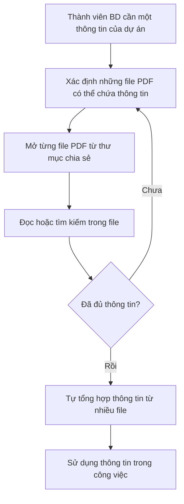
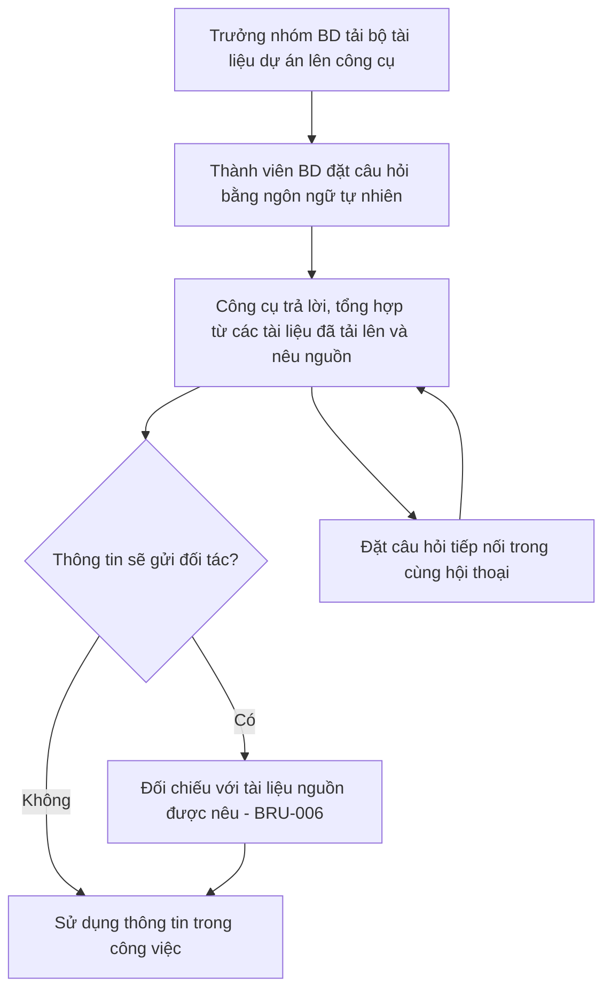

# Tài liệu Yêu cầu Nghiệp vụ (BRD) — Công cụ "Chat với tài liệu" (MVP)

> **Chuẩn áp dụng:** IEEE 29148-2018 · **Giai đoạn SDLC:** 5.2 Requirements and discovery
> **Trạng thái:** `In review` — **Ready for review** (xem [Tuyên bố mức độ sẵn sàng](#tuyên-bố-mức-độ-sẵn-sàng))

> ⚠️ **Tài liệu bài tập.** Mọi câu hỏi mở (OQ-001 đến OQ-022) đã được trả lời bằng **giả định cho bài tập**, chọn theo hướng an toàn: giới hạn chặt về phạm vi, bảo mật và chi phí; mục tiêu vừa phải, đạt được. Các giá trị này được đánh dấu **[GĐ]** và tổng hợp ở §12. Nếu áp dụng vào dự án thật, mọi giá trị [GĐ] phải được người có thẩm quyền xác nhận lại.

---

## Quy ước

| Tiếng Việt | IEEE 29148 | Ý nghĩa |
|---|---|---|
| **phải** | shall | Bắt buộc |
| **nên** | should | Mong muốn, không bắt buộc |
| **được phép** | may | Tùy chọn cho phép |

**Ký hiệu:**
- `[GĐ]`: giá trị giả định cho bài tập, đã chốt tại câu hỏi mở tương ứng ở §12.
- `SRC-001`: nguồn gốc duy nhất, là yêu cầu của quản lý.

---

## 1. Kiểm soát tài liệu

| Thuộc tính | Giá trị |
|---|---|
| Tiêu đề | Tài liệu Yêu cầu Nghiệp vụ — Công cụ "Chat với tài liệu" (MVP) |
| Số hiệu tài liệu | BRD-CWD-001 |
| Phiên bản | 0.4 |
| Trạng thái | In review |
| Tổ chức / Dự án | Công ty ABC — Phòng Phát triển kinh doanh — Dự án X [GĐ: OQ-001] |
| Tác giả | Business Analyst (bản nháp do Claude soạn hỗ trợ) |
| Người đóng góp | Giám đốc Kinh doanh, Trưởng nhóm BD, Phòng CNTT, Pháp chế |
| Người review | Trưởng nhóm BD; Trưởng phòng CNTT; Pháp chế [GĐ: OQ-018] |
| Người phê duyệt | Giám đốc Kinh doanh (nhà tài trợ) [GĐ: OQ-018] |
| Phân loại bảo mật | Nội bộ |

### Lịch sử phiên bản

| Phiên bản | Ngày | Tác giả | Tóm tắt thay đổi |
|---|---|---|---|
| 0.1 | 2026-10-19 | BA (Claude hỗ trợ) | Bản nháp đầu tiên, soạn từ yêu cầu của quản lý (SRC-001) |
| 0.2 | 2026-10-20 | BA (Claude hỗ trợ) | Sửa theo checklist IEEE 29148: BR-004, tách BR-013/BR-015, BR-009, AC-005, BR-014; thêm tầm nhìn, kịch bản, ROI, hồ sơ người dùng, STK-005/SN-008/BR-016, §7.5, CON-006, ASM-004..007, DEP-003, kế hoạch dự phòng, OQ-019..022 |
| 0.3 | 2026-10-20 | BA (Claude hỗ trợ) | Trả lời toàn bộ OQ bằng giả định bài tập [GĐ]; điền mọi giá trị TBD; BR-008, BR-016 nâng lên Must; thêm STK-006, BR-017 (gỡ tài liệu), BR-018 (sẵn sàng), BR-019 (khôi phục), BRU-003..006, CON-007; tính ROI theo hai kịch bản; chuyển trạng thái sang In review |
| 0.4 | 2026-10-21 | BA (Claude hỗ trợ) | Áp dụng quyết định cho vấn đề mở OI-01 của đặc tả use case: BR-013 làm rõ "xem" là xem nội dung; thêm BRU-007 (Quản trị viên chỉ thấy thông tin mô tả tài liệu); cập nhật AC-013 |

### Danh sách phân phối

Giám đốc Kinh doanh, Trưởng nhóm BD, Đội phát triển sản phẩm, Phòng CNTT, Pháp chế.

---

## 2. Tóm tắt điều hành

**Vấn đề.** Dự án X có nhiều tài liệu PDF. Đội Phát triển kinh doanh (BD) khó nắm bắt đầy đủ nội dung các tài liệu này. Mỗi khi cần một thông tin, họ phải mất thời gian tổng hợp từ nhiều file PDF (SRC-001). Hiện mỗi lần tra cứu mất trung vị **30 phút**, mỗi người tra cứu khoảng **10 lần/tuần**. Với đội 10 người, con số này tương đương khoảng **50 giờ công mỗi tuần** [GĐ: OQ-002, OQ-006].

**Thay đổi đề xuất.** Xây dựng một MVP công cụ "Chat với tài liệu". Người dùng tải các tài liệu PDF của dự án lên, sau đó đặt câu hỏi bằng ngôn ngữ tự nhiên và nhận câu trả lời tổng hợp từ nội dung các tài liệu đó, có nêu nguồn, thay cho việc mở và đọc từng file (SRC-001).

**Tầm nhìn.** Mọi thành viên BD có thể hỏi bất kỳ điều gì về tài liệu dự án và nhận ngay câu trả lời có dẫn nguồn, biến kho PDF rời rạc thành một nguồn tri thức hỏi đáp được. Tầm nhìn này phục vụ mục tiêu chiến lược **rút ngắn thời gian phản hồi đối tác** của Phòng Kinh doanh [GĐ: OQ-019].

**Lợi ích kỳ vọng và cách đo.**
- Giảm trung vị thời gian tra cứu từ 30 xuống ≤ 15 phút (MET-001) [GĐ: OQ-003].
- ≥ 80% câu trả lời đúng trên bộ câu hỏi kiểm thử (MET-002) [GĐ: OQ-004].
- ≥ 60% thành viên BD dùng công cụ hằng tuần trong 4 tuần thử nghiệm (MET-003) [GĐ: OQ-005].

**Đầu tư và thời gian** [GĐ: OQ-012]:
- Chi phí xây dựng: ≤ 200 triệu VND.
- Chi phí vận hành dịch vụ AI: ≤ 5 triệu VND/tháng.
- Lịch: phát triển 8 tuần (2026-11-02 → 2026-12-25), thử nghiệm 4 tuần (2027-01-04 → 2027-01-29), quyết định đầu tư tiếp trước 2027-02-05.

**Tính kinh tế** (chi tiết ở §4):
- Kịch bản thận trọng (60% người dùng chấp nhận): ROI năm đầu **âm**.
- Kịch bản đầy đủ (100% người dùng chấp nhận): hòa vốn sau khoảng **16 tháng**.
- Vì vậy MVP được duyệt như một **thử nghiệm có giới hạn chi phí**. Quyết định đầu tư tiếp dựa trên kết quả đo thực tế (BO-003).

**Rủi ro chính.**
- AI có thể đưa ra câu trả lời sai hoặc tự bịa (RSK-001).
- Tài liệu bí mật có thể bị lộ (RSK-002), được kiểm soát bằng BRU-001, BRU-005 và CON-007.
- Đội BD có thể không chuyển sang dùng công cụ (RSK-003).

**Quyết định đề nghị.** Đề nghị Giám đốc Kinh doanh phê duyệt phạm vi MVP, ngân sách và lịch thử nghiệm nêu trên, với điều kiện Phòng CNTT và Pháp chế ký xác nhận BRU-001, BRU-005 và CON-006 trước khi bắt đầu phát triển.

---

## 3. Bối cảnh nghiệp vụ và phát biểu vấn đề

### 3.1 Quy trình hiện tại

Quy trình được suy ra từ SRC-001 và được chấp nhận cho bài tập (ASM-004).

### 3.2 Quy trình đề xuất (mức nghiệp vụ)

### 3.3 Đối tượng bị ảnh hưởng

| Nhóm | Ảnh hưởng | Bằng chứng |
|---|---|---|
| Đội Phát triển kinh doanh (STK-002) | Mất khoảng 50 giờ công/tuần cho việc tra cứu; khó nắm bắt đầy đủ nội dung | SRC-001; [GĐ: OQ-002, OQ-006] |
| Giám đốc Kinh doanh (STK-001) | Đội BD phản hồi đối tác chậm | [GĐ: OQ-019] |

### 3.4 Chi phí nếu không hành động

- **Thời gian:** khoảng 50 giờ công/tuần, tức khoảng 2.400 giờ công/năm (48 tuần) dành cho tra cứu thủ công [GĐ].
- **Giá trị quy đổi:** khoảng 480 triệu VND/năm, với chi phí giờ công bình quân 200.000 VND/giờ [GĐ: OQ-012].
- **Chất lượng:** thông tin có thể bị bỏ sót khi tổng hợp thủ công từ nhiều file (ASM-004).

### 3.5 Nguyên nhân gốc và triệu chứng

| Loại | Nội dung | Nguồn |
|---|---|---|
| Triệu chứng | Tốn thời gian mỗi khi cần tìm một thông tin | SRC-001 |
| Triệu chứng | Đội BD khó nắm bắt đầy đủ nội dung tài liệu | SRC-001 |
| Nguyên nhân gốc | Thông tin nằm rải rác trên nhiều file PDF, không có điểm truy vấn chung qua tất cả tài liệu | SRC-001 |
| Nguyên nhân gốc | Khối lượng tài liệu (tới 50 file, mỗi file tới 200 trang) vượt quá khả năng đọc và ghi nhớ của từng người | [GĐ: OQ-006] |

### 3.6 Tại sao là bây giờ

Dự án X vừa nhận một khối lượng lớn hồ sơ (hợp đồng, phụ lục, báo giá), và số yêu cầu thông tin từ đối tác tăng [GĐ: OQ-005]. Quản lý đã yêu cầu phát triển MVP (SRC-001).

### 3.7 Kịch bản nghiệp vụ

Bốn loại kịch bản dưới đây là khung cho bộ câu hỏi kiểm thử (DEP-002). Tỷ lệ phân bổ của từng loại theo OQ-004.

| ID | Kịch bản | Ví dụ minh họa | Số câu trong bộ kiểm thử | Yêu cầu liên quan |
|---|---|---|---|---|
| SC-01 | Tra cứu một thông tin nằm trong một tài liệu | Đối tác hỏi thời hạn thanh toán; thông tin nằm trong hợp đồng khung | 20 | BR-005, BR-006, BR-008 |
| SC-02 | Tổng hợp thông tin nằm trên nhiều tài liệu | Phụ lục điều chỉnh thời hạn thanh toán của hợp đồng khung; cần trả lời đầy đủ cả hai | 10 | BR-007, BR-008 |
| SC-03 | Hỏi về thông tin không có trong tài liệu | Hỏi về một điều khoản chưa từng được thỏa thuận | 10 | BR-009 |
| SC-04 | Hỏi tiếp để làm rõ | Sau SC-01, hỏi "điều khoản đó có ngoại lệ không?" | 5 | BR-010 |
| SC-05 | Câu hỏi có nhiều đáp án hợp lệ | "Giá bao nhiêu?" khi báo giá có 3 hạng mục | 5 | BR-006, BR-008 |

---

## 4. Động lực nghiệp vụ và mục tiêu

| ID | Động lực nghiệp vụ | Mục tiêu (kết quả, không phải hoạt động) | Metric | Baseline | Mục tiêu | Thời hạn | Nguồn |
|---|---|---|---|---|---|---|---|
| BO-001 | Đội BD mất thời gian tổng hợp thông tin từ nhiều PDF | Giảm thời gian để một thành viên BD có được thông tin cần thiết từ bộ tài liệu dự án | MET-001 | 30 phút (trung vị) | ≤ 15 phút (giảm ≥ 50%) | 2027-01-29 (cuối thử nghiệm) | SRC-001; [GĐ: OQ-002, OQ-003] |
| BO-002 | Đội BD khó nắm bắt đầy đủ nội dung tài liệu | Đội BD nhận được câu trả lời đúng và đầy đủ cho câu hỏi về nội dung tài liệu dự án, kể cả thông tin nằm trên nhiều file | MET-002 | Không áp dụng (năng lực mới) | ≥ 80% | Nghiệm thu trước thử nghiệm (2026-12-25) và cuối thử nghiệm | SRC-001; [GĐ: OQ-004] |
| BO-003 | Cần dữ liệu thực tế trước khi đầu tư lớn | Có dữ liệu sử dụng thực tế để quyết định đầu tư tiếp hay dừng sau MVP | MET-003 | 0% (công cụ chưa tồn tại) | ≥ 60% | 4 tuần thử nghiệm, kết thúc 2027-01-29 | SRC-001 ("MVP"); [GĐ: OQ-005] |

### Định nghĩa metric

| ID | Định nghĩa | Công thức | Nguồn dữ liệu | Người sở hữu | Tần suất | Ngày đo baseline |
|---|---|---|---|---|---|---|
| MET-001 | Thời gian tìm thông tin: tính từ lúc thành viên BD bắt đầu tìm một thông tin đến khi có câu trả lời họ chấp nhận sử dụng | Trung vị thời gian (phút) trên bộ 10 tác vụ tra cứu chuẩn, thực hiện bởi 3 thành viên BD | Bấm giờ có kiểm soát: đo thủ công trước MVP, đo khi dùng công cụ ở tuần 4 thử nghiệm | Trưởng nhóm BD | Hai lần | 2026-10-27 [GĐ: OQ-002] |
| MET-002 | Tỷ lệ câu trả lời đúng: câu trả lời khớp với đáp án do đội BD xác định trước | (Số câu trả lời đúng ÷ Tổng số câu hỏi trong bộ kiểm thử) × 100% | Bộ 50 câu hỏi kiểm thử kèm đáp án (DEP-002, §3.7) | Trưởng nhóm BD | Mỗi lần nghiệm thu; cuối thử nghiệm | Không áp dụng |
| MET-003 | Tỷ lệ sử dụng: thành viên BD dùng công cụ ít nhất 1 lần/tuần | (Số thành viên BD dùng ≥ 1 lần/tuần ÷ 10) × 100% | Dữ liệu sử dụng ghi nhận trong thử nghiệm (BR-014) | Giám đốc Kinh doanh | Hằng tuần trong thử nghiệm | 2027-01-04 |

### Ước tính lợi ích và chi phí [GĐ: OQ-012]

**Đầu vào:**
- 10 thành viên BD; 10 lần tra cứu/người/tuần; 48 tuần làm việc/năm.
- Tiết kiệm 15 phút mỗi lần tra cứu (30 → 15 phút).
- Chi phí giờ công: 200.000 VND/giờ.
- Chi phí: xây dựng 200 triệu VND; dịch vụ AI 5 triệu VND/tháng; hỗ trợ vận hành 2 triệu VND/tháng.

| Đại lượng | Công thức | Thận trọng (60% chấp nhận) | Đầy đủ (100% chấp nhận) |
|---|---|---|---|
| Giờ công tiết kiệm/năm | 10 người × tỷ lệ chấp nhận × 10 lần × 0,25 giờ × 48 tuần | 720 giờ | 1.200 giờ |
| Giá trị tiết kiệm/năm | Giờ tiết kiệm × 200.000 VND | 144 triệu | 240 triệu |
| Chi phí vận hành/năm | (5 + 2) triệu × 12 tháng | 84 triệu | 84 triệu |
| Lợi ích ròng/năm (từ năm 2) | Giá trị tiết kiệm − Chi phí vận hành | 60 triệu | 156 triệu |
| Tổng chi phí năm đầu | 200 + 84 triệu | 284 triệu | 284 triệu |
| ROI năm đầu | (Giá trị tiết kiệm − Tổng chi phí năm đầu) ÷ Tổng chi phí năm đầu | −49% | −15% |
| Thời gian hoàn vốn chi phí xây dựng | 200 triệu ÷ Lợi ích ròng/năm | ≈ 40 tháng | ≈ 16 tháng |

**Kết luận:**
- Để giá trị tiết kiệm bù được chi phí vận hành (84 triệu/năm), cần tỷ lệ chấp nhận tối thiểu khoảng **35%**.
- Phương án kinh tế phụ thuộc chủ yếu vào tỷ lệ chấp nhận (MET-003) và số lần tra cứu thực tế. Đây là lý do BO-003 và BR-014 là Must: quyết định đầu tư tiếp phải dựa trên số đo thật, không dựa trên giả định.

---

## 5. Phạm vi

### 5.1 Trong phạm vi

| Hạng mục | Nội dung | Nguồn |
|---|---|---|
| Năng lực nghiệp vụ | Tải tài liệu PDF lên công cụ | SRC-001 |
| Năng lực nghiệp vụ | Hỏi đáp dạng hội thoại về nội dung các tài liệu đã tải lên, có nêu nguồn | SRC-001 |
| Năng lực nghiệp vụ | Tổng hợp thông tin từ nhiều tài liệu trong một câu trả lời | SRC-001 |
| Năng lực nghiệp vụ | Phân quyền truy cập, nhật ký truy cập, gỡ tài liệu theo yêu cầu (bởi CNTT) | BR-013, BR-015, BR-016, BR-017 |
| Đơn vị tổ chức | Đội Phát triển kinh doanh, 10 người | SRC-001; [GĐ: OQ-006] |
| Bộ tài liệu | Một bộ tài liệu: Dự án X | [GĐ: OQ-009] |
| Kênh | Ứng dụng web, chỉ truy cập qua mạng nội bộ hoặc VPN công ty (CON-002, CON-007) | SRC-001; [GĐ: OQ-014] |
| Miền dữ liệu | Tài liệu PDF dạng văn bản, phân loại "Công khai" hoặc "Nội bộ", tiếng Việt hoặc tiếng Anh | [GĐ: OQ-007, OQ-008, OQ-013] |
| Địa lý | Việt Nam | [GĐ: OQ-001] |

### 5.2 Ngoài phạm vi (đã xác nhận [GĐ: OQ-017])

| Hạng mục | Lý do |
|---|---|
| Định dạng khác PDF (Word, Excel, hình ảnh, email) | MVP giữ phạm vi tối thiểu (CON-001, CON-004) |
| Tài liệu phân loại "Mật" hoặc "Tuyệt mật" | Rủi ro lộ thông tin (BRU-001, RSK-002) |
| Tạo mới hoặc chỉnh sửa nội dung tài liệu | Mục tiêu là truy vấn, không phải biên soạn |
| Người dùng ngoài đội BD (khách hàng, đối tác, phòng ban khác) | Giới hạn rủi ro và chi phí của thử nghiệm |
| Ra quyết định tự động dựa trên câu trả lời | Câu trả lời chỉ mang tính tham khảo (BRU-006) |
| Truy cập từ Internet công cộng ngoài VPN | CON-007 |

### 5.3 Hoãn lại

| Hạng mục | Lý do hoãn | Xem xét lại |
|---|---|---|
| Tự động đồng bộ từ thư mục chia sẻ hoặc hệ thống quản lý tài liệu | Vượt phạm vi MVP (CON-001) | Sau quyết định 2027-02-05 |
| Nhiều bộ tài liệu (nhiều dự án) | MVP chỉ thử nghiệm trên Dự án X | Sau quyết định 2027-02-05 |
| Ứng dụng di động riêng | Đội BD làm việc trên laptop [GĐ: POQ-002 của PRD] | Sau quyết định 2027-02-05 |
| PDF dạng ảnh scan | Cần năng lực nhận dạng chữ, làm tăng chi phí [GĐ: OQ-013] | Nếu tỷ lệ file scan > 10% (ASM-001) |
| Người dùng tự xóa hoặc thay thế tài liệu | MVP chỉ cho CNTT gỡ tài liệu theo yêu cầu (BR-017) [GĐ: OQ-015] | Sau quyết định 2027-02-05 |

### 5.4 Ranh giới

- **Bắt đầu:** khi một thành viên BD có file PDF (lấy từ thư mục chia sẻ của phòng BD, DEP-003) và tải lên công cụ.
- **Kết thúc:** khi thành viên BD nhận được câu trả lời. Việc dùng câu trả lời trong công việc kinh doanh nằm ngoài sáng kiến, nhưng phải tuân theo BRU-006.
- **Chương trình liền kề:** không có [GĐ: OQ-017].

---

## 6. Các bên liên quan và nhu cầu

### 6.1 Các bên liên quan

| ID | Bên liên quan | Vai trò | Mối quan tâm | Ảnh hưởng | Nhu cầu | Nguồn |
|---|---|---|---|---|---|---|
| STK-001 | Giám đốc Kinh doanh (người giao việc) | Nhà tài trợ; người phê duyệt BRD | MVP chứng minh được giá trị trong ngân sách | Cao | SN-006 | SRC-001; [GĐ: OQ-018] |
| STK-002 | Đội Phát triển kinh doanh (10 người, gồm 1 Trưởng nhóm) | Người dùng chính; Trưởng nhóm là chủ sở hữu nghiệp vụ | Tìm thông tin nhanh và đúng từ tài liệu dự án | Cao | SN-001 đến SN-005 | SRC-001 |
| STK-003 | Đội phát triển sản phẩm | Xây dựng MVP | Yêu cầu rõ ràng, phạm vi khả thi | Trung bình | — (bên cung cấp, không phải bên có nhu cầu nghiệp vụ) | SRC-001 |
| STK-004 | Phòng CNTT | Quản trị quyền; phê duyệt dịch vụ AI; có thể chặn triển khai | Bảo vệ tài liệu bí mật của dự án | Cao | SN-007, SN-008 | [GĐ: OQ-008] |
| STK-005 | Đối tác / khách hàng có thông tin trong tài liệu dự án (gián tiếp) | Bên ngoài; không dùng công cụ | Thông tin của họ được xử lý đúng NDA | Thấp (trực tiếp), Cao (pháp lý) | SN-008 | [GĐ: OQ-020] |
| STK-006 | Pháp chế | Xác nhận tuân thủ pháp lý và NDA; có thể chặn triển khai | Tuân thủ quy định bảo vệ dữ liệu cá nhân và NDA | Cao | SN-008 | [GĐ: OQ-020] |

### 6.2 Nhu cầu

| ID | Bên liên quan | Nhu cầu | Khó khăn hiện tại | Bằng chứng | Ưu tiên |
|---|---|---|---|---|---|
| SN-001 | STK-002 | Tìm được một thông tin cụ thể mà không phải mở và đọc từng file PDF | Phải tra cứu thủ công từng file | SRC-001 | Must |
| SN-002 | STK-002 | Nhận được thông tin tổng hợp từ nhiều tài liệu trong một lần hỏi | Phải tự tổng hợp từ nhiều file | SRC-001 | Must |
| SN-003 | STK-002 | Tự đưa tài liệu PDF của dự án vào công cụ | Chưa có điểm tập trung tài liệu để truy vấn | SRC-001 | Must |
| SN-004 | STK-002 | Đặt câu hỏi bằng ngôn ngữ thông thường, dạng hội thoại | Tìm kiếm trong PDF chỉ theo từ khóa, từng file một | SRC-001 ("chat") | Must |
| SN-005 | STK-002 | Kiểm chứng được câu trả lời bằng cách đối chiếu với tài liệu gốc | Chưa có (nhu cầu phát sinh khi dùng AI) | [GĐ: OQ-010] | Must |
| SN-006 | STK-001 | Có MVP với kết quả đo được để quyết định đầu tư tiếp | Chưa có dữ liệu | SRC-001; [GĐ: OQ-005] | Must |
| SN-007 | STK-004 | Tài liệu dự án không bị người không có quyền truy cập, và gỡ được tài liệu tải lên nhầm | Chưa có cơ chế | [GĐ: OQ-008, OQ-009, OQ-015] | Must |
| SN-008 | STK-004, STK-005, STK-006 | Biết được ai đã truy cập tài liệu nào, để chứng minh tuân thủ NDA và quy định khi cần | Chưa có cơ chế | [GĐ: OQ-020] | Must |

**Bên liên quan có thể chặn triển khai:** STK-004 và STK-006, nếu BRU-001, BRU-005 hoặc CON-006 không được đáp ứng (RSK-002). **Bên có thể không chấp nhận thay đổi:** thành viên BD đã quen tra cứu thủ công (RSK-003).

### 6.3 Hồ sơ người dùng [GĐ: ASM-006]

| Lớp người dùng | Bên liên quan | Vai trò khi dùng công cụ | Mức thành thạo công nghệ | Tần suất dùng dự kiến | Bối cảnh làm việc | Số lượng |
|---|---|---|---|---|---|---|
| Người hỏi | STK-002 (chuyên viên BD) | Đặt câu hỏi, đối chiếu nguồn, có thể tải thêm tài liệu | Thành thạo công cụ văn phòng và trình duyệt; không có kiến thức kỹ thuật | ~10 lần/tuần | Laptop Windows, Chrome/Edge, qua VPN; thường tra cứu trong lúc họp hoặc trả lời email đối tác | 9 |
| Người quản lý bộ tài liệu | STK-002 (Trưởng nhóm BD) | Tải bộ tài liệu dự án lên lần đầu; chuẩn bị bộ câu hỏi kiểm thử; yêu cầu gỡ tài liệu | Như trên; quen quản lý thư mục tài liệu dùng chung | Khi có tài liệu mới; cũng là người hỏi | Như trên | 1 |
| Quản trị viên | STK-004 | Cấp và thu hồi quyền; gỡ tài liệu; tra nhật ký truy cập | Chuyên gia CNTT | Khi có thay đổi nhân sự hoặc yêu cầu | — | 2 |

---

## 7. Yêu cầu nghiệp vụ

Thang ưu tiên: **Must** (thiếu thì sáng kiến thất bại), **Should** (giá trị đáng kể, có cách làm thay thế), **Could** (mong muốn), **Won't** (loại trừ ở bản phát hành này).

### 7.1 Quản lý tài liệu

| ID | Yêu cầu | Lý do | Nguồn | Ưu tiên | Tiêu chí chấp nhận | Kiểm chứng | Trạng thái |
|---|---|---|---|---|---|---|---|
| BR-001 | Thành viên đội BD phải tải được một tài liệu định dạng PDF lên công cụ. | Không có tài liệu thì không có gì để truy vấn | SN-003 / BO-001 | Must | AC-001 | Test | Draft |
| BR-002 | Công cụ phải tiếp nhận được ít nhất 50 tài liệu PDF trong một bộ tài liệu, mỗi tài liệu dài tới 200 trang và dung lượng tới 20 MB. | Vấn đề gốc là có nhiều tài liệu | SN-002 / BO-002 | Must | AC-002 | Test | Draft |
| BR-003 | Thành viên đội BD nên xem được danh sách các tài liệu đã tải lên. | Người dùng cần biết câu trả lời được tổng hợp từ những tài liệu nào | SN-003 | Should | AC-003 | Demonstration | Draft |
| BR-004 | Khi một file không phải PDF hợp lệ, công cụ nên thông báo cho người tải lên rằng file đó không được tiếp nhận. | Tránh để người dùng tưởng tài liệu đã được đưa vào truy vấn | SN-003 / BO-002 | Should | AC-004 | Test | Draft |

### 7.2 Hỏi đáp về nội dung tài liệu

| ID | Yêu cầu | Lý do | Nguồn | Ưu tiên | Tiêu chí chấp nhận | Kiểm chứng | Trạng thái |
|---|---|---|---|---|---|---|---|
| BR-005 | Thành viên đội BD phải đặt được câu hỏi bằng ngôn ngữ tự nhiên về nội dung các tài liệu đã tải lên. | Đây là năng lực cốt lõi "chat với tài liệu" | SN-004 / BO-001 | Must | AC-005 | Test | Draft |
| BR-006 | Khi trả lời câu hỏi, công cụ phải chỉ dùng nội dung của các tài liệu đã tải lên làm căn cứ. | Câu trả lời ngoài tài liệu dự án không đáng tin cho công việc BD | SN-001 / BO-002 | Must | AC-006 | Test | Draft |
| BR-007 | Khi thông tin trả lời nằm ở nhiều tài liệu, công cụ phải tổng hợp thông tin từ tất cả các tài liệu liên quan vào một câu trả lời. | Đúng với vấn đề gốc: tổng hợp từ nhiều file | SN-002 / BO-002 | Must | AC-007 | Test | Draft |
| BR-008 | Mỗi câu trả lời có nội dung phải nêu tên tài liệu và số trang chứa thông tin đã dùng. | Cho phép kiểm chứng; biện pháp chính giảm RSK-001; hỗ trợ BRU-006 | SN-005 / BO-002 | Must | AC-008 | Inspection | Draft |
| BR-009 | Khi các tài liệu đã tải lên không chứa thông tin được hỏi, công cụ phải thông báo rằng không tìm thấy thông tin, thay vì đưa ra một câu trả lời suy đoán. | Câu trả lời bịa đặt gây rủi ro cho quyết định kinh doanh (RSK-001) | BO-002 | Must | AC-009 | Test | Draft |
| BR-010 | Thành viên đội BD nên đặt được câu hỏi tiếp nối có tham chiếu tới câu hỏi trước trong cùng hội thoại. | SRC-001 nêu "chat", tức là hỏi đáp nhiều lượt | SN-004 | Should | AC-010 | Demonstration | Draft |
| BR-011 | Công cụ nên trả lời hoàn tất trong vòng 20 giây với 90% số câu hỏi. | Để tiết kiệm thời gian so với tra cứu thủ công | BO-001 | Should | AC-011 | Test | Draft |
| BR-012 | Công cụ phải trả lời được câu hỏi viết bằng tiếng Việt hoặc tiếng Anh về tài liệu viết bằng tiếng Việt hoặc tiếng Anh. | Đội BD làm việc với đối tác trong và ngoài nước [GĐ: OQ-007] | SN-004 / BO-002 | Must | AC-012 | Test | Draft |

### 7.3 Truy cập và bảo vệ tài liệu

| ID | Yêu cầu | Lý do | Nguồn | Ưu tiên | Tiêu chí chấp nhận | Kiểm chứng | Trạng thái |
|---|---|---|---|---|---|---|---|
| BR-013 | Công cụ phải chỉ cho phép thành viên nhóm truy cập của bộ tài liệu (do CNTT quản lý) xem danh sách và nội dung tài liệu đã tải lên. Ngoại lệ duy nhất là Quản trị viên CNTT được thấy thông tin mô tả theo BRU-007. | Tài liệu dự án có thể chứa thông tin bí mật | SN-007 | Must | AC-013 | Test | Draft |
| BR-015 | Công cụ phải chỉ cho phép thành viên nhóm truy cập của bộ tài liệu truy vấn tài liệu đã tải lên. | Ngăn việc lấy nội dung tài liệu gián tiếp qua câu trả lời | SN-007 | Must | AC-015 | Test | Draft |
| BR-016 | Phòng CNTT phải truy xuất được danh sách người đã xem hoặc truy vấn một bộ tài liệu trong một khoảng thời gian bất kỳ thuộc 12 tháng gần nhất. | Chứng minh tuân thủ NDA và quy định bảo vệ dữ liệu khi được yêu cầu | SN-008 | Must | AC-016 | Demonstration | Draft |
| BR-017 | Khi Trưởng nhóm BD hoặc Pháp chế yêu cầu, Phòng CNTT phải gỡ hoàn toàn một tài liệu khỏi công cụ trong vòng 1 ngày làm việc. | Xử lý tài liệu "Mật" bị tải lên nhầm (BRU-001) hoặc yêu cầu từ đối tác | SN-007 / SN-008 | Must | AC-017 | Test | Draft |

### 7.4 Đo lường kết quả MVP

| ID | Yêu cầu | Lý do | Nguồn | Ưu tiên | Tiêu chí chấp nhận | Kiểm chứng | Trạng thái |
|---|---|---|---|---|---|---|---|
| BR-014 | Khi kết thúc giai đoạn thử nghiệm, Giám đốc Kinh doanh phải nhận được giá trị đo của MET-001, MET-002 và MET-003 để quyết định đầu tư tiếp hay dừng. | Không có dữ liệu thì không quyết định được việc đầu tư tiếp (§4) | SN-006 / BO-003 | Must | AC-014 | Inspection | Draft |

### 7.5 Tính liên tục và độ sẵn sàng [GĐ: OQ-021]

| ID | Yêu cầu | Lý do | Nguồn | Ưu tiên | Tiêu chí chấp nhận | Kiểm chứng | Trạng thái |
|---|---|---|---|---|---|---|---|
| BR-018 | Trong giai đoạn thử nghiệm, công cụ nên sẵn sàng ít nhất 95% thời gian trong giờ làm việc (8:00–18:00, thứ Hai đến thứ Sáu). | Công cụ không dùng được thì không đo được MET-001, MET-003 | BO-001 / BO-003 | Should | AC-018 | Analysis | Draft |
| BR-019 | Sau một sự cố, công cụ nên hoạt động trở lại trong vòng 1 ngày làm việc, với mọi tài liệu đã ở trạng thái sẵn sàng từ 24 giờ trước thời điểm sự cố. | Tránh phải tải lại toàn bộ bộ tài liệu, gián đoạn thử nghiệm | BO-003 | Should | AC-019 | Test | Draft |

Ngoài giờ làm việc không có cam kết sẵn sàng. Đây là mức an toàn cho MVP, giúp giữ chi phí vận hành trong CON-005.

### 7.6 Tiêu chí chấp nhận

| ID | Cho yêu cầu | Tiêu chí (quyết định được một cách khách quan) |
|---|---|---|
| AC-001 | BR-001 | Một thành viên BD tải lên 1 file PDF từ bộ tài liệu mẫu (DEP-002). Sau đó, một câu hỏi về nội dung chỉ có trong file này nhận được câu trả lời lấy từ file này. |
| AC-002 | BR-002 | Tải lên 50 file PDF, trong đó ít nhất 5 file dài 200 trang và ít nhất 1 file có dung lượng 20 MB. Với mỗi file, 1 câu hỏi kiểm thử về nội dung chỉ có trong file đó nhận được câu trả lời trích dẫn đúng file đó (100% file). |
| AC-003 | BR-003 | Sau khi tải lên 5 file, danh sách hiển thị đúng 5 tên file đó, không thiếu, không thừa. |
| AC-004 | BR-004 | Tải lên 1 file .docx và 1 file PDF bị hỏng. Người dùng nhận thông báo cho từng file, và cả hai file đều không xuất hiện trong danh sách tài liệu ở trạng thái sẵn sàng. |
| AC-005 | BR-005 | 20 câu hỏi kiểm thử loại SC-01, viết thành câu hoàn chỉnh, không dùng cú pháp hay từ khóa đặc biệt. Ít nhất 80% câu trả lời khớp với đáp án do đội BD xác định trước. |
| AC-006 | BR-006 | Trên bộ 50 câu hỏi kiểm thử (DEP-002), tỷ lệ câu trả lời đúng theo đáp án của đội BD đạt ít nhất 80%. Không câu trả lời nào chứa thông tin mâu thuẫn với tài liệu đã tải lên. |
| AC-007 | BR-007 | Với 10 câu hỏi loại SC-02, ít nhất 70% câu trả lời chứa đủ các phần thông tin từ mọi tài liệu liên quan. |
| AC-008 | BR-008 | 100% câu trả lời có nội dung trong bộ kiểm thử có nêu tên tài liệu và số trang. Kiểm tra ngẫu nhiên 20 câu trả lời: thông tin trong mỗi câu có mặt tại trang được nêu. |
| AC-009 | BR-009 | Với 10 câu hỏi loại SC-03, ít nhất 90% (9/10) nhận được thông báo "không tìm thấy thông tin". |
| AC-010 | BR-010 | Với 5 câu hỏi loại SC-04, ít nhất 4/5 câu trả lời đúng đối tượng được nhắc ở câu hỏi trước. |
| AC-011 | BR-011 | Trên bộ câu hỏi kiểm thử, ít nhất 90% số câu có câu trả lời hoàn tất trong vòng 20 giây kể từ lúc gửi câu hỏi. |
| AC-012 | BR-012 | Bộ câu hỏi kiểm thử gồm ít nhất 30% câu tiếng Anh và 30% câu tiếng Việt, trên tài liệu có cả hai ngôn ngữ. Tỷ lệ đúng của mỗi ngôn ngữ đạt ngưỡng của AC-006. |
| AC-013 | BR-013 | (a) Một tài khoản không thuộc nhóm truy cập và không phải Quản trị viên không xem được danh sách tài liệu, tên file hay nội dung file. (b) Quản trị viên CNTT không thuộc nhóm truy cập chỉ thấy thông tin mô tả theo BRU-007, không xem được đoạn trích dẫn hay file gốc. |
| AC-014 | BR-014 | Trong vòng 5 ngày làm việc sau khi kết thúc thử nghiệm (trước 2027-02-05), Giám đốc Kinh doanh nhận được báo cáo có giá trị đo của MET-001, MET-002, MET-003, kèm nguồn dữ liệu cho từng giá trị. |
| AC-015 | BR-015 | Một tài khoản không thuộc nhóm truy cập gửi câu hỏi về nội dung tài liệu và không nhận được câu trả lời nào chứa nội dung tài liệu. |
| AC-016 | BR-016 | Với một bộ tài liệu và khoảng thời gian cho trước, CNTT lấy được danh sách người đã xem hoặc truy vấn kèm thời điểm. Danh sách khớp 100% với các lượt truy cập đã thực hiện trong bài kiểm thử. |
| AC-017 | BR-017 | Sau khi CNTT gỡ một tài liệu: tài liệu không còn trong danh sách; 5 câu hỏi về nội dung chỉ có trong tài liệu đó đều nhận được "không tìm thấy thông tin"; thời gian từ lúc yêu cầu đến lúc hoàn tất ≤ 1 ngày làm việc; thao tác gỡ được ghi trong nhật ký truy cập. |
| AC-018 | BR-018 | Số liệu giám sát của 4 tuần thử nghiệm cho thấy thời gian sẵn sàng trong giờ làm việc ≥ 95%. |
| AC-019 | BR-019 | Diễn tập khôi phục trước thử nghiệm: sau khi mô phỏng sự cố, công cụ hoạt động lại trong ≤ 1 ngày làm việc, và mọi tài liệu đã sẵn sàng từ 24 giờ trước sự cố đều truy vấn được. |

---

## 8. Quy tắc nghiệp vụ

| ID | Quy tắc | Loại | Phạm vi | Người chịu trách nhiệm | Nguồn |
|---|---|---|---|---|---|
| BRU-001 | Chỉ tài liệu phân loại "Công khai" hoặc "Nội bộ" được tải lên công cụ. Tài liệu "Mật" và "Tuyệt mật" không được tải lên trong MVP. | Policy | Tải tài liệu lên | Người tải lên (xác nhận khi tải); Phòng CNTT (kiểm tra định kỳ) | [GĐ: OQ-008] |
| BRU-002 | Tài liệu đã tải lên được lưu trong thời gian thử nghiệm và 30 ngày sau đó. Nếu quyết định dừng, mọi tài liệu và dữ liệu đã xử lý bị xóa hoàn toàn. | Policy | Lưu trữ tài liệu | Phòng CNTT | [GĐ: OQ-016] |
| BRU-003 | Lịch sử hội thoại được lưu tối đa 30 ngày, sau đó tự động xóa. | Policy | Lưu trữ hội thoại | Phòng CNTT | [GĐ: OQ-016] |
| BRU-004 | Nhật ký truy cập (BR-016) được lưu 12 tháng và không chứa nội dung tài liệu hay câu hỏi. | Policy / Legal | Nhật ký | Phòng CNTT | [GĐ: OQ-016, OQ-020] |
| BRU-005 | Chỉ dùng dịch vụ AI bên ngoài khi nhà cung cấp cam kết bằng hợp đồng: (a) không dùng dữ liệu để huấn luyện mô hình; (b) không lưu dữ liệu sau khi xử lý xong; (c) xử lý trong vùng dữ liệu được Phòng CNTT phê duyệt. | Legal / Policy | Dịch vụ AI (CON-003) | Phòng CNTT + Pháp chế | [GĐ: OQ-008] |
| BRU-006 | Câu trả lời của công cụ chỉ mang tính tham khảo. Thông tin gửi cho đối tác phải được người gửi đối chiếu với tài liệu nguồn trước khi gửi. | Policy | Sử dụng câu trả lời | Trưởng nhóm BD | [GĐ: OQ-010]; RSK-001 |
| BRU-007 | Quản trị viên CNTT chỉ được thấy thông tin mô tả của tài liệu (tên file, số trang, dung lượng, người tải lên, thời điểm, trạng thái), đủ để gỡ tài liệu (BR-017) và tra nhật ký (BR-016). Quản trị viên không được xem hay truy vấn nội dung, trừ khi được thêm vào nhóm truy cập như một Thành viên BD. | Policy | Phân quyền | Phòng CNTT | [GĐ: OI-01 của UCS-CWD-001] |

---

## 9. Ràng buộc

| ID | Ràng buộc | Loại | Bên áp đặt | Tác động | Nguồn |
|---|---|---|---|---|---|
| CON-001 | Sản phẩm bàn giao ở mức MVP | Organizational | Giám đốc Kinh doanh | Giới hạn phạm vi ở năng lực tối thiểu để kiểm chứng giá trị (§5.3) | SRC-001 |
| CON-002 | Công cụ được cung cấp dưới dạng ứng dụng web (bắt buộc) | Technical | Giám đốc Kinh doanh | Người dùng truy cập qua trình duyệt | SRC-001; [GĐ: OQ-014] |
| CON-003 | Câu trả lời được tạo bằng AI (bắt buộc), tuân theo BRU-005 | Technical | Giám đốc Kinh doanh | Kéo theo RSK-001, RSK-002, RSK-006 | SRC-001; [GĐ: OQ-014] |
| CON-004 | Định dạng tài liệu đầu vào là PDF dạng văn bản | Technical | Giám đốc Kinh doanh | Các định dạng khác và PDF scan nằm ngoài phạm vi | SRC-001; [GĐ: OQ-013] |
| CON-005 | Ngân sách: xây dựng ≤ 200 triệu VND; dịch vụ AI ≤ 5 triệu VND/tháng; hỗ trợ vận hành ≤ 2 triệu VND/tháng. Thời hạn: phát triển 8 tuần, thử nghiệm 4 tuần, quyết định trước 2027-02-05 | Budget / Time | Giám đốc Kinh doanh | Giới hạn phạm vi; cần cơ chế kiểm soát chi phí AI (RSK-006) | [GĐ: OQ-012] |
| CON-006 | Tuân thủ quy định pháp luật Việt Nam về bảo vệ dữ liệu cá nhân, và các thỏa thuận bảo mật (NDA) với đối tác. Tài liệu dự án có thể chứa dữ liệu cá nhân của đại diện đối tác (họ tên, chức danh, liên hệ) | Regulatory / Contractual | Pháp luật Việt Nam; đối tác (STK-005) | Cần BRU-001, BRU-004, BRU-005, BR-016, BR-017; Pháp chế xác nhận văn bản pháp luật và điều khoản cụ thể áp dụng | [GĐ: OQ-020] |
| CON-007 | Công cụ chỉ được truy cập qua mạng nội bộ hoặc VPN công ty | Technical / Organizational | Phòng CNTT | Giảm bề mặt tấn công; người dùng ngoài văn phòng phải bật VPN | [GĐ: POQ-008 của PRD] |

---

## 10. Giả định, phụ thuộc và rủi ro

| ID | Hạng mục | Loại | Mô tả | Tác động nếu sai / Mức độ | Người chịu trách nhiệm | Kiểm chứng / Giảm thiểu | Hạn |
|---|---|---|---|---|---|---|---|
| ASM-001 | PDF có văn bản trích xuất được | Assumption | Ít nhất 90% PDF của Dự án X là PDF văn bản, không phải ảnh scan | Nhiều tài liệu không truy vấn được; BO-002 không đạt | Trưởng nhóm BD | Rà mẫu 20 file PDF, đếm tỷ lệ file scan; nếu > 10% thì xem lại §5.3 | 2026-10-30 |
| ASM-002 | Có dịch vụ AI đáp ứng BRU-005 | Assumption | Có ít nhất một nhà cung cấp dịch vụ AI chấp nhận các điều khoản của BRU-005 trong ngân sách CON-005 | Phải dùng dịch vụ AI nội bộ, chi phí và thời hạn tăng | Phòng CNTT | Đánh giá điều khoản của 2–3 nhà cung cấp | 2026-11-06 |
| ASM-003 | Đội BD tham gia thử nghiệm | Assumption | Trưởng nhóm BD dành 2 ngày xây bộ câu hỏi kiểm thử; 3 thành viên tham gia đo MET-001 | Không đo được MET-001 đến MET-003 | Giám đốc Kinh doanh | Phân công bằng văn bản | 2026-10-30 |
| ASM-004 | Quy trình hiện tại đúng như §3.1 | Assumption | Quy trình As-Is suy ra từ SRC-001 | Đo sai baseline MET-001 | Trưởng nhóm BD | Xác nhận khi đo baseline | 2026-10-27 |
| ASM-005 | MVP nhằm kiểm chứng giá trị | Assumption | Mục đích của MVP là thu dữ liệu để quyết định đầu tư tiếp | BO-003, BR-014 không cần thiết | Giám đốc Kinh doanh | Đã chấp nhận [GĐ: OQ-005] | — |
| ASM-006 | Hồ sơ người dùng đúng như §6.3 | Assumption | Mức thành thạo, thiết bị, tần suất của đội BD như mô tả | Thiết kế không phù hợp; RSK-003 tăng | Trưởng nhóm BD | Phỏng vấn 2–3 thành viên BD | 2026-10-30 |
| ASM-007 | Kịch bản §3.7 đại diện cho nhu cầu thật | Assumption | 5 loại kịch bản bao phủ phần lớn câu hỏi thực tế | Bộ kiểm thử không đại diện; MET-002 đo sai | Trưởng nhóm BD | Thu 20 câu hỏi thật và phân loại theo SC-01..05 | 2026-10-30 |
| DEP-001 | Dịch vụ AI | Dependency | Hợp đồng dịch vụ AI đáp ứng BRU-005, trong ngân sách CON-005 | Không xây được năng lực hỏi đáp (BR-005 đến BR-012) | Phòng CNTT | Theo dõi ASM-002 | 2026-11-06 |
| DEP-002 | Bộ tài liệu mẫu và bộ câu hỏi kiểm thử | Dependency | Đội BD cung cấp bộ PDF mẫu của Dự án X và 50 câu hỏi kèm đáp án theo §3.7 | Không nghiệm thu được AC-001 đến AC-012 | Trưởng nhóm BD | Thống nhất cấu trúc ở §3.7 | 2026-11-30 |
| DEP-003 | Nơi lưu tài liệu dự án hiện tại | Dependency | Tài liệu Dự án X nằm trên thư mục chia sẻ nội bộ của phòng BD; Trưởng nhóm BD có quyền lấy [GĐ: OQ-022] | Không chuẩn bị được bộ tài liệu dự án | Trưởng nhóm BD | Trưởng nhóm BD chọn và lọc tài liệu theo BRU-001 | 2026-11-30 |
| RSK-001 | Câu trả lời sai hoặc bịa đặt | Risk | AI tạo câu trả lời không có trong tài liệu → đội BD dùng thông tin sai → quyết định kinh doanh sai, ảnh hưởng uy tín | **Cao** | Giám đốc Kinh doanh | BR-006, BR-008, BR-009, BRU-006; hướng dẫn người dùng | Trước thử nghiệm |
| RSK-002 | Lộ tài liệu bí mật | Risk | Tài liệu được gửi tới dịch vụ AI bên thứ ba hoặc người không có quyền → lộ thông tin dự án, vi phạm NDA | **Cao** | Phòng CNTT | BRU-001, BRU-005, CON-007, BR-013, BR-015, BR-016, BR-017 | 2026-11-06 |
| RSK-003 | Mức sử dụng thấp | Risk | Đội BD tiếp tục tra cứu thủ công → MVP không chứng minh được giá trị | **Trung bình** | Giám đốc Kinh doanh | Đưa đội BD vào xây bộ câu hỏi kiểm thử; theo dõi MET-003 hằng tuần | Trong thử nghiệm |
| RSK-004 | Nội dung PDF không đọc được đầy đủ | Risk | Bảng, hình, file scan không được xử lý → câu trả lời thiếu | **Trung bình** | Đội phát triển | ASM-001; ghi rõ giới hạn trong hướng dẫn sử dụng | 2026-10-30 |
| RSK-005 | Phình phạm vi MVP | Risk | Thêm định dạng, tích hợp, tính năng → trễ hạn và vượt CON-005 | **Trung bình** | Giám đốc Kinh doanh | Mọi thay đổi phạm vi sau baseline phải được nhà tài trợ duyệt | Liên tục |
| RSK-006 | Chi phí vận hành AI vượt ngân sách | Risk | Số câu hỏi vượt dự kiến → chi phí vượt 5 triệu VND/tháng | **Trung bình** | Giám đốc Kinh doanh | Giới hạn câu hỏi mỗi người mỗi giờ; cảnh báo khi đạt 80% ngân sách tháng | Trong thử nghiệm |
| RSK-007 | Phương án kinh tế yếu | Risk | Tỷ lệ chấp nhận < 35% → giá trị tiết kiệm không bù được chi phí vận hành (§4) | **Trung bình** | Giám đốc Kinh doanh | Quyết định dừng hoặc tiếp dựa trên MET-003 thật (BR-014) | 2027-02-05 |

### Kế hoạch dự phòng (khi rủi ro xảy ra)

| Rủi ro | Dấu hiệu kích hoạt | Phương án dự phòng | Người quyết định |
|---|---|---|---|
| RSK-001 | MET-002 < 80% ở lần nghiệm thu, hoặc có báo cáo câu trả lời sai gây hậu quả trong công việc | Hoãn thử nghiệm; chỉ dùng công cụ để định vị tài liệu và trang chứa thông tin, người dùng tự đọc nguồn; cải thiện rồi đo lại | Giám đốc Kinh doanh |
| RSK-002 | ASM-002 sai (không có nhà cung cấp đáp ứng BRU-005), hoặc phát hiện sự cố lộ dữ liệu | Chuyển sang dịch vụ AI vận hành nội bộ (cập nhật CON-003, CON-005); hoặc giới hạn MVP chỉ cho tài liệu "Công khai". Nếu có sự cố: dừng dịch vụ ngay, gỡ tài liệu theo BR-017, xử lý theo quy trình sự cố của CNTT và thông báo Pháp chế | Giám đốc Kinh doanh + Phòng CNTT + Pháp chế |
| RSK-003 | MET-003 < 60% trong 2 tuần liên tiếp | Phỏng vấn người không dùng; tổ chức buổi hướng dẫn; nếu không cải thiện sau 2 tuần thì kết thúc thử nghiệm sớm | Giám đốc Kinh doanh |
| RSK-006 | Chi phí dịch vụ AI đạt 80% ngân sách tháng (4 triệu VND) | Giảm giới hạn câu hỏi mỗi người mỗi giờ; xem xét dịch vụ chi phí thấp hơn | Giám đốc Kinh doanh |
| RSK-007 | MET-003 thật < 35% khi kết thúc thử nghiệm | Đề xuất dừng, xóa dữ liệu theo BRU-002 | Giám đốc Kinh doanh |

---

## 11. Truy vết

### 11.1 Ma trận truy vết

| Mục tiêu | Nhu cầu | Yêu cầu | Tiêu chí chấp nhận | ID PRD |
|---|---|---|---|---|
| BO-001 | SN-003 | BR-001 | AC-001 | US-001, US-005 |
| BO-002 | SN-002 | BR-002 | AC-002 | US-002, NFR-005, NFR-007 |
| — | SN-003 | BR-003 | AC-003 | US-003 |
| BO-002 | SN-003 | BR-004 | AC-004 | US-004 |
| BO-001 | SN-004 | BR-005 | AC-005 | US-006, US-017 |
| BO-002 | SN-001 | BR-006 | AC-006 | US-007 |
| BO-002 | SN-002 | BR-007 | AC-007 | US-008 |
| BO-002 | SN-005 | BR-008 | AC-008 | US-009, US-019 |
| BO-002 | — | BR-009 | AC-009 | US-010 |
| — | SN-004 | BR-010 | AC-010 | US-011, US-016 |
| BO-001 | — | BR-011 | AC-011 | NFR-001, NFR-002 |
| BO-002 | SN-004 | BR-012 | AC-012 | NFR-004 |
| — | SN-007 | BR-013 | AC-013 | US-012, US-013 |
| BO-003 | SN-006 | BR-014 | AC-014 | §5.2 EVT-001..015 |
| — | SN-007 | BR-015 | AC-015 | US-012, US-014 |
| — | SN-008 | BR-016 | AC-016 | NFR-010 |
| — | SN-007, SN-008 | BR-017 | AC-017 | US-020 |
| BO-001, BO-003 | — | BR-018 | AC-018 | NFR-012 |
| BO-003 | — | BR-019 | AC-019 | NFR-013 |

### 11.2 Báo cáo độ phủ

| Kiểm tra | Kết quả |
|---|---|
| Mục tiêu chưa có yêu cầu | Không có. BO-001 → BR-001, 005, 011, 018; BO-002 → BR-002, 004, 006–009, 012; BO-003 → BR-014, 018, 019 |
| Yêu cầu mồ côi | Không có |
| Nhu cầu chưa có yêu cầu | Không có. SN-001 đến SN-008 đều có ít nhất một BR |
| Yêu cầu thiếu tiêu chí chấp nhận hoặc phương pháp kiểm chứng | Không có. Mọi AC đã có ngưỡng cụ thể, không còn `[TBD]` |
| Bên liên quan chưa có nhu cầu | STK-003 (đội phát triển): có chủ đích, vì đây là bên cung cấp |

---

## 12. Câu hỏi mở và quyết định

Mọi câu hỏi đã được trả lời bằng **giả định bài tập** ngày 2026-10-20. **Người quyết định:** BA (giả định bài tập, theo yêu cầu của người làm bài). **Nguyên tắc chọn:** an toàn, nghĩa là phạm vi hẹp, bảo mật chặt, chi phí có trần, mục tiêu vừa phải. Nếu dùng thực tế, mỗi dòng phải được người chịu trách nhiệm ghi ở cột 4 xác nhận lại.

| ID | Câu hỏi | Tại sao quan trọng | Người chịu trách nhiệm | Trạng thái | Quyết định [GĐ] và lý do |
|---|---|---|---|---|---|
| OQ-001 | Tên tổ chức, dự án, địa lý? | §1, §5.1 | Quản lý yêu cầu | Resolved | Công ty ABC, Phòng Phát triển kinh doanh, Dự án X; Việt Nam |
| OQ-002 | Baseline thời gian tra cứu? | MET-001 | Trưởng nhóm BD | Resolved | Trung vị 30 phút/lần; 10 lần/người/tuần; đo ngày 2026-10-27 trên 10 tác vụ chuẩn, 3 người |
| OQ-003 | Mục tiêu MET-001? | BO-001 | Giám đốc Kinh doanh | Resolved | ≤ 15 phút (giảm 50%) vào cuối thử nghiệm. Mức vừa phải, vì công cụ vẫn cần thời gian đối chiếu nguồn (BRU-006) |
| OQ-004 | Ngưỡng độ chính xác, cấu trúc bộ kiểm thử? | BO-002; AC-005..012 | Giám đốc Kinh doanh + Trưởng nhóm BD | Resolved | Đúng ≥ 80%; đa tài liệu ≥ 70%; "không tìm thấy" ≥ 90%; tiếp nối ≥ 4/5. Bộ 50 câu: 20 / 10 / 10 / 5 / 5 theo SC-01..05 |
| OQ-005 | Tiêu chí thành công MVP, sự kiện kích hoạt? | BO-003, §3.6 | Giám đốc Kinh doanh | Resolved | MET-003 ≥ 60%, thử nghiệm 4 tuần; kích hoạt: Dự án X nhận khối lượng hồ sơ lớn; quyết định đi tiếp hay dừng trước 2027-02-05 |
| OQ-006 | Quy mô người dùng và tài liệu? | BR-002 | Trưởng nhóm BD | Resolved | 10 người (9 chuyên viên + 1 trưởng nhóm); ≤ 50 file/bộ; ≤ 200 trang và ≤ 20 MB/file |
| OQ-007 | Ngôn ngữ? | BR-012 | Trưởng nhóm BD | Resolved | Tiếng Việt và tiếng Anh, cho cả tài liệu và câu hỏi |
| OQ-008 | Phân loại bảo mật; có được dùng AI bên ngoài? | BRU-001, BRU-005, CON-003 | Phòng CNTT | Resolved | Chỉ tài liệu "Công khai" hoặc "Nội bộ" (BRU-001). AI bên ngoài chỉ khi đáp ứng BRU-005. Lựa chọn an toàn nhất mà vẫn làm được MVP trong ngân sách |
| OQ-009 | Mô hình phân quyền? | BR-013, BR-015 | Giám đốc Kinh doanh | Resolved | Phân quyền theo bộ tài liệu; MVP chỉ có 1 bộ (Dự án X); CNTT quản lý thành viên nhóm truy cập |
| OQ-010 | Trích dẫn có bắt buộc? | BR-008 | Trưởng nhóm BD | Resolved | Bắt buộc (Must), gồm tên file và số trang; kèm BRU-006 |
| OQ-011 | Thời gian phản hồi chấp nhận được? | BR-011 | Trưởng nhóm BD | Resolved | 90% câu hỏi hoàn tất trong ≤ 20 giây. Chi tiết nội dung đầu tiên ≤ 5 giây ở PRD NFR-001 |
| OQ-012 | Ngân sách và thời hạn? | CON-005, §4 | Giám đốc Kinh doanh | Resolved | Xây dựng ≤ 200 triệu; AI ≤ 5 triệu/tháng; hỗ trợ ≤ 2 triệu/tháng; phát triển 8 tuần, thử nghiệm 4 tuần; chi phí giờ công 200.000 VND |
| OQ-013 | PDF scan trong phạm vi? | §5.3 | Trưởng nhóm BD | Resolved | Không (hoãn); công cụ báo lỗi rõ khi gặp file scan |
| OQ-014 | Web và AI là bắt buộc? | CON-002, CON-003 | Giám đốc Kinh doanh | Resolved | Cả hai bắt buộc; AI phải tuân BRU-005 |
| OQ-015 | Xóa hoặc thay thế tài liệu? | §5.3 | Trưởng nhóm BD | Resolved | Người dùng không tự xóa hoặc thay thế. CNTT gỡ theo yêu cầu trong 1 ngày làm việc (BR-017), để xử lý trường hợp tải nhầm tài liệu "Mật" |
| OQ-016 | Thời gian lưu trữ? | BRU-002..004 | Phòng CNTT | Resolved | Tài liệu: thời gian thử nghiệm + 30 ngày; hội thoại: 30 ngày; nhật ký: 12 tháng |
| OQ-017 | Xác nhận ngoài phạm vi và chương trình liền kề? | §5 | Giám đốc Kinh doanh | Resolved | Xác nhận §5.2, §5.3; không có chương trình liền kề |
| OQ-018 | Nhà tài trợ, chủ sở hữu, người phê duyệt? | §1, §14 | Giám đốc Kinh doanh | Resolved | Nhà tài trợ và người phê duyệt: Giám đốc Kinh doanh; chủ sở hữu nghiệp vụ: Trưởng nhóm BD; PO: Product Manager; người ký điều kiện: Trưởng phòng CNTT, Pháp chế |
| OQ-019 | Tầm nhìn và mục tiêu chiến lược? | §2 | Giám đốc Kinh doanh | Resolved | Chấp nhận tầm nhìn ở §2; phục vụ mục tiêu "rút ngắn thời gian phản hồi đối tác" |
| OQ-020 | Dữ liệu cá nhân, NDA, quy định áp dụng? | CON-006, BR-016 | Pháp chế + CNTT | Resolved | Có thể có dữ liệu cá nhân của đại diện đối tác và thông tin thuộc NDA. Áp dụng quy định bảo vệ dữ liệu cá nhân của Việt Nam; Pháp chế xác nhận văn bản cụ thể. Bắt buộc có nhật ký truy cập (BR-016 → Must) |
| OQ-021 | Kỳ vọng sẵn sàng và khôi phục? | §7.5 | Giám đốc Kinh doanh + CNTT | Resolved | ≥ 95% trong giờ làm việc; khôi phục ≤ 1 ngày làm việc; mất tối đa 24 giờ dữ liệu (BR-018, BR-019) |
| OQ-022 | Tài liệu hiện được lưu ở đâu? | DEP-003 | Trưởng nhóm BD | Resolved | Thư mục chia sẻ nội bộ của phòng BD; Trưởng nhóm BD có quyền |

---

## 13. Thuật ngữ và tài liệu tham chiếu

### 13.1 Thuật ngữ

| Thuật ngữ | Định nghĩa |
|---|---|
| AI | Trí tuệ nhân tạo. Trong tài liệu này là dịch vụ có khả năng hiểu câu hỏi ngôn ngữ tự nhiên và tạo câu trả lời |
| BD (Business Development) | Đội Phát triển kinh doanh, người dùng chính của công cụ |
| BRD | Business Requirements Document, tài liệu yêu cầu nghiệp vụ |
| Bộ tài liệu | Tập tài liệu PDF của một dự án, có nhóm truy cập riêng. MVP có 1 bộ: Dự án X |
| Bộ câu hỏi kiểm thử | 50 câu hỏi kèm đáp án đúng do đội BD chuẩn bị theo §3.7, dùng để đo MET-002 và nghiệm thu (DEP-002) |
| Câu hỏi đa tài liệu | Câu hỏi mà đáp án đầy đủ cần thông tin từ ít nhất 2 tài liệu (SC-02) |
| Câu hỏi tiếp nối | Câu hỏi trong cùng hội thoại, tham chiếu tới câu hỏi hoặc câu trả lời trước đó (SC-04) |
| Câu trả lời có nội dung | Câu trả lời đưa ra thông tin từ tài liệu; không tính thông báo "không tìm thấy" và câu hỏi lại để làm rõ |
| Câu trả lời bịa đặt | Câu trả lời chứa thông tin không có trong tài liệu đã tải lên |
| Chat / Hội thoại | Chuỗi các lượt hỏi và đáp liên tiếp giữa người dùng và công cụ |
| Giờ làm việc | 8:00–18:00, thứ Hai đến thứ Sáu, trừ ngày nghỉ lễ |
| [GĐ] | Giá trị giả định cho bài tập (xem §12) |
| MVP | Minimum Viable Product, phiên bản tối thiểu đủ để kiểm chứng giá trị với người dùng thật |
| NDA | Non-Disclosure Agreement, thỏa thuận bảo mật thông tin với đối tác |
| Nhật ký truy cập | Bản ghi ai đã xem, truy vấn hoặc gỡ bộ tài liệu nào, vào lúc nào; không chứa nội dung (BR-016, BRU-004) |
| Nhóm truy cập | Danh sách tài khoản được phép xem và truy vấn một bộ tài liệu, do Phòng CNTT quản lý |
| PDF | Định dạng tài liệu Portable Document Format |
| PDF dạng scan | File PDF chứa ảnh chụp trang giấy, không có lớp văn bản trích xuất được |
| Phân loại tài liệu | Mức bảo mật theo chính sách công ty: Công khai, Nội bộ, Mật, Tuyệt mật |
| ROI | Return on Investment, tỷ suất hoàn vốn |
| RPO / RTO | Mức mất dữ liệu tối đa chấp nhận được / thời gian khôi phục tối đa sau sự cố |
| Tài liệu đã tải lên | File PDF người dùng đã đưa vào công cụ và đang có thể truy vấn |

### 13.2 Tài liệu tham chiếu

| ID | Tên | Phiên bản | Vị trí | Ngày truy cập |
|---|---|---|---|---|
| SRC-001 | Yêu cầu của quản lý: MVP công cụ "Chat với tài liệu" | Không có phiên bản | [docs/BRD_Prompt_IEEE_standard.md](../BRD_Prompt_IEEE_standard.md) §2.1 | 2026-10-19 |
| REF-001 | IEEE 29148-2018, Systems and software engineering — Life cycle processes — Requirements engineering | 2018 | IEEE | 2026-10-19 |
| REF-002 | BRD Prompt (IEEE 29148) | 1.0 | [docs/BRD_Prompt_IEEE_standard.md](../BRD_Prompt_IEEE_standard.md) | 2026-10-19 |
| REF-003 | PRD — Công cụ "Chat với tài liệu" | 0.4 | [PRD.md](PRD.md) | 2026-10-21 |
| REF-005 | Đặc tả Use Case (UCS-CWD-001) và sơ đồ Use Case | 0.2 | [UseCase_Specification.md](UseCase_Specification.md), [UseCase_ChatVoiTaiLieu.drawio](UseCase_ChatVoiTaiLieu.drawio) | 2026-10-21 |
| REF-004 | Checklist IEEE 29148 cho BRD | — | [BRD_IEEE_29148_Checklist.xlsx](BRD_IEEE_29148_Checklist.xlsx) | 2026-10-20 |

---

## 14. Phê duyệt

| Vai trò | Họ tên | Quyết định | Chữ ký / Ngày |
|---|---|---|---|
| Nhà tài trợ (Executive sponsor) | Giám đốc Kinh doanh [GĐ] | [Phê duyệt / Phê duyệt có điều kiện / Từ chối] | |
| Chủ sở hữu nghiệp vụ | Trưởng nhóm BD [GĐ] | [Phê duyệt / Từ chối] | |
| Product Manager / Product Owner | Product Manager [GĐ] | [Phê duyệt / Từ chối] | |
| CNTT / Bảo mật | Trưởng phòng CNTT [GĐ] | [Phê duyệt / Từ chối] | |
| Pháp chế | Pháp chế [GĐ] | [Phê duyệt / Từ chối] | |

**Phiên bản xin phê duyệt:** 0.4.

**Điều kiện phê duyệt đề xuất:**
1. Phòng CNTT xác nhận có nhà cung cấp dịch vụ AI đáp ứng BRU-005 (ASM-002) trước 2026-11-06.
2. Pháp chế xác nhận văn bản pháp luật cụ thể áp dụng cho CON-006.
3. Trưởng nhóm BD hoàn tất đo baseline MET-001 (2026-10-27) và rà tỷ lệ PDF scan (ASM-001).

---

## 15. Phụ lục

### 15.1 Nguồn đầu vào (nguyên văn SRC-001)

> Bối cảnh giả sử: trong một dự án kinh doanh, có nhiều tài liệu PDF mà đội phát triển kinh doanh khó lòng nắm bắt đầy đủ, mỗi khi cần tìm một thông tin thường tốn thời gian tổng hợp từ nhiều file pdf. Bạn nhận được yêu cầu từ quản lý, phát triển một MVP cho một công cụ "Chat với tài liệu". Mục tiêu: một ứng dụng web cho phép người dùng upload pdf file và chat với AI để truy vấn về nội dung cả các tài liệu đã được upload.

### 15.2 Ghi chú cho PRD/SAD (không phải yêu cầu nghiệp vụ)

- Cách trích xuất văn bản từ PDF, chia nhỏ tài liệu và tìm đoạn liên quan để trả lời (thường gọi là RAG).
- Lựa chọn nhà cung cấp AI theo BRU-005 và CON-005.
- Cơ chế kiểm soát chi phí AI (giới hạn câu hỏi, cảnh báo ngân sách): đã đặc tả ở PRD (E-13, G-16).

### 15.3 Kết quả kiểm tra chất lượng (Mục 5 của prompt)

| Nhóm | Kiểm tra | Kết quả | Ghi chú |
|---|---|---|---|
| Chất lượng yêu cầu | Dùng "phải"/"nên", mỗi yêu cầu một nghĩa vụ | Đạt | |
| Chất lượng yêu cầu | Tiêu chí chấp nhận quyết định được khách quan | Đạt | Mọi AC có ngưỡng cụ thể |
| Chất lượng yêu cầu | Không chứa thiết kế giải pháp | Đạt | Web và AI là ràng buộc (CON-002, CON-003) |
| Chất lượng yêu cầu | Định lượng khi số lượng ảnh hưởng tới nghiệm thu | Đạt | Giá trị là [GĐ] |
| Chất lượng yêu cầu | Không còn từ ngữ mơ hồ | Đạt | |
| Chất lượng yêu cầu | Thuật ngữ chuyên biệt có trong bảng thuật ngữ | Đạt | |
| Chất lượng yêu cầu | Không trùng lặp, không mâu thuẫn | Đạt | |
| Chất lượng yêu cầu | ID duy nhất, cố định | Đạt | BR-015..019 là ID mới; không đánh số lại |
| Đầy đủ và truy vết | Mỗi mục tiêu có yêu cầu; mỗi yêu cầu có nguồn, AC, phương pháp kiểm chứng | Đạt | |
| Đầy đủ và truy vết | Mỗi bên liên quan có nhu cầu | Đạt | STK-003 là ngoại lệ có chủ đích |
| Đầy đủ và truy vết | Phạm vi, giả định, phụ thuộc, rủi ro đều có nội dung | Đạt | |
| Đầy đủ và truy vết | Mỗi câu hỏi mở có người chịu trách nhiệm và kết quả | Đạt | 22/22 Resolved [GĐ] |
| Xác nhận nghiệp vụ | Vấn đề có bằng chứng và định lượng | Đạt (giả định) | SRC-001 + [GĐ: OQ-002] |
| Xác nhận nghiệp vụ | Baseline và mục tiêu có nguồn, đo được | Đạt (giả định) | [GĐ: OQ-002..005] |
| Xác nhận nghiệp vụ | Nhà tài trợ đã xác nhận vấn đề và kết quả mong muốn | Chờ review | Đây là mục đích của bước review |
| Xác nhận nghiệp vụ | Người đọc nghiệp vụ hiểu được | Đạt | |

### Tuyên bố mức độ sẵn sàng

**`Ready for review`** (v0.4). Mọi yêu cầu Must đạt các kiểm tra chất lượng và không còn câu hỏi mở. Khi review, cần lưu ý:
- Toàn bộ số liệu là **giả định bài tập [GĐ]**.
- Bản này chỉ được chuyển sang `Approved` sau khi thỏa ba điều kiện phê duyệt ở §14.
