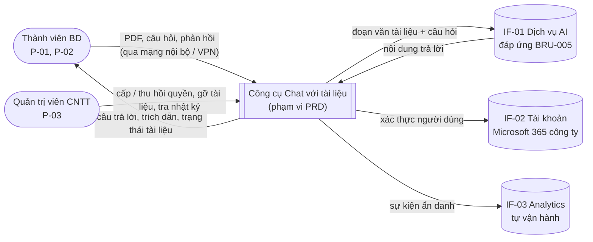
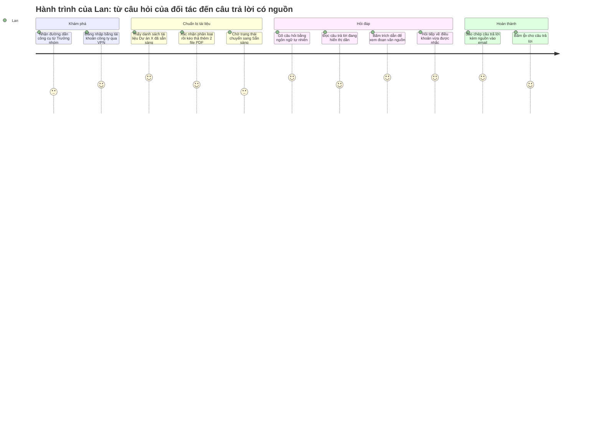

# Tài liệu Yêu cầu Sản phẩm (PRD) — Công cụ "Chat với tài liệu" (MVP)

> **Chuẩn tham chiếu:** IEEE 29148-2018 · **Đầu vào:** [BRD.md](BRD.md) v0.4 (BRD-CWD-001) · [UseCase_Specification.md](UseCase_Specification.md) v0.2
> **Trạng thái:** `In review` — **Ready for review**

> ⚠️ **Tài liệu bài tập.** Mọi câu hỏi mở của BRD (OQ-001 đến OQ-022) và của PRD (POQ-001 đến POQ-010) đã được trả lời bằng **giả định bài tập, theo hướng an toàn**. Các giá trị này được đánh dấu **[GĐ]**. Các ngưỡng trước đây mang nhãn [Đề xuất PM] đã được chấp nhận tại POQ-006.

| Thuộc tính | Giá trị |
|---|---|
| Số hiệu tài liệu | PRD-CWD-001 |
| Phiên bản | 0.4 (2026-10-21) |
| Tác giả | Product Manager (bản nháp do Claude soạn hỗ trợ) |
| Người review | Engineering Lead, Designer, QA Lead, Trưởng nhóm BD, Trưởng phòng CNTT, Pháp chế |
| Người phê duyệt | Product Owner; Giám đốc Kinh doanh (nhà tài trợ) [GĐ] |

### Lịch sử phiên bản

| Phiên bản | Ngày | Tóm tắt thay đổi |
|---|---|---|
| 0.1 | 2026-10-19 | Bản nháp đầu tiên, soạn từ BRD v0.1 |
| 0.2 | 2026-10-20 | Sửa theo checklist IEEE 29148: 5 mâu thuẫn; thêm US-017..019; AC cho mọi story; UI-001..009; bỏ chi tiết "cách làm"; thêm sơ đồ ngữ cảnh và §6; NFR bảo mật, độ tin cậy, khả năng mở rộng |
| 0.3 | 2026-10-20 | Áp dụng giả định bài tập [GĐ]: điền mọi TBD; thêm US-020 (gỡ tài liệu, BR-017), AC-US001-4 và UI-010 (xác nhận phân loại tài liệu, BRU-001); trả lời POQ-001..010; đồng bộ BRD v0.3 (BR-008, BR-016 nâng Must; BR-017..019) |
| 0.4 | 2026-10-21 | Áp dụng quyết định [GĐ] cho vấn đề mở OI-01..04 của đặc tả use case: Quản trị viên chỉ thấy thông tin mô tả (BRU-007, AC-US013-2); loại thông tin không có nguồn (AC-US009-4); chỉ vai trò Quản lý bộ tài liệu được tải lô (AC-US002-4); xuất nhật ký CSV (NFR-010) |

**Quy ước:**
- Ưu tiên: **P0** = bắt buộc để ra mắt (tương ứng Must), **P1** = nên có (Should), **P2** = có thì tốt (Could).
- ID: `EP` = Epic, `US` = User story, `UI` = Yêu cầu giao diện, `NFR` = Yêu cầu phi chức năng, `IF` = Giao tiếp ngoài, `COM` = Giao tiếp truyền thông, `PCON` = Ràng buộc PRD, `PDEP` = Phụ thuộc, `EVT` = Sự kiện analytics, `POQ` = Câu hỏi mở PRD. Các ID `BR`, `BRU`, `BO`, `MET`, `OQ`, `CON`, `RSK`, `DEP`, `SC` là ID của BRD.
- **Câu trả lời có nội dung:** câu trả lời có `answer_type = answered`. Không tính thông báo "không tìm thấy" (US-010) và câu hỏi lại để làm rõ (E-17). Định nghĩa này áp dụng cho KR2.3, G-09, AC-US009-1.

---

## 0. Thẩm định nền tảng sản phẩm

### 0.1 Nền tảng sản phẩm (rút ra từ BRD)

| Mục | Nội dung | Nguồn BRD |
|---|---|---|
| Tên sản phẩm | Chat với tài liệu (MVP) | §1, SRC-001 |
| Người dùng mục tiêu | 10 thành viên Đội Phát triển kinh doanh (BD) của Dự án X | STK-002, §6.3 |
| Vấn đề | Thông tin nằm rải rác trên tới 50 file PDF; mỗi lần tra cứu mất trung vị 30 phút, khoảng 50 giờ công/tuần cho cả đội | §2, §3.4 [GĐ] |
| Giải pháp cốt lõi | Ứng dụng web nội bộ: tải PDF lên, hỏi bằng ngôn ngữ tự nhiên (Việt/Anh), nhận câu trả lời tổng hợp từ **chỉ** các tài liệu đã tải lên, có nêu tên file và số trang | BR-001 đến BR-012, CON-002, CON-003 |
| Trụ cột UX | Xem §0.2 | — |

### 0.2 Thẩm định các trụ cột UX

| # | Trụ cột | Căn cứ | Đánh giá |
|---|---|---|---|
| UX-1 | **Tin cậy được kiểm chứng:** mọi câu trả lời có nội dung đều nêu tài liệu nguồn và số trang; khi không có thông tin thì nói rõ là không biết | BR-006, BR-008 (Must), BR-009, BRU-006, RSK-001 | **Giữ** |
| UX-2 | **Từ tài liệu đến câu trả lời trong một màn hình:** tải lên, theo dõi trạng thái và hỏi đáp trên cùng một giao diện | SN-001, SN-003, BO-001 | **Giữ** |
| UX-3 | **Ưu tiên máy tính (desktop-first), dùng được trên màn hình ≥ 1280px** | CON-002; đội BD dùng laptop [GĐ: POQ-002] | **Giữ** |
| UX-4 | **Phản hồi ngay:** câu trả lời hiển thị dần ngay khi được tạo | BR-011, NFR-001 | **Giữ** |
| — | Hoạt động ngoại tuyến (offline) | — | **Loại.** Cần dịch vụ AI trực tuyến (CON-003) |

### 0.3 Rủi ro của nền tảng cần biết trước khi xây dựng

1. **Chọn dịch vụ AI đáp ứng BRU-005** (không huấn luyện trên dữ liệu, không lưu dữ liệu sau xử lý, vùng dữ liệu được duyệt) là việc đầu tiên trên đường găng (PDEP-01, hạn 2026-11-06). Nếu không chọn được, áp dụng kế hoạch dự phòng của RSK-002.
2. **Persona và kịch bản là giả định** (ASM-006, ASM-007). Nên phỏng vấn nhanh 2–3 thành viên BD trong sprint 1.
3. **Ngưỡng chất lượng AI** (80% / 70% / 90%) cần đo thử sớm trên bộ tài liệu mẫu (DEP-002, hạn 2026-11-30) để phát hiện rủi ro trước thử nghiệm.

### 0.4 Ranh giới hệ thống (sơ đồ ngữ cảnh)



**Trong ranh giới:** tiếp nhận và xử lý PDF, lưu tài liệu, hỏi đáp, trích dẫn, phân quyền, nhật ký truy cập, gỡ tài liệu, ghi sự kiện.
**Ngoài ranh giới:** bản thân dịch vụ AI, hệ thống tài khoản công ty, thư mục chia sẻ của phòng BD (đồng bộ tự động đã hoãn).

---

## 1. Tóm tắt điều hành và chiến lược

### 1.1 Tầm nhìn sản phẩm

> **Mọi thành viên BD có thể hỏi bất kỳ điều gì về tài liệu dự án và nhận ngay câu trả lời có dẫn nguồn, biến kho PDF rời rạc thành một nguồn tri thức hỏi đáp được.** Tầm nhìn này phục vụ mục tiêu chiến lược "rút ngắn thời gian phản hồi đối tác" [GĐ: OQ-019].

Chiến lược MVP: chứng minh ba giả thuyết trong 4 tuần thử nghiệm (2027-01-04 → 2027-01-29), rồi quyết định đầu tư tiếp trước 2027-02-05 (BO-003):
1. Hỏi đáp nhanh hơn tra cứu thủ công.
2. Câu trả lời đủ chính xác để dùng trong công việc.
3. Đội BD thực sự sử dụng công cụ. Theo BRD §4, cần tỷ lệ chấp nhận tối thiểu khoảng 35% để giá trị tiết kiệm bù được chi phí vận hành.

### 1.2 Mục tiêu và kết quả then chốt (OKR)

| Mục tiêu | Kết quả then chốt (KR) | Giá trị [GĐ] | Liên kết BRD | Cách đo |
|---|---|---|---|---|
| **O1. Rút ngắn thời gian tìm thông tin** | KR1.1 Trung vị thời gian hoàn thành tác vụ tra cứu chuẩn giảm từ 30 xuống ≤ 15 phút | OQ-002, OQ-003 | BO-001, MET-001 | Bấm giờ trên 10 tác vụ chuẩn, 3 người, trước MVP và tuần 4 thử nghiệm |
| | KR1.2 Với 90% câu hỏi, nội dung trả lời đầu tiên xuất hiện trong ≤ 5 giây và câu trả lời hoàn tất trong ≤ 20 giây | OQ-011 | BR-011 | EVT-007 |
| **O2. Câu trả lời đáng tin cậy** | KR2.1 ≥ 80% câu trả lời đúng trên bộ 50 câu hỏi kiểm thử | OQ-004 | BO-002, MET-002 | Chấm điểm bộ kiểm thử (DEP-002) |
| | KR2.2 ≥ 90% câu hỏi loại SC-03 nhận thông báo "không tìm thấy" | OQ-004 | BR-009 | Như trên |
| | KR2.3 100% câu trả lời có nội dung nêu tên tài liệu và số trang | OQ-010 | BR-008 | EVT-007 (`citation_count`) |
| **O3. Chứng minh nhu cầu sử dụng** | KR3.1 ≥ 60% thành viên BD (≥ 6/10) dùng công cụ ít nhất 1 lần/tuần trong cả 4 tuần thử nghiệm | OQ-005 | BO-003, MET-003 | EVT-011 gộp theo tuần |
| | KR3.2 ≥ 70% lượt đánh giá câu trả lời là 👍 | POQ-006 | BO-002 | EVT-009 |

**Ngoài phạm vi MVP** (BRD §5.2, §5.3):
- Định dạng khác PDF.
- PDF dạng scan.
- Tài liệu "Mật" hoặc "Tuyệt mật".
- Tạo hoặc chỉnh sửa tài liệu.
- Người dùng ngoài đội BD.
- Truy cập ngoài VPN.
- Nhiều bộ tài liệu.
- Đồng bộ tự động.
- Ứng dụng di động riêng.
- Người dùng tự xóa hoặc thay thế tài liệu.

---

## 2. Persona và hành trình người dùng

### 2.1 Persona mục tiêu [GĐ: ASM-006, POQ-002]

**Persona chính: P-01 "Lan", Chuyên viên Phát triển kinh doanh** (STK-002; 9 người)
- **Công việc:** chuẩn bị đề xuất và trả lời câu hỏi của đối tác; tra cứu điều khoản, số liệu, phạm vi công việc trong hồ sơ Dự án X, khoảng 10 lần/tuần.
- **Bối cảnh:** laptop Windows, Chrome hoặc Edge, kết nối VPN khi ở ngoài văn phòng; thường tra cứu trong lúc họp hoặc trao đổi email.
- **Mức thành thạo công nghệ:** dùng thành thạo email, trình duyệt, công cụ văn phòng; đã thử chatbot AI phổ thông nhưng chưa dùng trong công việc; không có kiến thức kỹ thuật.
- **Nỗi đau:** không nhớ thông tin nằm ở file nào; phải mở 5–10 file PDF để ghép một câu trả lời, mất khoảng 30 phút (SN-001, SN-002).
- **Thành công nghĩa là:** có câu trả lời đúng, kèm vị trí trong tài liệu để tự đối chiếu (BRU-006), trong vòng chưa tới 1 phút.
- **Rào cản chấp nhận:** không tin AI nếu thấy một câu trả lời sai mà không có nguồn (RSK-001, RSK-003).

**Persona phụ: P-02 "Minh", Trưởng nhóm BD** (STK-002; 1 người; chủ sở hữu nghiệp vụ)
- **Công việc:** lọc tài liệu theo BRU-001 rồi tải bộ tài liệu Dự án X lên; chuẩn bị 50 câu hỏi kiểm thử (DEP-002); yêu cầu CNTT gỡ tài liệu khi cần; theo dõi mức độ sử dụng.
- **Mức thành thạo công nghệ:** tương đương Lan; quen quản lý thư mục tài liệu dùng chung.
- **Nhu cầu:** biết chắc tài liệu nào đã sẵn sàng để hỏi, và tài liệu nào bị lỗi.

**Persona phụ: P-03 "Hùng", Quản trị viên CNTT** (STK-004; 2 người)
- **Công việc:** quản lý nhóm truy cập; gỡ tài liệu theo yêu cầu (BR-017); tra nhật ký truy cập (BR-016).
- **Mức thành thạo công nghệ:** chuyên gia CNTT; quen quản trị tài khoản Microsoft 365 và phân quyền.

**Bên liên quan không dùng trực tiếp:** Giám đốc Kinh doanh (STK-001) nhận báo cáo kết quả MVP (BR-014). Pháp chế (STK-006) xác nhận tuân thủ.

### 2.2 Hành trình người dùng chính



| Bước | Người dùng làm gì | Hệ thống phản hồi | User story |
|---|---|---|---|
| 1. Truy cập | Mở đường dẫn (qua mạng nội bộ / VPN), đăng nhập | Xác thực; chỉ hiển thị bộ tài liệu mà người dùng có quyền | US-012, US-013 |
| 2. Xem tài liệu | Xem danh sách tài liệu | Hiển thị tên file, số trang, trạng thái xử lý | US-003 |
| 3. Tải lên (tùy chọn) | Xác nhận phân loại, rồi kéo thả một hoặc nhiều PDF | Kiểm tra định dạng và giới hạn, hiện tiến trình, báo lỗi theo từng file | US-001, US-002, US-004, US-005 |
| 4. Hỏi | Gõ câu hỏi | Hiển thị câu trả lời dần dần, chỉ dựa trên tài liệu đã tải lên | US-006, US-007, US-008, US-017 |
| 5. Kiểm chứng | Bấm vào trích dẫn | Hiển thị tên tài liệu, số trang và đoạn văn nguồn | US-009, US-019 |
| 6. Hỏi tiếp | Đặt câu hỏi nối tiếp | Hiểu ngữ cảnh của các lượt hỏi trước | US-011 |
| 7. Dùng kết quả | Sao chép câu trả lời | Sao chép nội dung kèm danh sách nguồn | US-018 |
| 8. Phản hồi | Bấm 👍/👎 | Ghi nhận để đo KR3.2 | US-015 |

Bước 3 là tùy chọn: người dùng có thể chỉ hỏi trên các tài liệu người khác đã tải lên.

**Luồng phụ:**
- **Minh (P-02):** lọc tài liệu Dự án X theo BRU-001 → tải lên lần đầu → theo dõi đến khi mọi file "Sẵn sàng" → chạy thử 5 câu hỏi kiểm thử → gửi đường dẫn cho nhóm.
- **Hùng (P-03):** nhận yêu cầu gỡ tài liệu → gỡ trong 1 ngày làm việc (US-020) → xác nhận lại với người yêu cầu.

---

## 3. Yêu cầu chức năng và User Story

### 3.1 Ma trận Epic

| Epic | Mô tả | Yêu cầu BRD | Số story (P0/P1/P2) |
|---|---|---|---|
| EP-01 Quản lý tài liệu | Tải lên, xử lý, xem danh sách, báo lỗi tài liệu | BR-001 đến BR-004, BRU-001 | 2 / 3 / 0 |
| EP-02 Hỏi đáp có căn cứ | Hỏi, trả lời từ tài liệu, tổng hợp nhiều nguồn, trích dẫn, "không tìm thấy", hỏi tiếp, dừng, sao chép | BR-005 đến BR-012 | 5 / 3 / 2 |
| EP-03 Truy cập và bảo vệ | Đăng nhập, phân quyền xem và truy vấn, gỡ tài liệu | BR-013, BR-015, BR-017 | 4 / 0 / 0 |
| EP-04 Phản hồi và đo lường | Phản hồi câu trả lời, dữ liệu đo MVP | BR-014 | 0 / 1 / 0 (cùng analytics ở §5.2) |
| **Tổng** | | | **11 / 7 / 2** |

**Đồng bộ với BRD v0.3:**
- BR-008 là Must, khớp với US-009 P0.
- BR-013 (xem) tương ứng US-013; BR-015 (truy vấn) tương ứng US-014.
- BR-016 (nhật ký) được đáp ứng bằng NFR-010; BR-017 (gỡ tài liệu) bằng US-020.
- BR-018 và BR-019 được đáp ứng bằng NFR-012 và NFR-013.
- BR-014 được đáp ứng qua analytics (§5.2).

### 3.2 EP-01: Quản lý tài liệu

| ID | User story | Ưu tiên | BRD |
|---|---|---|---|
| US-001 | Là **Lan**, tôi muốn tải một file PDF lên công cụ, để có thể đặt câu hỏi về nội dung file đó. | **P0** | BR-001, BRU-001 |
| US-002 | Là **Minh**, tôi muốn tải nhiều file PDF lên trong một lần, để chuẩn bị cả bộ tài liệu dự án mà không phải thao tác từng file. | **P0** | BR-002 |
| US-003 | Là **Lan**, tôi muốn xem danh sách tài liệu đã tải lên kèm trạng thái xử lý, để biết câu trả lời được tổng hợp từ những tài liệu nào. | P1 | BR-003 |
| US-004 | Là **Lan**, tôi muốn được báo rõ khi một file không được tiếp nhận và lý do, để không tưởng nhầm tài liệu đó đã được đưa vào truy vấn. | P1 | BR-004 |
| US-005 | Là **Minh**, tôi muốn thấy tiến trình xử lý của từng file, để biết khi nào có thể bắt đầu hỏi. | P1 | BR-001 (bổ sung ở mức sản phẩm) |

**Tiêu chí chấp nhận**

**US-001 (P0)**
- **AC-US001-1 (thành công):** *Cho trước* Lan đã đăng nhập và thuộc nhóm truy cập của bộ tài liệu; *khi* Lan chọn một file PDF hợp lệ ≤ 200 trang và ≤ 20 MB; *thì* file xuất hiện trong danh sách với trạng thái "Đang xử lý", sau đó chuyển sang "Sẵn sàng" trong thời gian theo NFR-003.
- **AC-US001-2 (truy vấn được):** *Cho trước* file đã ở trạng thái "Sẵn sàng"; *khi* Lan hỏi về một nội dung chỉ có trong file đó; *thì* câu trả lời lấy từ file đó và trích dẫn tên file đó (truy vết AC-001).
- **AC-US001-3 (chưa sẵn sàng):** *Cho trước* có ít nhất 1 file "Sẵn sàng" và 1 file "Đang xử lý"; *khi* Lan đặt câu hỏi; *thì* câu trả lời kèm ghi chú nêu tên các file chưa được dùng để trả lời.
- **AC-US001-4 (xác nhận phân loại, BRU-001):** *Cho trước* Lan mở hộp tải lên lần đầu trong phiên đăng nhập; *khi* Lan chưa đánh dấu xác nhận "Tài liệu thuộc loại Công khai hoặc Nội bộ, không phải Mật/Tuyệt mật"; *thì* nút tải lên bị vô hiệu. Sau khi xác nhận, lượt xác nhận được ghi vào nhật ký truy cập (NFR-010).

**US-002 (P0)**
- **AC-US002-1:** *Cho trước* Minh có 50 file PDF hợp lệ; *khi* Minh kéo thả tất cả vào vùng tải lên trong một lần; *thì* mỗi file có dòng trạng thái riêng, và 100% file đạt trạng thái "Sẵn sàng".
- **AC-US002-2 (lỗi một phần):** *Cho trước* trong lô có 1 file không hợp lệ; *khi* tải lên; *thì* các file hợp lệ vẫn được tiếp nhận, còn file lỗi hiện thông báo riêng (xem §4.2).
- **AC-US002-3 (mọi file đều truy vấn được):** *Cho trước* bộ tài liệu có 50 file, trong đó ít nhất 5 file dài 200 trang; *khi* với mỗi file, Minh hỏi 1 câu kiểm thử về nội dung chỉ có trong file đó; *thì* với 100% file, câu trả lời trích dẫn đúng file chứa nội dung đó (truy vết AC-002). Độ chính xác nội dung được đo riêng ở G-06.
- **AC-US002-4 (chỉ vai trò Quản lý bộ tài liệu) [GĐ: OI-03]:** *Cho trước* Lan là Thành viên BD, không có vai trò Quản lý bộ tài liệu; *khi* Lan chọn nhiều file cùng lúc; *thì* hệ thống không tiếp nhận lô và hướng dẫn tải từng file. Vai trò Quản lý bộ tài liệu do CNTT gán (UC-19); MVP gán cho Trưởng nhóm BD.

**US-003 (P1)**
- **AC-US003-1:** *Cho trước* bộ tài liệu có 5 file đã tải lên; *khi* Lan mở thanh tài liệu; *thì* danh sách hiển thị đúng 5 file, mỗi dòng có tên file, số trang và trạng thái, sắp xếp file mới nhất lên đầu (truy vết AC-003).

**US-004 (P1)**
- **AC-US004-1:** *Cho trước* Lan chọn 1 file .docx và 1 file PDF hỏng; *khi* tải lên; *thì* mỗi file có thông báo riêng nêu lý do theo E-03/E-04, và không file nào có trạng thái "Sẵn sàng" (truy vết AC-004).

**US-005 (P1)**
- **AC-US005-1:** *Cho trước* một file đang được xử lý; *khi* Minh xem danh sách; *thì* dòng của file hiển thị phần trăm tiến trình, cập nhật ít nhất mỗi 5 giây, cho đến khi chuyển sang "Sẵn sàng" hoặc "Lỗi".

### 3.3 EP-02: Hỏi đáp có căn cứ

| ID | User story | Ưu tiên | BRD |
|---|---|---|---|
| US-006 | Là **Lan**, tôi muốn đặt câu hỏi bằng ngôn ngữ tự nhiên, để không phải nhớ từ khóa chính xác trong tài liệu. | **P0** | BR-005, BR-012 |
| US-007 | Là **Lan**, tôi muốn câu trả lời chỉ dựa trên tài liệu dự án đã tải lên, để có thể dùng nó trong công việc mà không lo thông tin từ bên ngoài. | **P0** | BR-006 |
| US-008 | Là **Lan**, tôi muốn nhận một câu trả lời tổng hợp khi thông tin nằm ở nhiều tài liệu, để không phải tự ghép từ nhiều file. | **P0** | BR-007 |
| US-009 | Là **Lan**, tôi muốn mỗi câu trả lời có nội dung nêu tên tài liệu và số trang nguồn, để đối chiếu trước khi gửi thông tin cho đối tác. | **P0** | BR-008, BRU-006 |
| US-010 | Là **Lan**, tôi muốn được báo rõ khi tài liệu không chứa thông tin tôi hỏi, để không dùng nhầm một câu trả lời bịa đặt. | **P0** | BR-009 |
| US-011 | Là **Lan**, tôi muốn đặt câu hỏi tiếp nối mà không phải nhắc lại ngữ cảnh, để hỏi đáp tự nhiên như trao đổi với đồng nghiệp. | P1 | BR-010 |
| US-017 | Là **Lan**, tôi muốn dừng một câu trả lời đang được tạo, để không phải chờ khi nhận ra mình hỏi sai. | P1 | BR-005, BO-001 (bổ sung ở mức sản phẩm) |
| US-018 | Là **Lan**, tôi muốn sao chép câu trả lời kèm danh sách nguồn, để dán vào email hoặc tài liệu gửi đối tác. | P1 | BO-001, BRU-006 (bổ sung ở mức sản phẩm) |
| US-016 | Là **Lan**, tôi muốn bắt đầu một hội thoại mới, để câu hỏi về chủ đề khác không bị lẫn ngữ cảnh cũ. | P2 | BR-010 (bổ sung ở mức sản phẩm) |
| US-019 | Là **Lan**, tôi muốn mở file PDF gốc tại đúng trang được trích dẫn, để đọc thêm ngữ cảnh xung quanh. | P2 | BR-008 (bổ sung ở mức sản phẩm) |

**Lưu ý:**
- **BR-011** được đáp ứng bằng NFR-001 và NFR-002.
- **BR-012** được đáp ứng bằng NFR-004 (tiếng Việt và tiếng Anh). Mọi tiêu chí chấp nhận của EP-02 được kiểm thử bằng cả hai ngôn ngữ, theo tỷ lệ của AC-012 trong BRD.

**Tiêu chí chấp nhận**

**US-006 (P0)**
- **AC-US006-1:** *Cho trước* có ít nhất 1 tài liệu "Sẵn sàng" và bộ câu hỏi kiểm thử (DEP-002); *khi* Lan gửi từng câu hỏi hoàn chỉnh (không cú pháp, không toán tử tìm kiếm) bằng phím Enter; *thì* mỗi câu hỏi nhận được câu trả lời, và thời gian tới khi nội dung đầu tiên hiển thị đạt NFR-001 (p90 ≤ 5 giây trên toàn bộ bộ câu hỏi).
- **AC-US006-2:** *Cho trước* 20 câu hỏi loại SC-01; *khi* gửi lần lượt; *thì* ≥ 80% câu trả lời khớp với đáp án của đội BD (truy vết AC-005).
- **AC-US006-3 (đầu vào rỗng):** *Cho trước* ô nhập trống hoặc chỉ có khoảng trắng; *khi* Lan nhấn gửi; *thì* nút gửi bị vô hiệu và không có yêu cầu nào được gửi đi.

**US-007 (P0)**
- **AC-US007-1:** *Cho trước* bộ 50 câu hỏi kiểm thử; *khi* chạy toàn bộ; *thì* tỷ lệ trả lời đúng ≥ 80% (G-06), và 0 câu trả lời chứa thông tin mâu thuẫn với tài liệu (truy vết AC-006).
- **AC-US007-2 (kiến thức ngoài):** *Cho trước* tài liệu không đề cập tới một sự kiện phổ biến (ví dụ: thủ đô của một quốc gia); *khi* Lan hỏi về sự kiện đó; *thì* hệ thống trả lời "không tìm thấy trong tài liệu" thay vì dùng kiến thức chung.

**US-008 (P0)**
- **AC-US008-1:** *Cho trước* 10 câu hỏi loại SC-02; *khi* Lan hỏi; *thì* ≥ 70% câu trả lời chứa đủ các phần thông tin từ mọi tài liệu liên quan và trích dẫn từng tài liệu đó (G-07; truy vết AC-007).
- **AC-US008-2 (mâu thuẫn giữa các tài liệu):** *Cho trước* hai tài liệu nêu hai giá trị khác nhau cho cùng một thông tin; *khi* Lan hỏi; *thì* câu trả lời nêu cả hai giá trị kèm nguồn của từng giá trị, không tự chọn một.

**US-009 (P0)**
- **AC-US009-1:** *Cho trước* một câu trả lời có nội dung; *khi* câu trả lời hiển thị xong; *thì* câu trả lời có ít nhất 1 trích dẫn gồm tên tài liệu và số trang.
- **AC-US009-2:** *Cho trước* một trích dẫn; *khi* Lan bấm vào; *thì* đoạn văn nguồn (tối đa 300 ký tự) hiển thị trong khung xem trước kèm tên file và số trang.
- **AC-US009-3:** *Cho trước* 20 câu trả lời có nội dung chọn ngẫu nhiên; *khi* QA đối chiếu thủ công; *thì* 100% thông tin được trích dẫn có mặt tại trang đã nêu (G-09; truy vết AC-008).
- **AC-US009-4 (thông tin không có nguồn) [GĐ: OI-02]:** *Cho trước* một thông tin trong nội dung do Dịch vụ AI trả về không xác định được tài liệu và trang nguồn; *khi* câu trả lời được hoàn tất; *thì* thông tin đó không xuất hiện trong câu trả lời. Nếu mọi thông tin đều bị loại, hệ thống trả thông báo "không tìm thấy" (US-010).

**US-010 (P0)**
- **AC-US010-1:** *Cho trước* 10 câu hỏi loại SC-03; *khi* chạy; *thì* ≥ 9/10 nhận được thông điệp "Không tìm thấy thông tin này trong các tài liệu đã tải lên" (G-08; truy vết AC-009).
- **AC-US010-2:** *Cho trước* hệ thống trả lời "không tìm thấy"; *khi* hiển thị; *thì* có gợi ý hành động: diễn đạt lại câu hỏi, hoặc kiểm tra xem tài liệu liên quan đã được tải lên chưa.

**US-011 (P1)**
- **AC-US011-1:** *Cho trước* Lan vừa hỏi "Thời hạn thanh toán trong hợp đồng khung là bao lâu?"; *khi* Lan hỏi tiếp "Điều khoản đó có ngoại lệ không?"; *thì* câu trả lời thứ hai nói về đúng điều khoản thanh toán của hợp đồng khung.
- **AC-US011-2:** *Cho trước* 5 câu hỏi loại SC-04; *khi* chạy; *thì* ≥ 4/5 câu hỏi tiếp nối được hiểu đúng đối tượng tham chiếu (truy vết AC-010).

**US-017 (P1)**
- **AC-US017-1:** *Cho trước* một câu trả lời đang hiển thị dần; *khi* Lan bấm "Dừng"; *thì* nội dung ngừng hiển thị trong ≤ 1 giây, phần đã hiển thị được giữ lại và đánh dấu "đã dừng", và ô nhập sẵn sàng cho câu hỏi mới.

**US-018 (P1)**
- **AC-US018-1:** *Cho trước* một câu trả lời đã hoàn tất; *khi* Lan bấm "Sao chép"; *thì* bộ nhớ tạm chứa toàn bộ nội dung câu trả lời và danh sách nguồn (tên file, số trang), ở dạng văn bản thuần.

**US-016 (P2)**
- **AC-US016-1:** *Cho trước* Lan đang ở giữa một hội thoại; *khi* Lan bấm "Hội thoại mới" rồi hỏi tiếp một câu chỉ dùng đại từ tham chiếu; *thì* câu trả lời không dùng ngữ cảnh của hội thoại trước, và danh sách tài liệu không thay đổi.

**US-019 (P2)**
- **AC-US019-1:** *Cho trước* một trích dẫn tới trang N của file X; *khi* Lan chọn "Mở tài liệu gốc"; *thì* file X mở ở trang N trong tab mới, và chỉ người có quyền xem bộ tài liệu (US-013) mới mở được.

### 3.4 EP-03: Truy cập và bảo vệ tài liệu

**Mô hình phân quyền** [GĐ: OQ-009]: phân quyền theo bộ tài liệu. MVP chỉ có 1 bộ (Dự án X). Phòng CNTT quản lý danh sách thành viên nhóm truy cập.

| ID | User story | Ưu tiên | BRD |
|---|---|---|---|
| US-012 | Là **Lan**, tôi muốn phải đăng nhập trước khi dùng công cụ, để chỉ người được xác thực mới tiếp cận được tài liệu dự án. | **P0** | BR-013, BR-015 |
| US-013 | Là **Hùng**, tôi muốn chỉ thành viên nhóm truy cập mới **xem** được tài liệu trong bộ (tên file, đoạn trích dẫn, file gốc), để tài liệu dự án không lộ ra ngoài nhóm. | **P0** | BR-013 |
| US-014 | Là **Hùng**, tôi muốn chỉ thành viên nhóm truy cập mới **truy vấn** được tài liệu, để không ai lấy được nội dung gián tiếp qua câu trả lời. | **P0** | BR-015 |
| US-020 | Là **Hùng**, tôi muốn gỡ hoàn toàn một tài liệu khỏi bộ tài liệu theo yêu cầu, để xử lý trường hợp tài liệu "Mật" bị tải lên nhầm hoặc có yêu cầu từ đối tác. | **P0** | BR-017, BRU-001 |

**Ghi chú về US-012:** đăng nhập bằng tài khoản Microsoft 365 hiện có của công ty (đăng nhập một lần) [GĐ: POQ-005]. Lựa chọn này được ghi là ràng buộc IF-02; nó không phải yêu cầu nghiệp vụ.

**Tiêu chí chấp nhận**
- **AC-US012-1:** *Cho trước* người dùng chưa đăng nhập; *khi* mở bất kỳ đường dẫn nào của công cụ; *thì* được chuyển tới màn hình đăng nhập, và không dữ liệu tài liệu nào được trả về.
- **AC-US012-2:** *Cho trước* phiên đăng nhập hết hạn (NFR-009); *khi* người dùng gửi câu hỏi; *thì* nội dung câu hỏi đang gõ được giữ lại, và người dùng được yêu cầu đăng nhập lại.
- **AC-US013-1:** *Cho trước* tài khoản không thuộc nhóm truy cập và không phải Quản trị viên; *khi* mở danh sách tài liệu, đoạn trích dẫn hoặc đường dẫn trực tiếp tới file gốc; *thì* nhận thông báo "không có quyền truy cập", không thấy tên file hay nội dung (truy vết AC-013a).
- **AC-US013-2 (Quản trị viên, BRU-007) [GĐ: OI-01]:** *Cho trước* Hùng là Quản trị viên, không thuộc nhóm truy cập; *khi* mở bộ tài liệu, một đoạn trích dẫn hoặc file gốc; *thì* chỉ thấy thông tin mô tả (tên file, số trang, dung lượng, người tải lên, thời điểm, trạng thái), không xem được đoạn trích dẫn hay file gốc, và không gửi được câu hỏi (truy vết AC-013b).
- **AC-US014-1:** *Cho trước* tài khoản không thuộc nhóm truy cập; *khi* gửi câu hỏi về nội dung tài liệu; *thì* không nhận được câu trả lời chứa nội dung tài liệu (truy vết AC-015).
- **AC-US014-2:** *Cho trước* tài khoản bị CNTT gỡ khỏi nhóm truy cập; *khi* sau 15 phút người đó mở công cụ hoặc gửi câu hỏi; *thì* bị từ chối truy cập (NFR-011).
- **AC-US020-1:** *Cho trước* tài liệu X đang "Sẵn sàng"; *khi* Hùng gỡ tài liệu X; *thì* X biến mất khỏi danh sách của mọi người dùng trong ≤ 10 giây; 5 câu hỏi về nội dung chỉ có trong X đều nhận được "không tìm thấy"; file gốc và dữ liệu đã xử lý của X bị xóa; thao tác được ghi vào nhật ký truy cập (truy vết AC-017).
- **AC-US020-2:** *Cho trước* người dùng không phải quản trị viên; *khi* tìm thao tác gỡ tài liệu; *thì* thao tác này không hiển thị và không thực hiện được.

### 3.5 EP-04: Phản hồi và đo lường

| ID | User story | Ưu tiên | BRD |
|---|---|---|---|
| US-015 | Là **Lan**, tôi muốn đánh giá 👍/👎 cho câu trả lời (kèm lý do khi 👎), để nhóm sản phẩm biết câu trả lời nào sai. | P1 | BO-002, BR-014 |

- **AC-US015-1:** *Cho trước* một câu trả lời đã hoàn tất; *khi* Lan bấm 👎; *thì* hiện danh sách lý do (Sai / Thiếu / Nguồn sai / Khác). Sau khi chọn, đánh giá được ghi nhận (EVT-009) và nút được đánh dấu đã chọn.
- **AC-US015-2:** *Cho trước* Lan đã đánh giá một câu trả lời; *khi* Lan bấm lại nút còn lại; *thì* đánh giá được thay bằng lựa chọn mới. Mỗi người chỉ có một đánh giá cho mỗi câu trả lời.

Dữ liệu đo MVP (BR-014) được thu thập qua sự kiện analytics ở §5.2.

---

## 4. Yêu cầu UX và UI

### 4.1 Bố cục và luồng tương tác chính

**Bố cục một màn hình, hai vùng chính** (desktop ≥ 1280px; từ 768px đến 1279px thì thanh tài liệu thu gọn thành ngăn kéo). Khung dưới đây **chỉ mang tính minh họa**: nó thể hiện vị trí logic của các vùng, không quy định thiết kế hình ảnh. Biểu tượng, màu sắc và kiểu chữ do Designer quyết định.

```
┌──────────────────────────────────────────────────────────────────────┐
│ Chat với tài liệu          Bộ tài liệu: Dự án X           [Lan ▾]    │
├───────────────────────┬──────────────────────────────────────────────┤
│ TÀI LIỆU (12)         │  Lan: Thời hạn thanh toán trong hợp đồng     │
│ ┌───────────────────┐ │       khung là bao lâu?                      │
│ │ Kéo thả PDF vào   │ │                                              │
│ │ đây hoặc [Chọn]   │ │  Trợ lý: Thời hạn thanh toán là 30 ngày kể   │
│ └───────────────────┘ │  từ ngày nhận hóa đơn [1]. Phụ lục 2 điều    │
│ ✔ HopDongKhung.pdf 48t│  chỉnh thành 45 ngày cho đơn > 1 tỷ [2].     │
│ ✔ PhuLuc2.pdf     12t │   [1] HopDongKhung.pdf · tr.14               │
│ ⟳ BaoGia_v3.pdf   62% │   [2] PhuLuc2.pdf · tr.3                     │
│ ✖ scan_bienban.pdf    │                       [👍] [👎] [Sao chép]   │
│   Không đọc được chữ  │                                              │
│                       ├──────────────────────────────────────────────┤
│ [+ Hội thoại mới]     │ [Đặt câu hỏi về tài liệu...]   [Gửi / Dừng]  │
│                       │ Câu trả lời chỉ dựa trên tài liệu đã tải lên │
└───────────────────────┴──────────────────────────────────────────────┘
```

| ID | Vùng / tương tác | Yêu cầu | Story |
|---|---|---|---|
| UI-001 | Thanh tài liệu | Vùng kéo thả ở đầu; danh sách sắp xếp theo thời gian tải lên, mới nhất trước; mỗi dòng có tên file, số trang, trạng thái (Đang tải / Đang xử lý % / Sẵn sàng / Lỗi + lý do) | US-001 đến US-005 |
| UI-002 | Tên bộ tài liệu | Hiển thị tên bộ tài liệu hiện tại (MVP có 1 bộ, không cần bộ chọn) | US-013 |
| UI-003 | Vùng hội thoại | Câu trả lời hiển thị dần trong khi đang được tạo; trích dẫn dạng chỉ số [n] trong câu và danh sách nguồn ở cuối câu trả lời | US-006 đến US-011 |
| UI-004 | Trích dẫn | Chọn [n] mở khung xem trước đoạn văn nguồn (tối đa 300 ký tự); từ khung xem trước có thể mở tài liệu gốc (P2) | US-009, US-019 |
| UI-005 | Hành động trên câu trả lời | Đánh giá tích cực / tiêu cực (tiêu cực mở danh sách lý do); sao chép câu trả lời kèm nguồn | US-015, US-018 |
| UI-006 | Ô nhập câu hỏi | Enter để gửi, Shift+Enter để xuống dòng; tối đa 2.000 ký tự, có bộ đếm khi còn ≤ 200 ký tự; trong lúc đang trả lời thì nút Gửi đổi thành Dừng | US-006, US-017 |
| UI-007 | Dòng nhắc cố định | Luôn hiển thị dưới ô nhập: "Câu trả lời chỉ dựa trên tài liệu đã tải lên. Hãy đối chiếu nguồn trước khi gửi cho đối tác." | UX-1, BRU-006 |
| UI-008 | Hội thoại mới | Nút "Hội thoại mới" xóa ngữ cảnh hội thoại, giữ nguyên tài liệu | US-016 |
| UI-009 | Khả năng tiếp cận | Mọi thao tác ở UI-001 đến UI-010 dùng được hoàn toàn bằng bàn phím; tỷ lệ tương phản đạt WCAG 2.1 mức AA. Đây là mục tiêu P1, không chặn ra mắt [GĐ: POQ-004] | Toàn bộ |
| UI-010 | Xác nhận phân loại khi tải lên | Hộp xác nhận "Tài liệu thuộc loại Công khai hoặc Nội bộ, không phải Mật/Tuyệt mật" xuất hiện ở lần tải lên đầu tiên trong phiên; chưa đánh dấu thì không tải lên được | US-001 (AC-US001-4), BRU-001 |

Các thao tác quản trị của P-03 (quản lý nhóm truy cập, gỡ tài liệu, tra nhật ký) dùng giao diện quản trị riêng, chỉ hiện với quản trị viên. Bố cục của giao diện này do Designer quyết định.

### 4.2 Trường hợp biên và trạng thái lỗi

| # | Tình huống | Hành vi bắt buộc | Thông điệp cho người dùng (gợi ý) |
|---|---|---|---|
| E-01 | **Trạng thái trống:** chưa có tài liệu nào | Ô nhập bị vô hiệu; vùng hội thoại hiển thị hướng dẫn 3 bước và vùng kéo thả lớn | "Tải lên tài liệu PDF đầu tiên để bắt đầu hỏi đáp." |
| E-02 | Có tài liệu nhưng tất cả đang xử lý | Cho phép gõ nhưng nút Gửi vô hiệu; hiện tiến trình | "Đang xử lý 3 tài liệu, bạn có thể hỏi khi ít nhất một tài liệu sẵn sàng." |
| E-03 | File không phải PDF (.docx, .xlsx, ảnh...) | Từ chối trước khi nội dung file được gửi lên hệ thống; không xuất hiện trong danh sách | "BaoCao.docx: chỉ hỗ trợ file PDF." |
| E-04 | PDF hỏng hoặc không mở được | Đánh dấu Lỗi; không dùng file này để trả lời | "File bị hỏng hoặc không đọc được. Hãy xuất lại PDF và thử lại." |
| E-05 | PDF có mật khẩu | Đánh dấu Lỗi | "File được bảo vệ bằng mật khẩu. Hãy gỡ mật khẩu rồi tải lại." |
| E-06 | PDF dạng scan, không có lớp văn bản (ngoài phạm vi, OQ-013) | Đánh dấu Lỗi; không trả lời từ file | "Không trích xuất được chữ từ file này (có thể là bản scan). Bản MVP chưa hỗ trợ PDF scan." |
| E-07 | File > 200 trang hoặc > 20 MB | Từ chối trước khi nội dung file được gửi lên hệ thống | "File vượt quá giới hạn 200 trang / 20 MB." |
| E-08 | Bộ tài liệu đã có 50 file | Từ chối các file vượt giới hạn, giữ các file trong giới hạn | "Bộ tài liệu đã đạt tối đa 50 file. Liên hệ Trưởng nhóm BD." |
| E-09 | Trùng tên với file đã có | Giữ cả hai: tự đổi tên file mới thành `ten (2).pdf` và thông báo. Thay thế tài liệu nằm ngoài phạm vi | "HopDong.pdf đã tồn tại, file mới được lưu thành HopDong (2).pdf." |
| E-10 | **Mất mạng khi đang tải lên** | Tự động thử lại tối đa 3 lần rồi hiện nút "Thử lại"; không tạo bản ghi tài liệu dở dang | "Mất kết nối, đang thử lại… (2/3)" |
| E-11 | **Mất mạng khi đang nhận câu trả lời** | Giữ phần đã hiển thị và đánh dấu "chưa hoàn tất"; hiện nút "Tạo lại câu trả lời"; ghi EVT-008, không ghi EVT-007 | "Câu trả lời bị gián đoạn do mất kết nối." |
| E-12 | Dịch vụ AI lỗi hoặc không phản hồi sau 60 giây | Dừng chờ; giữ nguyên câu hỏi trong ô nhập; ghi EVT-008; các chức năng khác vẫn hoạt động (NFR-014) | "Hệ thống đang bận, vui lòng thử lại sau ít phút." |
| E-13 | Vượt 30 câu hỏi/người/giờ, hoặc chi phí AI tháng đạt 100% ngân sách (RSK-006) | Tạm chặn gửi câu hỏi với người dùng đó tới hết khung giờ; nếu do ngân sách thì chặn toàn hệ thống và báo quản trị viên | "Bạn đã đạt giới hạn 30 câu hỏi trong giờ này." |
| E-14 | Câu hỏi rỗng hoặc chỉ có khoảng trắng | Nút Gửi vô hiệu | — |
| E-15 | Câu hỏi vượt 2.000 ký tự | Bộ đếm ký tự báo vượt; chặn gửi | "Câu hỏi tối đa 2.000 ký tự." |
| E-16 | Không tìm thấy thông tin trong tài liệu | Trả lời theo US-010; không đưa ra suy đoán | Xem AC-US010-1 |
| E-17 | **Câu hỏi có nhiều đáp án hợp lệ** (SC-05): tài liệu chứa ≥ 2 đáp án khác nhau, mỗi đáp án ứng với một đối tượng khác nhau, và câu hỏi không chỉ rõ đối tượng nào | Liệt kê tất cả các đáp án kèm đối tượng và nguồn của từng đáp án, hoặc hỏi lại để làm rõ (`answer_type = clarification`) | "Tài liệu có giá cho 3 hạng mục, bạn muốn hỏi hạng mục nào?" |
| E-18 | Phiên đăng nhập hết hạn | Theo AC-US012-2 | "Phiên đăng nhập đã hết hạn." |
| E-19 | Không có quyền truy cập | Theo AC-US013-1; không tiết lộ tên tài liệu | "Bạn không có quyền truy cập bộ tài liệu này." |
| E-20 | Hai người cùng tải lên một lúc | Danh sách tài liệu của mọi người đang mở bộ tài liệu cập nhật trong ≤ 10 giây, không cần tải lại trang | — |
| E-21 | Truy cập từ ngoài mạng nội bộ / VPN | Không truy cập được (CON-007) | Do hạ tầng mạng xử lý |
| E-22 | Tài liệu đang được dùng trong một câu trả lời thì bị gỡ (US-020) | Câu trả lời đã hiển thị giữ nguyên; trích dẫn tới tài liệu đã gỡ hiển thị "Tài liệu đã được gỡ" và không mở được | "Tài liệu đã được gỡ khỏi bộ tài liệu." |

---

## 5. Tiêu chí phát hành và chỉ số sau ra mắt

### 5.1 Tiêu chí cổng ra mắt (launch gate)

MVP chỉ được mở cho đội BD dùng thử (2027-01-04) khi **mọi** mục dưới đây đạt.

**A. Chức năng và chất lượng QA**

| ID | Tiêu chí | Ngưỡng |
|---|---|---|
| G-01 | Toàn bộ AC của story P0 (US-001, 002, 006–010, 012–014, 020) | 100% đạt |
| G-02 | Toàn bộ trường hợp biên E-01 đến E-22 | Đã kiểm thử; không còn lỗi mức Critical/High |
| G-03 | Lỗi tồn đọng | 0 Critical, 0 High; lỗi Medium có kế hoạch xử lý |
| G-04 | Trình duyệt hỗ trợ | 2 phiên bản mới nhất của Chrome và Edge trên Windows [GĐ: POQ-002] |
| G-05 | Bộ câu hỏi kiểm thử (DEP-002) | 50 câu theo BRD §3.7 (20 SC-01, 10 SC-02, 10 SC-03, 5 SC-04, 5 SC-05), ≥ 30% mỗi ngôn ngữ (Việt, Anh) |

**B. Chất lượng câu trả lời AI** (đo trên bộ kiểm thử, chấm bởi đội BD)

| ID | Tiêu chí | Ngưỡng [GĐ: OQ-004] |
|---|---|---|
| G-06 | Tỷ lệ trả lời đúng | ≥ 80%, đạt cho từng ngôn ngữ |
| G-07 | Câu hỏi đa tài liệu (SC-02) trả lời đủ | ≥ 70% |
| G-08 | Câu không có đáp án (SC-03) được trả lời "không tìm thấy" | ≥ 90% |
| G-09 | Câu trả lời có nội dung có trích dẫn đúng trang | 100% trên mẫu 20 câu |

**C. Hiệu năng và khả năng mở rộng** [GĐ: OQ-006, OQ-011]

| ID | Yêu cầu | Ngưỡng |
|---|---|---|
| NFR-001 | Thời gian tới khi nội dung trả lời đầu tiên hiển thị | p90 ≤ 5 giây |
| NFR-002 | Thời gian hoàn tất câu trả lời | p90 ≤ 20 giây |
| NFR-003 | Thời gian xử lý tài liệu đến khi "Sẵn sàng" | ≤ 2 phút cho PDF 50 trang; ≤ 8 phút cho PDF 200 trang |
| NFR-004 | Ngôn ngữ câu hỏi và tài liệu được hỗ trợ | Tiếng Việt và tiếng Anh, kể cả câu hỏi một ngôn ngữ về tài liệu ngôn ngữ kia |
| NFR-005 | Số người dùng đồng thời mà vẫn đạt NFR-001/002 | 10 (100% đội BD) |
| NFR-006 | Thông lượng hỏi đáp mà vẫn đạt NFR-001/002 | 20 câu hỏi/phút |
| NFR-007 | Dung lượng tài liệu mỗi bộ | 50 file × 200 trang (10.000 trang), ≤ 1 GB |
| NFR-008 | Kiến trúc mở rộng được lên gấp 5 lần NFR-005 và NFR-007 mà không cần thiết kế lại, nếu quyết định 2027-02-05 là mở rộng | Đánh giá trong SAD |

**D. Bảo mật và quyền riêng tư** [GĐ: OQ-008, OQ-016, OQ-020]

| ID | Tiêu chí / Yêu cầu |
|---|---|
| G-10 | Phòng CNTT và Pháp chế phê duyệt bằng văn bản: (a) nhà cung cấp dịch vụ AI đáp ứng BRU-005; (b) cách xử lý dữ liệu phù hợp CON-006. **Đây là điều kiện chặn tuyệt đối.** |
| G-11 | Kiểm thử phân quyền theo AC-US002-4, AC-US013-1, AC-US013-2, AC-US014-1, AC-US014-2, AC-US020-2: 100% đạt |
| G-12 | Dữ liệu được mã hóa khi truyền (TLS 1.2 trở lên) và khi lưu trữ, theo chuẩn mã hóa do Phòng CNTT quy định |
| G-13 | Analytics và log ứng dụng **không** chứa nội dung tài liệu hay nội dung câu hỏi |
| G-14 | Tự động xóa dữ liệu theo BRU-002 (tài liệu), BRU-003 (hội thoại 30 ngày), BRU-004 (nhật ký 12 tháng); có kiểm thử xác nhận |
| G-15 | Không còn lỗ hổng mức Critical/High trong quét bảo mật phụ thuộc và ứng dụng |
| NFR-009 | Phiên đăng nhập hết hạn sau 8 giờ không hoạt động |
| NFR-010 | Hệ thống ghi nhật ký truy cập gồm: ai, lúc nào, thao tác gì (tải lên, xác nhận phân loại, xem, truy vấn, gỡ tài liệu, thay đổi quyền), trên bộ tài liệu nào. Nhật ký không chứa nội dung; lưu 12 tháng (BRU-004); quản trị viên lọc được theo bộ tài liệu và khoảng thời gian (BR-016). **P1 [GĐ: OI-04]:** quản trị viên xuất được kết quả đã lọc ra file CSV; mỗi lần xuất được ghi nhật ký |
| NFR-011 | Khi người dùng bị gỡ khỏi nhóm truy cập, quyền hết hiệu lực trong ≤ 15 phút |

**Mô hình vai trò – quyền** [GĐ: OQ-009]:

| Vai trò | Xem thông tin mô tả | Xem nội dung | Truy vấn | Tải lên từng file | Tải lô | Gỡ tài liệu | Quản lý nhóm truy cập | Xem / xuất nhật ký |
|---|---|---|---|---|---|---|---|---|
| Thành viên BD (P-01) | ✔ | ✔ | ✔ | ✔ | — | — | — | — |
| Quản lý bộ tài liệu (P-02, Trưởng nhóm BD) | ✔ | ✔ | ✔ | ✔ | ✔ | — | — | — |
| Quản trị viên CNTT (P-03) | ✔ (BRU-007) | — | — | — | — | ✔ | ✔ | ✔ |

- **Tách quyền (BRU-007):** Quản trị viên chỉ thấy thông tin mô tả (tên file, số trang, dung lượng, người tải lên, thời điểm, trạng thái), không xem hay truy vấn được nội dung. Muốn xem nội dung, quản trị viên phải được thêm vào nhóm truy cập như một Thành viên BD.
- **Vai trò Quản lý bộ tài liệu** do CNTT gán qua UC-19. Trong MVP, vai trò này chỉ gán cho Trưởng nhóm BD [GĐ: OI-03].

**E. Độ tin cậy và vận hành** [GĐ: OQ-021, OQ-012]

| ID | Tiêu chí / Yêu cầu |
|---|---|
| NFR-012 | Độ sẵn sàng trong thử nghiệm: ≥ 95% trong giờ làm việc (8:00–18:00, thứ Hai đến thứ Sáu); ngoài giờ không cam kết (BR-018) |
| NFR-013 | Sau sự cố: hoạt động trở lại trong ≤ 1 ngày làm việc (RTO); tài liệu đã "Sẵn sàng" từ 24 giờ trước sự cố không bị mất (RPO ≤ 24 giờ). Diễn tập khôi phục 1 lần trước thử nghiệm (BR-019) |
| NFR-014 | Khi dịch vụ AI không khả dụng, các chức năng xem danh sách và tải tài liệu lên vẫn hoạt động; hỏi đáp hiển thị thông báo E-12 |
| G-16 | Giới hạn 30 câu hỏi/người/giờ; trần chi phí dịch vụ AI 5 triệu VND/tháng; cảnh báo quản trị viên khi đạt 80% (4 triệu VND) (RSK-006, CON-005) |
| G-17 | Có hướng dẫn sử dụng 1 trang, nêu rõ: chỉ PDF dạng văn bản; không tải tài liệu Mật/Tuyệt mật (BRU-001); luôn đối chiếu nguồn trước khi gửi đối tác (BRU-006); cách yêu cầu gỡ tài liệu |
| G-18 | Diễn tập khôi phục (NFR-013) và diễn tập gỡ tài liệu (US-020) đã thực hiện và đạt |

### 5.2 Analytics và theo dõi

**Nguyên tắc:**
- Mỗi sự kiện có định danh người dùng ẩn danh (không chứa tên hay email), `session_id`, `timestamp`, `doc_set_id`.
- **Không** gửi nội dung câu hỏi, câu trả lời hay tài liệu vào analytics (G-13).
- Analytics tự vận hành trong cùng hạ tầng của ứng dụng; không dùng dịch vụ analytics bên ngoài [GĐ: POQ-009].
- Dữ liệu analytics phục vụ BR-014 (MET-002, MET-003). Riêng MET-001 đo bằng bài bấm giờ có kiểm soát.

| ID | Sự kiện | Kích hoạt khi | Thuộc tính | Phục vụ |
|---|---|---|---|---|
| EVT-001 | `doc_upload_started` | Người dùng chọn hoặc thả file | `file_count`, `total_size_mb` | Phễu tải lên |
| EVT-002 | `doc_upload_rejected` | File bị từ chối trước khi gửi lên | `reason` (not_pdf / too_large / too_many_pages / limit_reached) | E-03, E-07, E-08 |
| EVT-003 | `doc_processing_completed` | Tài liệu chuyển sang "Sẵn sàng" | `page_count`, `processing_ms` | NFR-003 |
| EVT-004 | `doc_processing_failed` | Tài liệu chuyển sang "Lỗi" | `reason` (corrupt / encrypted / no_text / timeout), `page_count` | E-04 đến E-06, ASM-001 |
| EVT-005 | `conversation_started` | Câu hỏi đầu tiên, hoặc bấm "Hội thoại mới" | `ready_doc_count` | US-016 |
| EVT-006 | `question_submitted` | Gửi câu hỏi | `conversation_id`, `turn_index`, `question_length`, `is_follow_up`, `language` (vi / en) | US-006, US-011, NFR-004 |
| EVT-007 | `answer_completed` | Câu trả lời hiển thị xong | `answer_type` (answered / not_found / clarification), `citation_count`, `distinct_doc_count`, `latency_first_token_ms`, `latency_total_ms` | KR1.2, KR2.3, NFR-001/002 |
| EVT-008 | `answer_failed` | Câu trả lời lỗi hoặc gián đoạn | `reason` (network / timeout / service_error / rate_limited / budget_cap), `elapsed_ms` | E-11 đến E-13 |
| EVT-009 | `answer_feedback` | Đánh giá 👍/👎 | `rating`, `reason` (wrong / incomplete / wrong_source / other), `answer_type` | KR3.2, MET-002 |
| EVT-010 | `citation_opened` | Mở trích dẫn | `citation_index`, `doc_id`, `target` (preview / original) | UX-1, US-019 |
| EVT-011 | `user_active_day` | Người dùng có ít nhất 1 câu hỏi trong ngày (ghi 1 lần/người/ngày) | `questions_count` | KR3.1, MET-003 |
| EVT-012 | `answer_copied` | Bấm sao chép câu trả lời | `citation_count` | US-018 |
| EVT-013 | `access_denied` | Bị từ chối truy cập | `resource_type` | G-11 |
| EVT-014 | `login_succeeded` | Đăng nhập thành công | — | Phễu hỏi đáp |
| EVT-015 | `answer_stopped` | Người dùng bấm Dừng | `elapsed_ms` | US-017 |
| EVT-016 | `doc_removed` | Quản trị viên gỡ tài liệu | `page_count`, `hours_since_request` | US-020, AC-017 |

**Phễu và bảng theo dõi cần có trong giai đoạn thử nghiệm:**

| Báo cáo | Định nghĩa | Ngưỡng cảnh báo |
|---|---|---|
| Phễu hỏi đáp (mọi người dùng) | Đăng nhập (EVT-014) → mở bộ tài liệu có ≥ 1 file "Sẵn sàng", bất kể ai tải lên → hỏi câu đầu (EVT-006) → nhận câu trả lời (EVT-007) | Tỷ lệ chuyển đổi < 50% ở bất kỳ bước nào |
| Phễu tải lên (chỉ người có tải lên) | Bắt đầu tải lên (EVT-001) → xử lý xong (EVT-003) → có ít nhất 1 câu hỏi trên bộ tài liệu trong 7 ngày | Bước "xử lý xong" < 90% |
| Tỷ lệ lỗi xử lý tài liệu | EVT-004 ÷ (EVT-003 + EVT-004) | > 10%: kích hoạt xem lại ASM-001 (PDF scan) |
| Tỷ lệ "không tìm thấy" | `answer_type = not_found` ÷ EVT-007 | > 30%: có thể thiếu tài liệu, hoặc chất lượng truy xuất kém |
| Mức độ kiểm chứng | EVT-010 ÷ EVT-007 | Theo dõi (không đặt ngưỡng) |
| Người dùng hoạt động hằng tuần | Số người dùng có EVT-011 trong tuần ÷ 10 | < 60% trong 2 tuần liên tiếp: kích hoạt kế hoạch dự phòng RSK-003 |
| Chi phí AI | Chi phí lũy kế tháng ÷ 5 triệu VND | ≥ 80%: kích hoạt kế hoạch dự phòng RSK-006 |
| Độ trễ | p50 và p90 của `latency_first_token_ms`, `latency_total_ms` | Vượt NFR-001/002 |

---

## 6. Môi trường, giao tiếp, ràng buộc và phụ thuộc

### 6.1 Môi trường vận hành [GĐ]

| Khía cạnh | Yêu cầu |
|---|---|
| Thiết bị người dùng | Laptop Windows; màn hình ≥ 1280px (tối thiểu 768px với bố cục thu gọn) (POQ-002) |
| Trình duyệt | 2 phiên bản mới nhất của Chrome và Edge (G-04) |
| Mạng người dùng | Chỉ truy cập qua mạng nội bộ hoặc VPN công ty (CON-007, POQ-008) |
| Nơi vận hành hệ thống | Hạ tầng trong vùng dữ liệu được Phòng CNTT phê duyệt (đám mây hoặc máy chủ nội bộ; SAD chọn). Không công khai ra Internet (CON-007) |
| Phần cứng chuyên dụng | Không có. **Giao tiếp phần cứng: không áp dụng**, vì đây là ứng dụng web chạy trên trình duyệt, không kết nối cảm biến hay thiết bị ngoại vi (CON-002) |

### 6.2 Giao tiếp phần mềm

Đặc tả ở mức logic. Chi tiết API để lại cho SRS/SAD.

| ID | Hệ thống ngoài | Mục đích | Dữ liệu gửi đi | Dữ liệu nhận về | Yêu cầu bảo mật | Lựa chọn [GĐ] |
|---|---|---|---|---|---|---|
| IF-01 | Dịch vụ AI | Tạo câu trả lời từ câu hỏi và các đoạn tài liệu liên quan | Câu hỏi, đoạn văn tài liệu, ngữ cảnh hội thoại | Nội dung câu trả lời | BRU-005: không huấn luyện trên dữ liệu, không lưu sau xử lý, vùng dữ liệu được duyệt; chi phí trong CON-005 | Nhà cung cấp được CNTT chọn trước 2026-11-06 (PDEP-01) |
| IF-02 | Hệ thống tài khoản công ty | Xác thực người dùng (đăng nhập một lần) | Yêu cầu xác thực | Định danh người dùng, nhóm | Theo chuẩn của Phòng CNTT | Microsoft 365 hiện có của công ty (POQ-005) |
| IF-03 | Analytics | Lưu sự kiện EVT-001 đến EVT-016 | Sự kiện ẩn danh, không có nội dung (G-13) | — | Không chứa dữ liệu cá nhân trực tiếp | Tự vận hành trong hạ tầng ứng dụng (POQ-009) |

### 6.3 Giao tiếp truyền thông

| ID | Yêu cầu |
|---|---|
| COM-01 | Mọi giao tiếp giữa trình duyệt và hệ thống, và giữa hệ thống với IF-01 đến IF-03, dùng kênh mã hóa (HTTPS, TLS 1.2 trở lên; G-12) |
| COM-02 | Hệ thống phải đẩy được dữ liệu tới trình duyệt mà không cần tải lại trang, để hiển thị câu trả lời dần dần (UI-003, NFR-001) và cập nhật danh sách tài liệu (E-20, AC-US020-1). Giao thức cụ thể do SAD quyết định |
| COM-03 | Tải file lên phải chịu được gián đoạn mạng ngắn theo E-10 |
| COM-04 | Hệ thống chỉ nhận kết nối từ dải địa chỉ của mạng nội bộ và VPN công ty (CON-007) |

### 6.4 Ràng buộc thiết kế

| ID | Ràng buộc | Nguồn |
|---|---|---|
| CON-001 | Phạm vi MVP | BRD |
| CON-002 | Ứng dụng web (bắt buộc) | BRD |
| CON-003 | Câu trả lời được tạo bằng AI, tuân theo BRU-005 | BRD |
| CON-004 | Chỉ nhận PDF dạng văn bản | BRD |
| CON-005 | Xây dựng ≤ 200 triệu VND; AI ≤ 5 triệu VND/tháng; phát triển 8 tuần, thử nghiệm 4 tuần | BRD |
| CON-006 | Tuân thủ quy định bảo vệ dữ liệu cá nhân của Việt Nam và các NDA với đối tác | BRD |
| CON-007 | Chỉ truy cập qua mạng nội bộ / VPN | BRD |
| PCON-01 | Hỗ trợ trình duyệt theo G-04 | PRD |
| PCON-02 | Khả năng tiếp cận WCAG 2.1 AA là mục tiêu P1 (UI-009) | PRD [GĐ: POQ-004] |
| PCON-03 | Tách quyền: quản trị viên chỉ thấy thông tin mô tả, không xem được nội dung tài liệu (§5.1 D) | BRD BRU-007 |

### 6.5 Phụ thuộc

| ID | Phụ thuộc | Loại | Bên cung cấp | Cần trước | Tác động nếu trễ |
|---|---|---|---|---|---|
| PDEP-01 | Chọn nhà cung cấp dịch vụ AI đáp ứng BRU-005; Phòng CNTT và Pháp chế phê duyệt (G-10) | Quyết định | Phòng CNTT + Pháp chế | 2026-11-06 | Không xây được EP-02; kích hoạt dự phòng RSK-002 |
| PDEP-02 | Hợp đồng và ngân sách dịch vụ AI (DEP-001) | Dịch vụ / ngân sách | Giám đốc Kinh doanh | 2026-11-06 | Không phát triển được EP-02 |
| PDEP-03 | Đăng ký ứng dụng với Microsoft 365 công ty; tạo nhóm truy cập Dự án X (IF-02) | Hệ thống | Phòng CNTT | 2026-11-16 (sprint 2) | Không hoàn thành EP-03; chặn ra mắt |
| PDEP-04 | Hạ tầng vận hành, VPN, analytics nội bộ (IF-03, CON-007) | Hệ thống | Phòng CNTT | 2026-11-16 | Không triển khai được; không đo được KR3.x |
| PDEP-05 | Bộ tài liệu mẫu đã lọc theo BRU-001 và 50 câu hỏi kiểm thử có đáp án (DEP-002, DEP-003, G-05) | Dữ liệu | Trưởng nhóm BD | 2026-11-30 | Không đánh giá được G-06 đến G-09 |
| PDEP-06 | Người chấm điểm bộ kiểm thử (2 thành viên BD, khoảng 1 ngày mỗi lần chấm) | Nhân lực | Đội BD | 2026-12-14 | Không nghiệm thu được AC-US007-1, US008-1, US010-1 |

---

## 7. Truy vết BRD → PRD → Kiểm thử

| BRD | PRD | Test case | Ghi chú |
|---|---|---|---|
| BR-001 | US-001, US-005, UI-001 | [TBD: QA] | |
| BR-002 | US-002, NFR-005, NFR-007, E-07, E-08 | [TBD: QA] | |
| BR-003 | US-003, UI-001 | [TBD: QA] | |
| BR-004 | US-004, E-03 đến E-07 | [TBD: QA] | P1 (Should) |
| BR-005 | US-006, US-017, UI-003, UI-006 | [TBD: QA] | |
| BR-006 | US-007 | [TBD: QA] | |
| BR-007 | US-008 | [TBD: QA] | |
| BR-008 | US-009, US-019, UI-004 | [TBD: QA] | Must |
| BR-009 | US-010, E-16 | [TBD: QA] | |
| BR-010 | US-011, US-016, UI-008 | [TBD: QA] | |
| BR-011 | NFR-001, NFR-002, NFR-006 | [TBD: QA] | |
| BR-012 | NFR-004, US-006 | [TBD: QA] | |
| BR-013 | US-012, US-013, NFR-009, NFR-011 | [TBD: QA] | |
| BR-014 | §5.2 EVT-001 đến EVT-016 | [TBD: QA] | |
| BR-015 | US-012, US-014 | [TBD: QA] | |
| BR-016 | NFR-010 | [TBD: QA] | Must |
| BR-017 | US-020, E-22, EVT-016 | [TBD: QA] | |
| BR-018 | NFR-012 | [TBD: QA] | |
| BR-019 | NFR-013, G-18 | [TBD: QA] | |
| BRU-001 | AC-US001-4, UI-010, G-17 | [TBD: QA] | |
| BRU-002..004 | G-14, NFR-010 | [TBD: QA] | |
| BRU-005 | IF-01, G-10 | Review hợp đồng | |
| BRU-006 | UI-007, G-17, US-018 | [TBD: QA] | |
| BRU-007 | AC-US013-2, PCON-03, §5.1 D | [TBD: QA] | Từ OI-01 |
| BO-001 | O1, US-018 | — | |
| BO-002 | O2, US-015 | — | |
| BO-003 | O3, NFR-008 | — | |

**Độ phủ:** 19/19 yêu cầu BR và 7/7 quy tắc BRU của BRD v0.4 có thành phần PRD tương ứng. Mọi user story, UI-xxx và NFR đều truy vết về một BR, BRU hoặc BO. Cột Test case để QA điền khi lập kế hoạch kiểm thử. Đây là bước tiếp theo, không phải lỗ hổng của PRD.

---

## 8. Câu hỏi mở của PRD

Mọi câu hỏi đã được trả lời bằng **giả định bài tập** ngày 2026-10-20, theo hướng an toàn.

| ID | Câu hỏi | Ảnh hưởng | Người chịu trách nhiệm | Trạng thái | Quyết định [GĐ] |
|---|---|---|---|---|---|
| POQ-001 | Nâng BR-008 lên Must? | US-009, G-09 | Giám đốc Kinh doanh + Trưởng nhóm BD | Resolved | Có; BRD v0.3 đã cập nhật |
| POQ-002 | Thiết bị, trình duyệt, mức thành thạo? | UX-3, G-04, §2.1 | Trưởng nhóm BD | Resolved | Laptop Windows; Chrome/Edge; không cần điện thoại; persona như §2.1 |
| POQ-003 | Tầm nhìn có phù hợp chiến lược? | §1.1 | Giám đốc Kinh doanh | Resolved | Có, theo BRD OQ-019 |
| POQ-004 | Yêu cầu bắt buộc về khả năng tiếp cận? | UI-009 | Giám đốc Kinh doanh | Resolved | Không bắt buộc; WCAG 2.1 AA là mục tiêu P1 |
| POQ-005 | Hệ thống đăng nhập, chính sách hết phiên? | US-012, IF-02, NFR-009 | Phòng CNTT | Resolved | Microsoft 365 hiện có; hết phiên sau 8 giờ không hoạt động |
| POQ-006 | Chấp nhận các ngưỡng [Đề xuất PM]? | OKR, NFR, launch gate | Giám đốc Kinh doanh | Resolved | Chấp nhận toàn bộ, theo BRD §12 |
| POQ-007 | Mức sẵn sàng, khôi phục? | NFR-012, NFR-013 | Giám đốc Kinh doanh + CNTT | Resolved | Theo BRD OQ-021 |
| POQ-008 | Truy cập qua Internet hay mạng nội bộ? | §6.1, COM-04 | Phòng CNTT | Resolved | Chỉ mạng nội bộ / VPN (CON-007), lựa chọn an toàn hơn |
| POQ-009 | Nền tảng analytics? | IF-03 | Phòng CNTT + Nhóm sản phẩm | Resolved | Tự vận hành trong hạ tầng ứng dụng; không gửi sự kiện ra dịch vụ bên ngoài |
| POQ-010 | Dữ liệu cá nhân, NDA, quy định? | CON-006, G-10 | Pháp chế | Resolved | Theo BRD OQ-020 |

---

## 9. Mức độ sẵn sàng

**`Ready for review`** (v0.4). Sẵn sàng để review và lập kế hoạch sprint.

- **Sprint 1 có thể bắt đầu ngay:** thiết kế UX (§4); EP-01; khung EP-03 (đăng nhập, phân quyền).
- **Điều kiện trước khi làm EP-02 với dữ liệu thật:** PDEP-01 (chọn dịch vụ AI theo BRU-005, hạn 2026-11-06).
- **Điều kiện trước khi ra mắt thử nghiệm (2027-01-04):** đạt G-01 đến G-18.
- **Lưu ý:** mọi số liệu là giả định bài tập [GĐ].
