# User Stories — Công cụ "Chat với tài liệu" (MVP)

> **Đầu vào:** [PRD v0.4](PRD.md) §3 (user story, tiêu chí chấp nhận) · [Đặc tả Use Case v0.2](UseCase_Specification.md) · [BRD v0.4](BRD.md) · [Blueprint v0.2](../design/Blueprint_SDD.md) · [Thiết kế UI/UX](../design/UI_UX_design/index.html)
> ⚠️ Tài liệu bài tập: mọi số liệu [GĐ] là giả định bài tập; dữ liệu trong ảnh màn hình là dữ liệu mẫu.

| Thuộc tính | Giá trị |
|---|---|
| Số hiệu | USB-CWD-001 |
| Phiên bản | 0.1 (2026-10-21) |
| Trạng thái | Draft |
| Chủ sở hữu backlog | Product Owner |
| Người review | Trưởng nhóm BD, Engineering Lead, QA Lead, Designer |

---

## 1. Cách đọc tài liệu

- **Câu chữ user story và tiêu chí chấp nhận (AC)** lấy **nguyên văn từ PRD v0.4** để không lệch nguồn. Nếu PRD thay đổi, cập nhật tài liệu này theo PRD.
- **US-021 và US-022 là story mới**, được rút ra từ UC-19 và UC-21. Chúng đã có trong đặc tả use case nhưng PRD v0.4 chưa có story tương ứng (xem §5).
- **Ảnh màn hình** chụp từ bộ thiết kế HTML ở 1440×900, chế độ `?clean` (không có thanh chuyển trạng thái và ghi chú thiết kế). Dưới mỗi ảnh có link **"Mở bản tương tác"** trỏ tới đúng trạng thái trong file HTML.
- **Ưu tiên:** P0 = bắt buộc để ra mắt, P1 = nên có, P2 = có thì tốt (PRD §3.1).

### Persona

| Persona | Vai trò | Ghi chú |
|---|---|---|
| **Lan** (P-01) | Thành viên BD, 9 người | Người hỏi chính; tải lên từng file |
| **Minh** (P-02) | Trưởng nhóm BD, vai trò *Quản lý bộ tài liệu* | Kế thừa mọi quyền của Lan, cộng thêm tải lô |
| **Hùng** (P-03) | Quản trị viên CNTT, 2 người | Quản lý quyền, gỡ tài liệu, tra nhật ký; chỉ thấy thông tin mô tả, không thấy nội dung (BRU-007) |

### Definition of Ready / Definition of Done

| Definition of Ready (trước khi đưa vào sprint) | Definition of Done (trước khi đóng story) |
|---|---|
| Story có AC dạng Cho trước/Khi/Thì đo được | 100% AC đạt; AC đo theo bộ kiểm thử (G-05) có báo cáo kết quả |
| Có màn hình thiết kế cho mọi trạng thái trong AC | Giao diện khớp màn hình thiết kế và design token |
| Đã xác định endpoint trong `openapi.json` | API khớp `openapi.json` (contract test xanh) |
| Phụ thuộc bên ngoài (PDEP) đã sẵn sàng hoặc có giả lập | Unit và integration test xanh; độ phủ `domain` + `application` ≥ 80% |
| Không còn câu hỏi mở chặn story | `axe-core` không có lỗi mức serious; dùng được bằng bàn phím |
| | Log và analytics không chứa nội dung tài liệu hay câu hỏi (G-13) |
| | Sự kiện analytics liên quan (EVT) được ghi đúng |
| | Product Owner chấp nhận trên môi trường staging |

---

## 2. Tổng quan backlog

| ID | Tiêu đề | Epic | Ưu tiên | Persona | Use case | Yêu cầu BRD | Màn hình |
|---|---|---|---|---|---|---|---|
| [US-001](#us-001) | Tải một file PDF lên | EP-01 | **P0** | Lan | UC-01, UC-03, UC-05 | BR-001, BRU-001 | 03, 04, 05 |
| [US-002](#us-002) | Tải lô tài liệu dự án | EP-01 | **P0** | Minh | UC-02 | BR-002 | 04 |
| [US-003](#us-003) | Xem danh sách tài liệu và trạng thái | EP-01 | P1 | Lan | UC-06 | BR-003 | 04, 02 |
| [US-004](#us-004) | Được báo khi file không được tiếp nhận | EP-01 | P1 | Lan | UC-05 | BR-004 | 04 |
| [US-005](#us-005) | Thấy tiến trình xử lý từng file | EP-01 | P1 | Minh | UC-06 | BR-001 | 02, 04 |
| [US-006](#us-006) | Đặt câu hỏi bằng ngôn ngữ tự nhiên | EP-02 | **P0** | Lan | UC-07 | BR-005, BR-012 | 05, 02 |
| [US-007](#us-007) | Câu trả lời chỉ dựa trên tài liệu | EP-02 | **P0** | Lan | UC-08 | BR-006 | 05, 07 |
| [US-008](#us-008) | Câu trả lời tổng hợp nhiều tài liệu | EP-02 | **P0** | Lan | UC-08 | BR-007 | 05, 07 |
| [US-009](#us-009) | Trích dẫn tên tài liệu và số trang | EP-02 | **P0** | Lan | UC-09, UC-13 | BR-008, BRU-006 | 05, 06 |
| [US-010](#us-010) | Báo rõ khi không tìm thấy thông tin | EP-02 | **P0** | Lan | UC-10 | BR-009 | 07 |
| [US-011](#us-011) | Đặt câu hỏi tiếp nối | EP-02 | P1 | Lan | UC-11 | BR-010 | 05 |
| [US-012](#us-012) | Đăng nhập trước khi dùng | EP-03 | **P0** | Lan | UC-18 | BR-013, BR-015 | 01 |
| [US-013](#us-013) | Chỉ thành viên nhóm mới xem được tài liệu | EP-03 | **P0** | Hùng | UC-06, UC-13 | BR-013, BRU-007 | 11, 09 |
| [US-014](#us-014) | Chỉ thành viên nhóm mới truy vấn được | EP-03 | **P0** | Hùng | UC-07 | BR-015 | 11 |
| [US-015](#us-015) | Đánh giá câu trả lời | EP-04 | P1 | Lan | UC-17 | BR-014 | 05 |
| [US-016](#us-016) | Bắt đầu hội thoại mới | EP-02 | P2 | Lan | UC-16 | BR-010 | 05 |
| [US-017](#us-017) | Dừng câu trả lời đang tạo | EP-02 | P1 | Lan | UC-12 | BR-005 | 05, 07 |
| [US-018](#us-018) | Sao chép câu trả lời kèm nguồn | EP-02 | P1 | Lan | UC-15 | BRU-006 | 05 |
| [US-019](#us-019) | Mở PDF gốc tại trang trích dẫn | EP-02 | P2 | Lan | UC-14 | BR-008 | 06 |
| [US-020](#us-020) | Gỡ hoàn toàn một tài liệu | EP-03 | **P0** | Hùng | UC-20 | BR-017 | 09, 06 |
| [US-021](#us-021) | Quản lý nhóm truy cập và vai trò *(mới)* | EP-03 | **P0** | Hùng | UC-19 | BR-013, BR-015, NFR-011 | 08, 11 |
| [US-022](#us-022) | Tra cứu và xuất nhật ký truy cập *(mới)* | EP-03 | **P0** | Hùng | UC-21 | BR-016, BRU-004 | 10 |

**Tổng:** 22 story, gồm 13 P0, 7 P1, 2 P2.

---

## 3. Chi tiết user story

### EP-01 · Quản lý tài liệu

### US-001 · Tải một file PDF lên

| Epic | Ưu tiên | Persona | Use case | Yêu cầu | Trường hợp biên |
|---|---|---|---|---|---|
| EP-01 | **P0** | Lan | UC-01, UC-03, UC-05 | BR-001, BRU-001, NFR-003 | E-03..E-10 |

> **Là** Lan, **tôi muốn** tải một file PDF lên công cụ, **để** có thể đặt câu hỏi về nội dung file đó.

**Tiêu chí chấp nhận**
- **AC-US001-1 (thành công):** *Cho trước* Lan đã đăng nhập và thuộc nhóm truy cập của bộ tài liệu; *khi* Lan chọn một file PDF hợp lệ ≤ 200 trang và ≤ 20 MB; *thì* file xuất hiện trong danh sách với trạng thái "Đang xử lý", sau đó chuyển sang "Sẵn sàng" trong thời gian theo NFR-003.
- **AC-US001-2 (truy vấn được):** *Cho trước* file đã ở trạng thái "Sẵn sàng"; *khi* Lan hỏi về một nội dung chỉ có trong file đó; *thì* câu trả lời lấy từ file đó và trích dẫn tên file đó (truy vết AC-001).
- **AC-US001-3 (chưa sẵn sàng):** *Cho trước* có ít nhất 1 file "Sẵn sàng" và 1 file "Đang xử lý"; *khi* Lan đặt câu hỏi; *thì* câu trả lời kèm ghi chú nêu tên các file chưa được dùng để trả lời.
- **AC-US001-4 (xác nhận phân loại, BRU-001):** *Cho trước* Lan mở hộp tải lên lần đầu trong phiên đăng nhập; *khi* Lan chưa đánh dấu xác nhận "Tài liệu thuộc loại Công khai hoặc Nội bộ, không phải Mật/Tuyệt mật"; *thì* nút tải lên bị vô hiệu. Sau khi xác nhận, lượt xác nhận được ghi vào nhật ký truy cập (NFR-010).

**Giao diện**

*Hộp thoại xác nhận phân loại, ở lần tải lên đầu tiên trong phiên (AC-US001-4)*
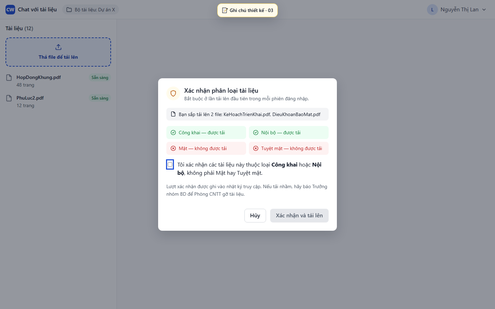
[Mở bản tương tác](../design/UI_UX_design/03-xac-nhan-phan-loai.html)

*Danh sách sau khi tải lên: đang tải, đang xử lý, sẵn sàng (AC-US001-1)*
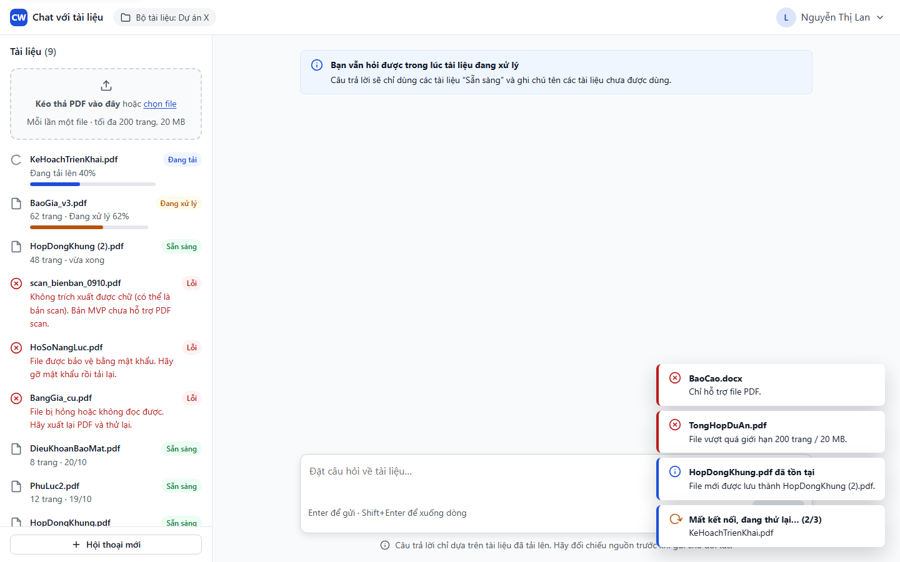
[Mở bản tương tác](../design/UI_UX_design/04-tai-tai-lieu-len.html#member)

*Câu trả lời ghi chú tài liệu chưa sẵn sàng (AC-US001-3)*
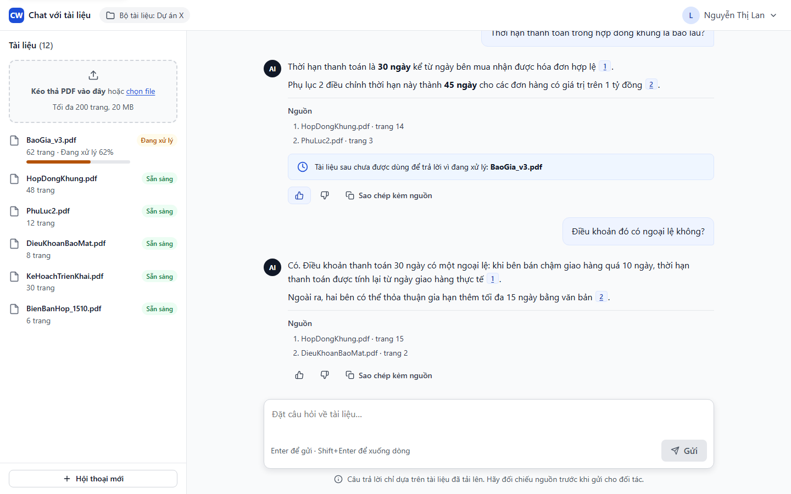
[Mở bản tương tác](../design/UI_UX_design/05-hoi-dap.html#completed)

---

### US-002 · Tải lô tài liệu dự án

| Epic | Ưu tiên | Persona | Use case | Yêu cầu | Trường hợp biên |
|---|---|---|---|---|---|
| EP-01 | **P0** | Minh | UC-02 | BR-002, NFR-007 | E-08 |

> **Là** Minh, **tôi muốn** tải nhiều file PDF lên trong một lần, **để** chuẩn bị cả bộ tài liệu dự án mà không phải thao tác từng file.

**Tiêu chí chấp nhận**
- **AC-US002-1:** *Cho trước* Minh có 50 file PDF hợp lệ; *khi* Minh kéo thả tất cả vào vùng tải lên trong một lần; *thì* mỗi file có dòng trạng thái riêng, và 100% file đạt trạng thái "Sẵn sàng".
- **AC-US002-2 (lỗi một phần):** *Cho trước* trong lô có 1 file không hợp lệ; *khi* tải lên; *thì* các file hợp lệ vẫn được tiếp nhận, còn file lỗi hiện thông báo riêng (xem PRD §4.2).
- **AC-US002-3 (mọi file đều truy vấn được):** *Cho trước* bộ tài liệu có 50 file, trong đó ít nhất 5 file dài 200 trang; *khi* với mỗi file, Minh hỏi 1 câu kiểm thử về nội dung chỉ có trong file đó; *thì* với 100% file, câu trả lời trích dẫn đúng file chứa nội dung đó (truy vết AC-002). Độ chính xác nội dung được đo riêng ở G-06.
- **AC-US002-4 (chỉ vai trò Quản lý bộ tài liệu) [GĐ: OI-03]:** *Cho trước* Lan là Thành viên BD, không có vai trò Quản lý bộ tài liệu; *khi* Lan chọn nhiều file cùng lúc; *thì* hệ thống không tiếp nhận lô và hướng dẫn tải từng file. Vai trò Quản lý bộ tài liệu do CNTT gán (UC-19); MVP gán cho Trưởng nhóm BD.

**Giao diện**

*Kết quả tải lô 50 file: thống kê, file cần xử lý, bộ tài liệu đã đủ 50 file (AC-US002-1, AC-US002-2, E-08)*
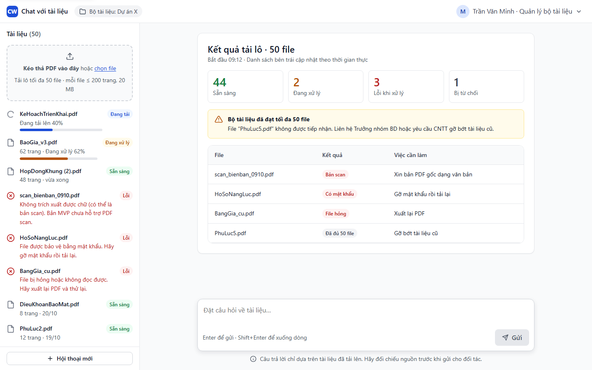
[Mở bản tương tác](../design/UI_UX_design/04-tai-tai-lieu-len.html#manager)

---

### US-003 · Xem danh sách tài liệu và trạng thái

| Epic | Ưu tiên | Persona | Use case | Yêu cầu | Trường hợp biên |
|---|---|---|---|---|---|
| EP-01 | P1 | Lan | UC-06 | BR-003 | E-01, E-20 |

> **Là** Lan, **tôi muốn** xem danh sách tài liệu đã tải lên kèm trạng thái xử lý, **để** biết câu trả lời được tổng hợp từ những tài liệu nào.

**Tiêu chí chấp nhận**
- **AC-US003-1:** *Cho trước* bộ tài liệu có 5 file đã tải lên; *khi* Lan mở thanh tài liệu; *thì* danh sách hiển thị đúng 5 file, mỗi dòng có tên file, số trang và trạng thái, sắp xếp file mới nhất lên đầu (truy vết AC-003).

**Giao diện**

*Thanh tài liệu (UI-001), mới nhất trước, mỗi dòng có tên, số trang, trạng thái*

[Mở bản tương tác](../design/UI_UX_design/04-tai-tai-lieu-len.html#member)

*Trạng thái rỗng khi chưa có tài liệu (E-01)*
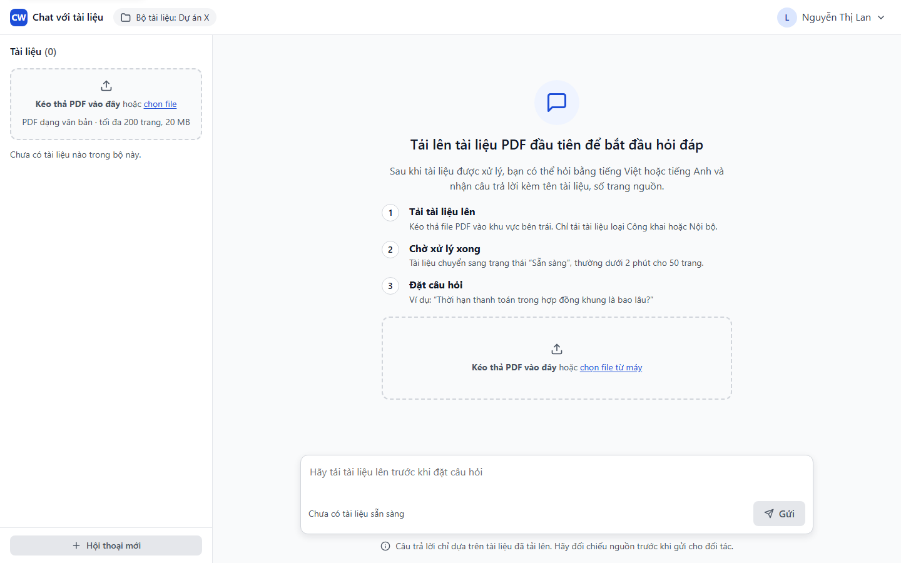
[Mở bản tương tác](../design/UI_UX_design/02-trang-thai-trong.html#empty)

---

### US-004 · Được báo khi file không được tiếp nhận

| Epic | Ưu tiên | Persona | Use case | Yêu cầu | Trường hợp biên |
|---|---|---|---|---|---|
| EP-01 | P1 | Lan | UC-05 | BR-004 | E-03..E-07, E-09, E-10 |

> **Là** Lan, **tôi muốn** được báo rõ khi một file không được tiếp nhận và lý do, **để** không tưởng nhầm tài liệu đó đã được đưa vào truy vấn.

**Tiêu chí chấp nhận**
- **AC-US004-1:** *Cho trước* Lan chọn 1 file .docx và 1 file PDF hỏng; *khi* tải lên; *thì* mỗi file có thông báo riêng nêu lý do theo E-03/E-04, và không file nào có trạng thái "Sẵn sàng" (truy vết AC-004).

**Giao diện**

*Thông báo từng file: không phải PDF (E-03), quá giới hạn (E-07), trùng tên (E-09), mất kết nối (E-10); lỗi xử lý: scan (E-06), mật khẩu (E-05), hỏng (E-04)*

[Mở bản tương tác](../design/UI_UX_design/04-tai-tai-lieu-len.html#member)

---

### US-005 · Thấy tiến trình xử lý từng file

| Epic | Ưu tiên | Persona | Use case | Yêu cầu | Trường hợp biên |
|---|---|---|---|---|---|
| EP-01 | P1 | Minh | UC-06 | BR-001 (mức sản phẩm), NFR-003 | E-02, E-20 |

> **Là** Minh, **tôi muốn** thấy tiến trình xử lý của từng file, **để** biết khi nào có thể bắt đầu hỏi.

**Tiêu chí chấp nhận**
- **AC-US005-1:** *Cho trước* một file đang được xử lý; *khi* Minh xem danh sách; *thì* dòng của file hiển thị phần trăm tiến trình, cập nhật ít nhất mỗi 5 giây, cho đến khi chuyển sang "Sẵn sàng" hoặc "Lỗi".

**Giao diện**

*Mọi tài liệu đang xử lý, có thanh tiến trình, nút Gửi chưa bật (E-02)*
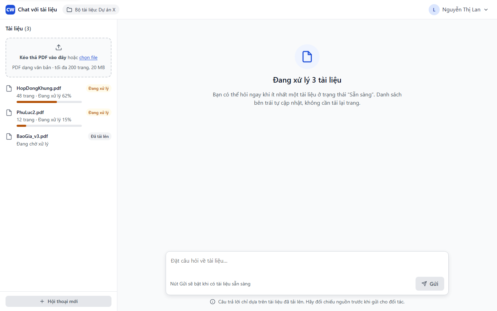
[Mở bản tương tác](../design/UI_UX_design/02-trang-thai-trong.html#processing)

---

### EP-02 · Hỏi đáp có căn cứ

### US-006 · Đặt câu hỏi bằng ngôn ngữ tự nhiên

| Epic | Ưu tiên | Persona | Use case | Yêu cầu | Trường hợp biên |
|---|---|---|---|---|---|
| EP-02 | **P0** | Lan | UC-07 | BR-005, BR-012, NFR-001, NFR-004 | E-01, E-02, E-14, E-15 |

> **Là** Lan, **tôi muốn** đặt câu hỏi bằng ngôn ngữ tự nhiên, **để** không phải nhớ từ khóa chính xác trong tài liệu.

**Tiêu chí chấp nhận**
- **AC-US006-1:** *Cho trước* có ít nhất 1 tài liệu "Sẵn sàng" và bộ câu hỏi kiểm thử (DEP-002); *khi* Lan gửi từng câu hỏi hoàn chỉnh (không cú pháp, không toán tử tìm kiếm) bằng phím Enter; *thì* mỗi câu hỏi nhận được câu trả lời, và thời gian tới khi nội dung đầu tiên hiển thị đạt NFR-001 (p90 ≤ 5 giây trên toàn bộ bộ câu hỏi).
- **AC-US006-2:** *Cho trước* 20 câu hỏi loại SC-01; *khi* gửi lần lượt; *thì* ≥ 80% câu trả lời khớp với đáp án của đội BD (truy vết AC-005).
- **AC-US006-3 (đầu vào rỗng):** *Cho trước* ô nhập trống hoặc chỉ có khoảng trắng; *khi* Lan nhấn gửi; *thì* nút gửi bị vô hiệu và không có yêu cầu nào được gửi đi.

**Giao diện**

*Hỏi đáp: câu hỏi, câu trả lời có trích dẫn, ô nhập với nút Gửi (UI-003, UI-006)*

[Mở bản tương tác](../design/UI_UX_design/05-hoi-dap.html#completed)

*Đang trả lời: nội dung hiển thị dần, chỉ báo "Đang trả lời…" (NFR-001)*
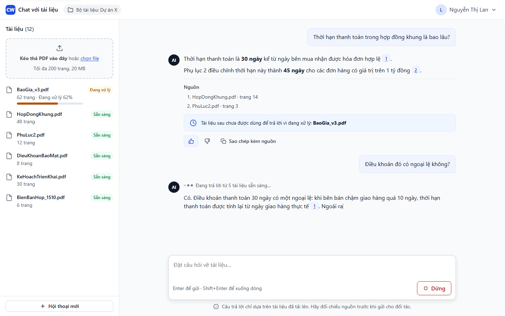
[Mở bản tương tác](../design/UI_UX_design/05-hoi-dap.html#streaming)

---

### US-007 · Câu trả lời chỉ dựa trên tài liệu đã tải lên

| Epic | Ưu tiên | Persona | Use case | Yêu cầu | Trường hợp biên |
|---|---|---|---|---|---|
| EP-02 | **P0** | Lan | UC-08 | BR-006, G-06 | E-16 |

> **Là** Lan, **tôi muốn** câu trả lời chỉ dựa trên tài liệu dự án đã tải lên, **để** có thể dùng nó trong công việc mà không lo thông tin từ bên ngoài.

**Tiêu chí chấp nhận**
- **AC-US007-1:** *Cho trước* bộ 50 câu hỏi kiểm thử; *khi* chạy toàn bộ; *thì* tỷ lệ trả lời đúng ≥ 80% (G-06), và 0 câu trả lời chứa thông tin mâu thuẫn với tài liệu (truy vết AC-006).
- **AC-US007-2 (kiến thức ngoài):** *Cho trước* tài liệu không đề cập tới một sự kiện phổ biến (ví dụ: thủ đô của một quốc gia); *khi* Lan hỏi về sự kiện đó; *thì* hệ thống trả lời "không tìm thấy trong tài liệu" thay vì dùng kiến thức chung.

**Giao diện**

*Câu trả lời chỉ từ tài liệu, có trích dẫn; dòng nhắc cố định dưới ô nhập (UI-007)*

[Mở bản tương tác](../design/UI_UX_design/05-hoi-dap.html#completed)

*Câu hỏi ngoài phạm vi tài liệu: trả "không tìm thấy" thay vì dùng kiến thức chung (AC-US007-2)*
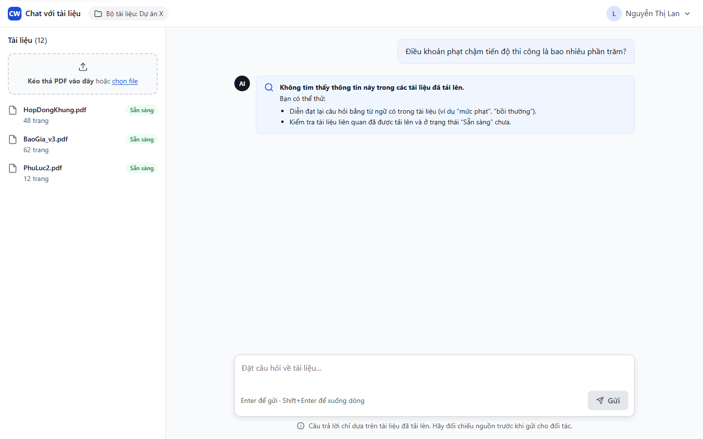
[Mở bản tương tác](../design/UI_UX_design/07-trang-thai-cau-tra-loi.html#notfound)

---

### US-008 · Câu trả lời tổng hợp từ nhiều tài liệu

| Epic | Ưu tiên | Persona | Use case | Yêu cầu | Trường hợp biên |
|---|---|---|---|---|---|
| EP-02 | **P0** | Lan | UC-08 | BR-007, G-07 | E-17 |

> **Là** Lan, **tôi muốn** nhận một câu trả lời tổng hợp khi thông tin nằm ở nhiều tài liệu, **để** không phải tự ghép từ nhiều file.

**Tiêu chí chấp nhận**
- **AC-US008-1:** *Cho trước* 10 câu hỏi loại SC-02; *khi* Lan hỏi; *thì* ≥ 70% câu trả lời chứa đủ các phần thông tin từ mọi tài liệu liên quan và trích dẫn từng tài liệu đó (G-07; truy vết AC-007).
- **AC-US008-2 (mâu thuẫn giữa các tài liệu):** *Cho trước* hai tài liệu nêu hai giá trị khác nhau cho cùng một thông tin; *khi* Lan hỏi; *thì* câu trả lời nêu cả hai giá trị kèm nguồn của từng giá trị, không tự chọn một.

**Giao diện**

*Một câu trả lời, hai nguồn: hợp đồng khung (30 ngày) và phụ lục 2 (45 ngày) (AC-US008-1, AC-US008-2)*

[Mở bản tương tác](../design/UI_UX_design/05-hoi-dap.html#completed)

*Nhiều đáp án hợp lệ: liệt kê từng đáp án kèm nguồn (E-17)*
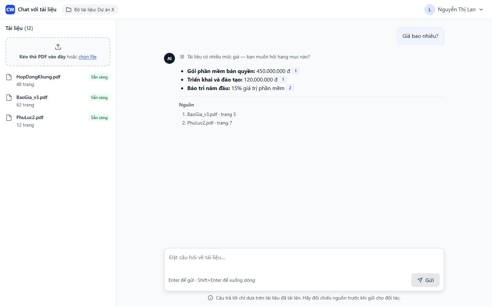
[Mở bản tương tác](../design/UI_UX_design/07-trang-thai-cau-tra-loi.html#clarify)

---

### US-009 · Trích dẫn tên tài liệu và số trang

| Epic | Ưu tiên | Persona | Use case | Yêu cầu | Trường hợp biên |
|---|---|---|---|---|---|
| EP-02 | **P0** | Lan | UC-09, UC-13 | BR-008, BRU-006, G-09 | E-22 |

> **Là** Lan, **tôi muốn** mỗi câu trả lời có nội dung nêu tên tài liệu và số trang nguồn, **để** đối chiếu trước khi gửi thông tin cho đối tác.

**Tiêu chí chấp nhận**
- **AC-US009-1:** *Cho trước* một câu trả lời có nội dung; *khi* câu trả lời hiển thị xong; *thì* câu trả lời có ít nhất 1 trích dẫn gồm tên tài liệu và số trang.
- **AC-US009-2:** *Cho trước* một trích dẫn; *khi* Lan bấm vào; *thì* đoạn văn nguồn (tối đa 300 ký tự) hiển thị trong khung xem trước kèm tên file và số trang.
- **AC-US009-3:** *Cho trước* 20 câu trả lời có nội dung chọn ngẫu nhiên; *khi* QA đối chiếu thủ công; *thì* 100% thông tin được trích dẫn có mặt tại trang đã nêu (G-09; truy vết AC-008).
- **AC-US009-4 (thông tin không có nguồn) [GĐ: OI-02]:** *Cho trước* một thông tin trong nội dung do Dịch vụ AI trả về không xác định được tài liệu và trang nguồn; *khi* câu trả lời được hoàn tất; *thì* thông tin đó không xuất hiện trong câu trả lời. Nếu mọi thông tin đều bị loại, hệ thống trả thông báo "không tìm thấy" (US-010).

**Giao diện**

*Chỉ số trích dẫn [n] trong câu và danh sách nguồn cuối câu trả lời (AC-US009-1)*

[Mở bản tương tác](../design/UI_UX_design/05-hoi-dap.html#completed)

*Khung xem trước đoạn trích ≤ 300 ký tự kèm tên file và số trang (AC-US009-2, UI-004)*
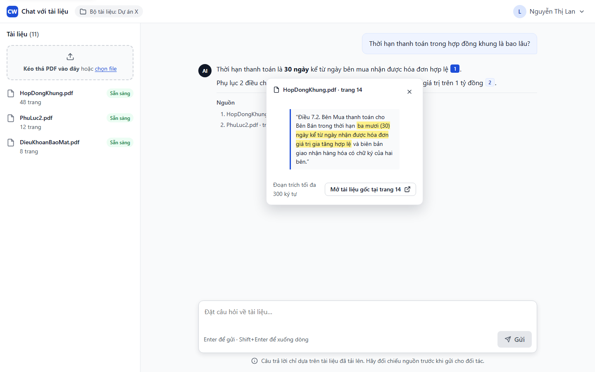
[Mở bản tương tác](../design/UI_UX_design/06-trich-dan.html#normal)

---

### US-010 · Báo rõ khi không tìm thấy thông tin

| Epic | Ưu tiên | Persona | Use case | Yêu cầu | Trường hợp biên |
|---|---|---|---|---|---|
| EP-02 | **P0** | Lan | UC-10 | BR-009, G-08 | E-16 |

> **Là** Lan, **tôi muốn** được báo rõ khi tài liệu không chứa thông tin tôi hỏi, **để** không dùng nhầm một câu trả lời bịa đặt.

**Tiêu chí chấp nhận**
- **AC-US010-1:** *Cho trước* 10 câu hỏi loại SC-03; *khi* chạy; *thì* ≥ 9/10 nhận được thông điệp "Không tìm thấy thông tin này trong các tài liệu đã tải lên" (G-08; truy vết AC-009).
- **AC-US010-2:** *Cho trước* hệ thống trả lời "không tìm thấy"; *khi* hiển thị; *thì* có gợi ý hành động: diễn đạt lại câu hỏi, hoặc kiểm tra xem tài liệu liên quan đã được tải lên chưa.

**Giao diện**

*Thông điệp "Không tìm thấy" kèm hai gợi ý hành động (AC-US010-1, AC-US010-2)*

[Mở bản tương tác](../design/UI_UX_design/07-trang-thai-cau-tra-loi.html#notfound)

---

### US-011 · Đặt câu hỏi tiếp nối

| Epic | Ưu tiên | Persona | Use case | Yêu cầu | Trường hợp biên |
|---|---|---|---|---|---|
| EP-02 | P1 | Lan | UC-11 | BR-010 | — |

> **Là** Lan, **tôi muốn** đặt câu hỏi tiếp nối mà không phải nhắc lại ngữ cảnh, **để** hỏi đáp tự nhiên như trao đổi với đồng nghiệp.

**Tiêu chí chấp nhận**
- **AC-US011-1:** *Cho trước* Lan vừa hỏi "Thời hạn thanh toán trong hợp đồng khung là bao lâu?"; *khi* Lan hỏi tiếp "Điều khoản đó có ngoại lệ không?"; *thì* câu trả lời thứ hai nói về đúng điều khoản thanh toán của hợp đồng khung.
- **AC-US011-2:** *Cho trước* 5 câu hỏi loại SC-04; *khi* chạy; *thì* ≥ 4/5 câu hỏi tiếp nối được hiểu đúng đối tượng tham chiếu (truy vết AC-010).

**Giao diện**

*Lượt 2 "Điều khoản đó có ngoại lệ không?" được hiểu là điều khoản thanh toán ở lượt 1 (AC-US011-1)*

[Mở bản tương tác](../design/UI_UX_design/05-hoi-dap.html#completed)

---

### US-016 · Bắt đầu hội thoại mới

| Epic | Ưu tiên | Persona | Use case | Yêu cầu | Trường hợp biên |
|---|---|---|---|---|---|
| EP-02 | P2 | Lan | UC-16 | BR-010 (mức sản phẩm), BRU-003 | — |

> **Là** Lan, **tôi muốn** bắt đầu một hội thoại mới, **để** câu hỏi về chủ đề khác không bị lẫn ngữ cảnh cũ.

**Tiêu chí chấp nhận**
- **AC-US016-1:** *Cho trước* Lan đang ở giữa một hội thoại; *khi* Lan bấm "Hội thoại mới" rồi hỏi tiếp một câu chỉ dùng đại từ tham chiếu; *thì* câu trả lời không dùng ngữ cảnh của hội thoại trước, và danh sách tài liệu không thay đổi.

**Giao diện**

*Nút "Hội thoại mới" ở cuối thanh tài liệu (UI-008)*

[Mở bản tương tác](../design/UI_UX_design/05-hoi-dap.html#completed)

> Ghi chú thiết kế: chưa có ảnh riêng cho trạng thái ngay sau khi bấm "Hội thoại mới" (vùng hội thoại trống, danh sách tài liệu giữ nguyên). Trạng thái này giống màn 05 nhưng chưa có lượt nào; cần bổ sung nếu PO yêu cầu.

---

### US-017 · Dừng câu trả lời đang tạo

| Epic | Ưu tiên | Persona | Use case | Yêu cầu | Trường hợp biên |
|---|---|---|---|---|---|
| EP-02 | P1 | Lan | UC-12 | BR-005, BO-001 (mức sản phẩm) | — |

> **Là** Lan, **tôi muốn** dừng một câu trả lời đang được tạo, **để** không phải chờ khi nhận ra mình hỏi sai.

**Tiêu chí chấp nhận**
- **AC-US017-1:** *Cho trước* một câu trả lời đang hiển thị dần; *khi* Lan bấm "Dừng"; *thì* nội dung ngừng hiển thị trong ≤ 1 giây, phần đã hiển thị được giữ lại và đánh dấu "đã dừng", và ô nhập sẵn sàng cho câu hỏi mới.

**Giao diện**

*Khi đang trả lời, nút Gửi đổi thành Dừng (UI-006)*

[Mở bản tương tác](../design/UI_UX_design/05-hoi-dap.html#streaming)

*Sau khi dừng: giữ phần đã hiển thị, đánh dấu "Đã dừng · chưa đầy đủ"*
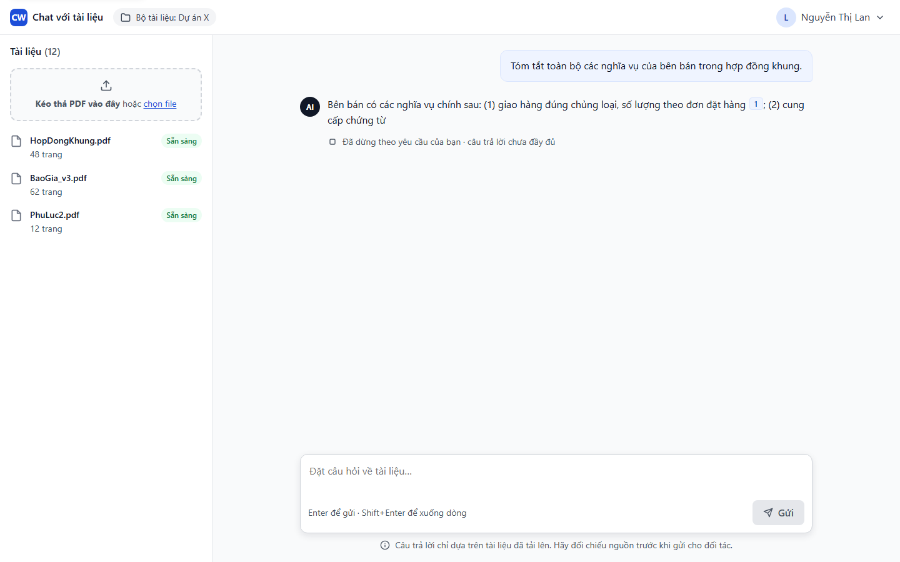
[Mở bản tương tác](../design/UI_UX_design/07-trang-thai-cau-tra-loi.html#stopped)

---

### US-018 · Sao chép câu trả lời kèm nguồn

| Epic | Ưu tiên | Persona | Use case | Yêu cầu | Trường hợp biên |
|---|---|---|---|---|---|
| EP-02 | P1 | Lan | UC-15 | BO-001, BRU-006 (mức sản phẩm) | — |

> **Là** Lan, **tôi muốn** sao chép câu trả lời kèm danh sách nguồn, **để** dán vào email hoặc tài liệu gửi đối tác.

**Tiêu chí chấp nhận**
- **AC-US018-1:** *Cho trước* một câu trả lời đã hoàn tất; *khi* Lan bấm "Sao chép"; *thì* bộ nhớ tạm chứa toàn bộ nội dung câu trả lời và danh sách nguồn (tên file, số trang), ở dạng văn bản thuần.

**Giao diện**

*Xác nhận đã sao chép, kèm nhắc đối chiếu nguồn trước khi gửi đối tác (BRU-006)*
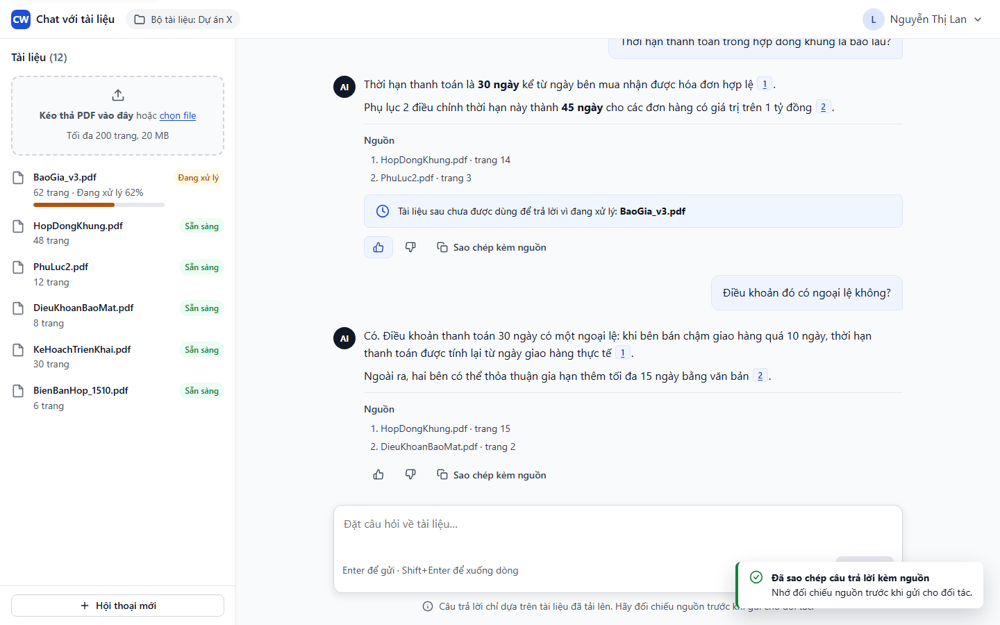
[Mở bản tương tác](../design/UI_UX_design/05-hoi-dap.html#copied)

---

### US-019 · Mở PDF gốc tại trang được trích dẫn

| Epic | Ưu tiên | Persona | Use case | Yêu cầu | Trường hợp biên |
|---|---|---|---|---|---|
| EP-02 | P2 | Lan | UC-14 | BR-008 (mức sản phẩm) | E-19, E-22 |

> **Là** Lan, **tôi muốn** mở file PDF gốc tại đúng trang được trích dẫn, **để** đọc thêm ngữ cảnh xung quanh.

**Tiêu chí chấp nhận**
- **AC-US019-1:** *Cho trước* một trích dẫn tới trang N của file X; *khi* Lan chọn "Mở tài liệu gốc"; *thì* file X mở ở trang N trong tab mới, và chỉ người có quyền xem bộ tài liệu (US-013) mới mở được.

**Giao diện**

*Nút "Mở tài liệu gốc tại trang 14" trong khung xem trước trích dẫn*

[Mở bản tương tác](../design/UI_UX_design/06-trich-dan.html#normal)

---

### EP-03 · Truy cập và bảo vệ tài liệu

### US-012 · Đăng nhập trước khi dùng công cụ

| Epic | Ưu tiên | Persona | Use case | Yêu cầu | Trường hợp biên |
|---|---|---|---|---|---|
| EP-03 | **P0** | Lan | UC-18 | BR-013, BR-015, NFR-009, IF-02 | E-18, E-21 |

> **Là** Lan, **tôi muốn** phải đăng nhập trước khi dùng công cụ, **để** chỉ người được xác thực mới tiếp cận được tài liệu dự án.

**Tiêu chí chấp nhận**
- **AC-US012-1:** *Cho trước* người dùng chưa đăng nhập; *khi* mở bất kỳ đường dẫn nào của công cụ; *thì* được chuyển tới màn hình đăng nhập, và không dữ liệu tài liệu nào được trả về.
- **AC-US012-2:** *Cho trước* phiên đăng nhập hết hạn (NFR-009); *khi* người dùng gửi câu hỏi; *thì* nội dung câu hỏi đang gõ được giữ lại, và người dùng được yêu cầu đăng nhập lại.

**Giao diện**

*Đăng nhập bằng Microsoft 365, không có form mật khẩu (AC-US012-1)*
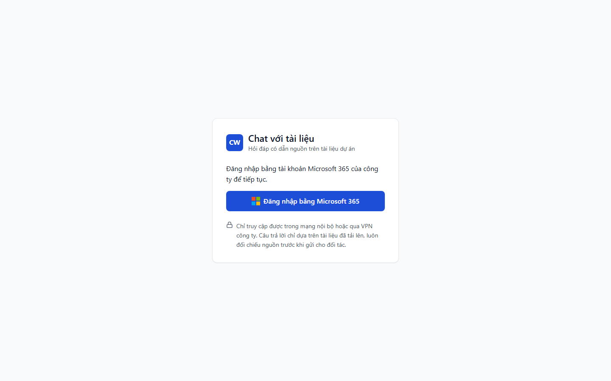
[Mở bản tương tác](../design/UI_UX_design/01-dang-nhap.html#default)

*Phiên hết hạn: thông báo câu hỏi đang gõ đã được giữ lại (AC-US012-2, E-18)*
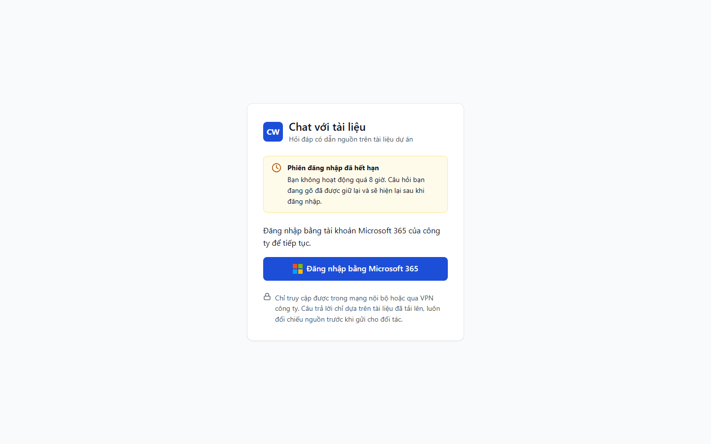
[Mở bản tương tác](../design/UI_UX_design/01-dang-nhap.html#expired)

---

### US-013 · Chỉ thành viên nhóm truy cập mới xem được tài liệu

| Epic | Ưu tiên | Persona | Use case | Yêu cầu | Trường hợp biên |
|---|---|---|---|---|---|
| EP-03 | **P0** | Hùng | UC-06, UC-13, UC-14 | BR-013, BRU-007, PCON-03 | E-19 |

> **Là** Hùng, **tôi muốn** chỉ thành viên nhóm truy cập mới **xem** được tài liệu trong bộ (tên file, đoạn trích dẫn, file gốc), **để** tài liệu dự án không lộ ra ngoài nhóm.

**Tiêu chí chấp nhận**
- **AC-US013-1:** *Cho trước* tài khoản không thuộc nhóm truy cập và không phải Quản trị viên; *khi* mở danh sách tài liệu, đoạn trích dẫn hoặc đường dẫn trực tiếp tới file gốc; *thì* nhận thông báo "không có quyền truy cập", không thấy tên file hay nội dung (truy vết AC-013a).
- **AC-US013-2 (Quản trị viên, BRU-007) [GĐ: OI-01]:** *Cho trước* Hùng là Quản trị viên, không thuộc nhóm truy cập; *khi* mở bộ tài liệu, một đoạn trích dẫn hoặc file gốc; *thì* chỉ thấy thông tin mô tả (tên file, số trang, dung lượng, người tải lên, thời điểm, trạng thái), không xem được đoạn trích dẫn hay file gốc, và không gửi được câu hỏi (truy vết AC-013b).

**Giao diện**

*Người không thuộc nhóm: không thấy tên bộ tài liệu hay tên file (AC-US013-1)*
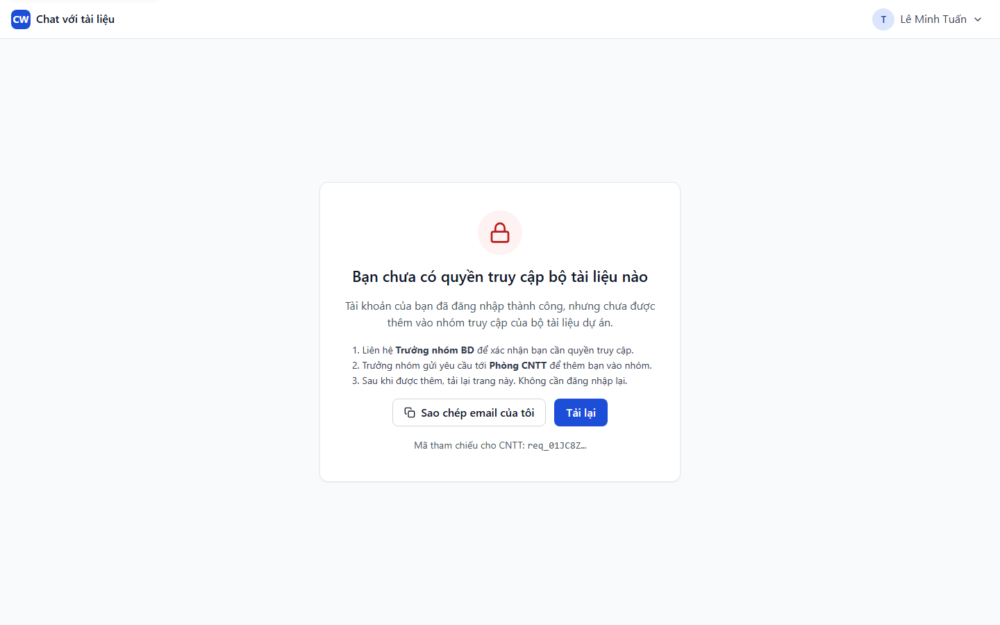
[Mở bản tương tác](../design/UI_UX_design/11-khong-co-quyen.html#nogroup)

*Quản trị viên chỉ thấy thông tin mô tả, không có thao tác xem nội dung (AC-US013-2)*
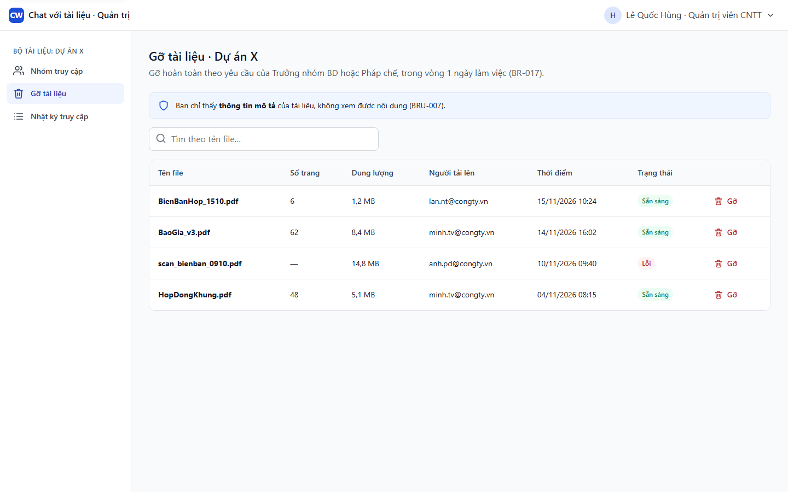
[Mở bản tương tác](../design/UI_UX_design/09-quan-tri-go-tai-lieu.html#list)

---

### US-014 · Chỉ thành viên nhóm truy cập mới truy vấn được

| Epic | Ưu tiên | Persona | Use case | Yêu cầu | Trường hợp biên |
|---|---|---|---|---|---|
| EP-03 | **P0** | Hùng | UC-07 | BR-015, NFR-011 | E-19 |

> **Là** Hùng, **tôi muốn** chỉ thành viên nhóm truy cập mới **truy vấn** được tài liệu, **để** không ai lấy được nội dung gián tiếp qua câu trả lời.

**Tiêu chí chấp nhận**
- **AC-US014-1:** *Cho trước* tài khoản không thuộc nhóm truy cập; *khi* gửi câu hỏi về nội dung tài liệu; *thì* không nhận được câu trả lời chứa nội dung tài liệu (truy vết AC-015).
- **AC-US014-2:** *Cho trước* tài khoản bị CNTT gỡ khỏi nhóm truy cập; *khi* sau 15 phút người đó mở công cụ hoặc gửi câu hỏi; *thì* bị từ chối truy cập (NFR-011).

**Giao diện**

*Bị thu hồi quyền trong lúc đang dùng: từ chối ở thao tác kế tiếp (AC-US014-2)*

[Mở bản tương tác](../design/UI_UX_design/11-khong-co-quyen.html#revoked)

---

### US-020 · Gỡ hoàn toàn một tài liệu

| Epic | Ưu tiên | Persona | Use case | Yêu cầu | Trường hợp biên |
|---|---|---|---|---|---|
| EP-03 | **P0** | Hùng | UC-20 | BR-017, BRU-001, BRU-002 | E-22 |

> **Là** Hùng, **tôi muốn** gỡ hoàn toàn một tài liệu khỏi bộ tài liệu theo yêu cầu, **để** xử lý trường hợp tài liệu "Mật" bị tải lên nhầm hoặc có yêu cầu từ đối tác.

**Tiêu chí chấp nhận**
- **AC-US020-1:** *Cho trước* tài liệu X đang "Sẵn sàng"; *khi* Hùng gỡ tài liệu X; *thì* X biến mất khỏi danh sách của mọi người dùng trong ≤ 10 giây; 5 câu hỏi về nội dung chỉ có trong X đều nhận được "không tìm thấy"; file gốc và dữ liệu đã xử lý của X bị xóa; thao tác được ghi vào nhật ký truy cập (truy vết AC-017).
- **AC-US020-2:** *Cho trước* người dùng không phải quản trị viên; *khi* tìm thao tác gỡ tài liệu; *thì* thao tác này không hiển thị và không thực hiện được.

**Giao diện**

*Xác nhận gỡ vĩnh viễn: người yêu cầu, lý do, cảnh báo không hoàn tác (UC-20 bước 2–4)*
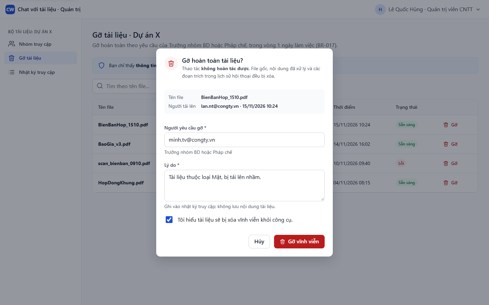
[Mở bản tương tác](../design/UI_UX_design/09-quan-tri-go-tai-lieu.html#dialog)

*Sau khi gỡ: tài liệu biến mất khỏi danh sách (AC-US020-1)*
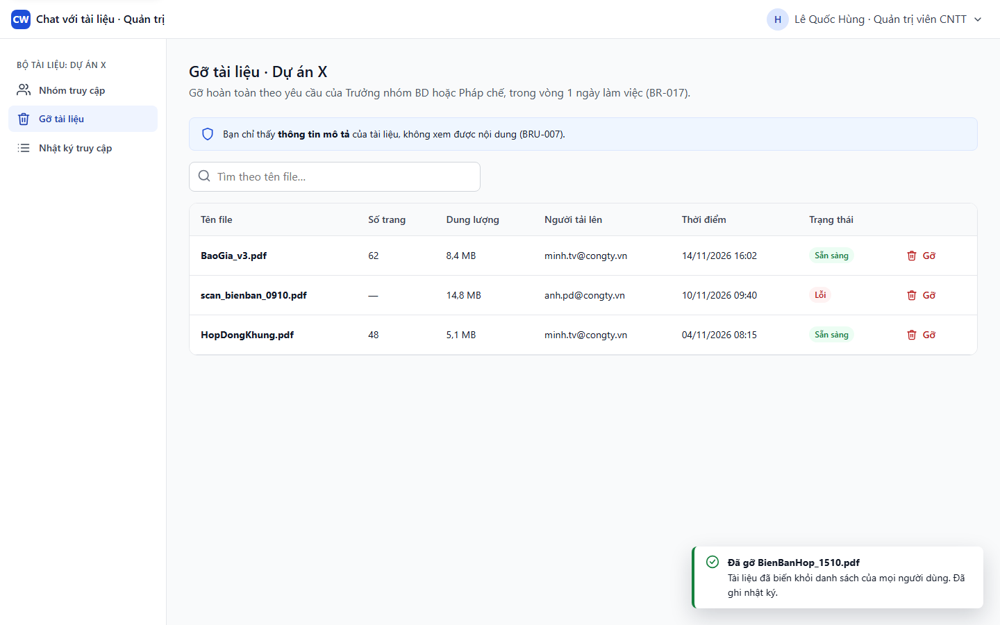
[Mở bản tương tác](../design/UI_UX_design/09-quan-tri-go-tai-lieu.html#done)

*Lỗi lưu trữ: nội dung đã xóa, file gốc chờ xóa lại (Blueprint ALG-07)*
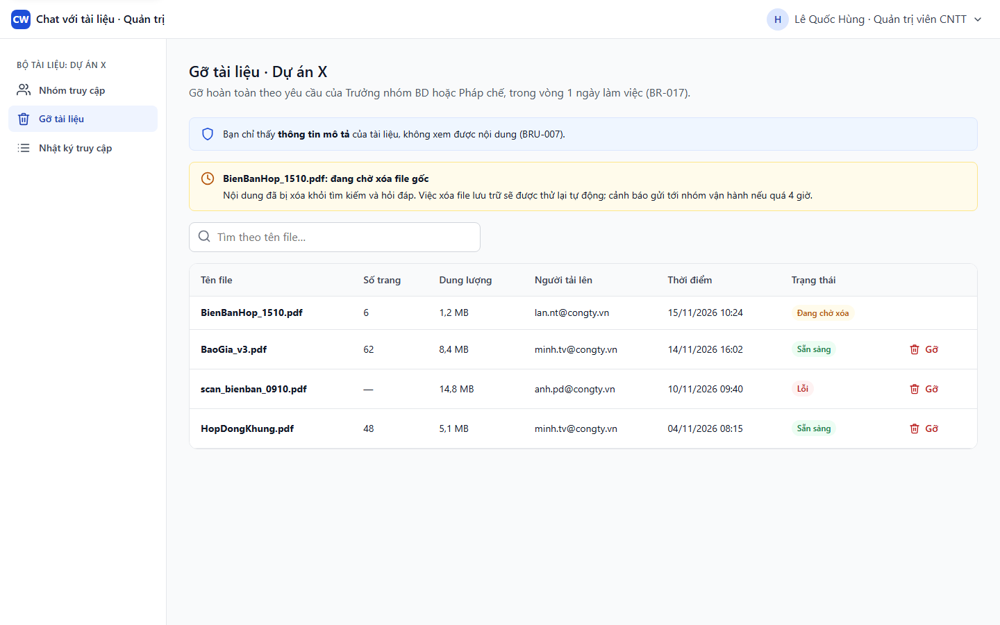
[Mở bản tương tác](../design/UI_UX_design/09-quan-tri-go-tai-lieu.html#pending)

*Phía người dùng: trích dẫn tới tài liệu đã gỡ hiển thị "Tài liệu đã được gỡ" (E-22)*
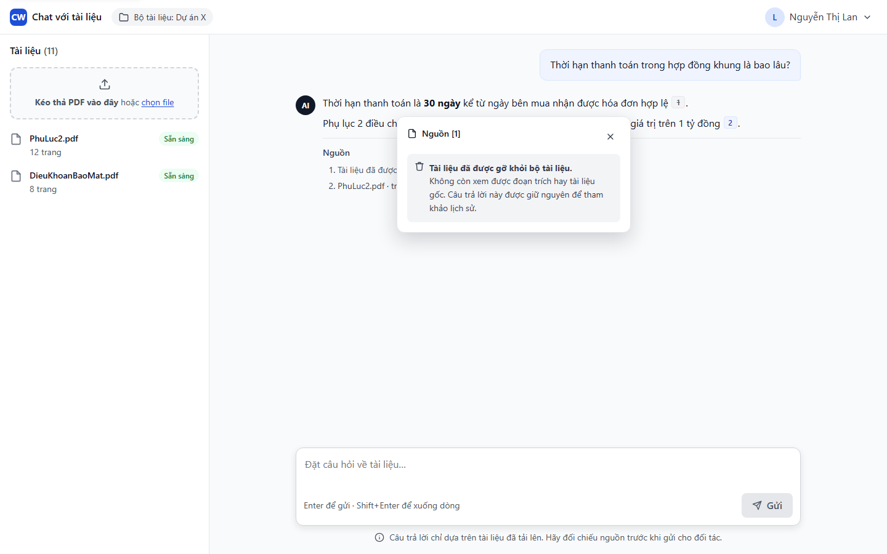
[Mở bản tương tác](../design/UI_UX_design/06-trich-dan.html#removed)

---

### US-021 · Quản lý nhóm truy cập và vai trò *(story mới)*

| Epic | Ưu tiên | Persona | Use case | Yêu cầu | Trường hợp biên |
|---|---|---|---|---|---|
| EP-03 | **P0** | Hùng | UC-19 | BR-013, BR-015, NFR-011, BRU-007, OI-03 | E-19 |

> **Là** Hùng, **tôi muốn** thêm hoặc gỡ thành viên khỏi nhóm truy cập và gán vai trò Quản lý bộ tài liệu, **để** chỉ đúng người được xem, hỏi và tải lô tài liệu dự án.

*Nguồn: UC-19 (Đặc tả Use Case v0.2). PRD v0.4 chưa có story riêng cho năng lực này. Ưu tiên P0 vì BR-013 và BR-015 là Must và không thể đáp ứng nếu không có cách quản lý nhóm truy cập.*

**Tiêu chí chấp nhận** *(đề xuất, viết từ luồng chính và luồng ngoại lệ của UC-19)*
- **AC-US021-1 (thêm):** *Cho trước* tài khoản `tuan.lm@congty.vn` tồn tại trong Microsoft 365 và chưa thuộc nhóm; *khi* Hùng thêm tài khoản này với vai trò Thành viên; *thì* tài khoản xuất hiện trong danh sách, người đó xem và hỏi được bộ tài liệu ở lần truy cập kế tiếp, và thao tác được ghi nhật ký (`member_add`).
- **AC-US021-2 (tài khoản không tồn tại, UC-19 E1):** *Cho trước* email không tồn tại trong Microsoft 365 công ty; *khi* Hùng thêm; *thì* hệ thống báo "Không tìm thấy tài khoản này trong Microsoft 365 công ty" ngay tại ô email, và nhóm không thay đổi.
- **AC-US021-3 (gỡ):** *Cho trước* Phạm Đức Anh là thành viên; *khi* Hùng gỡ người này; *thì* người này bị từ chối ở thao tác kế tiếp, không chậm hơn 15 phút (AC-US014-2, NFR-011), và thao tác được ghi nhật ký (`member_remove`).
- **AC-US021-4 (vai trò):** *Cho trước* Lan là Thành viên; *khi* Hùng đổi vai trò của Lan thành Quản lý bộ tài liệu; *thì* Lan tải lô được (AC-US002-4 không còn chặn), và thao tác được ghi nhật ký (`role_change`).
- **AC-US021-5 (tách quyền):** *Cho trước* Hùng là Quản trị viên; *khi* mở trang quản lý nhóm; *thì* trang không có lối tắt nào tới nội dung tài liệu (BRU-007).

**Giao diện**

*Danh sách thành viên và vai trò*
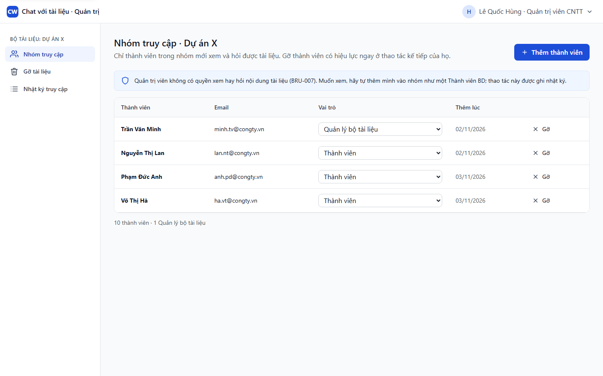
[Mở bản tương tác](../design/UI_UX_design/08-quan-tri-nhom-truy-cap.html#list)

*Thêm thành viên (AC-US021-1)*
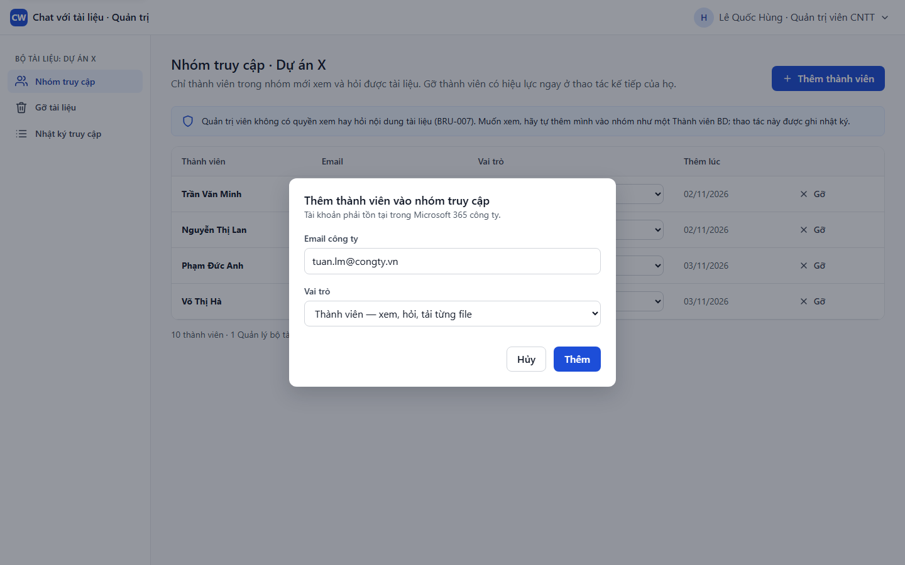
[Mở bản tương tác](../design/UI_UX_design/08-quan-tri-nhom-truy-cap.html#add)

*Tài khoản không tồn tại trong Microsoft 365 (AC-US021-2)*
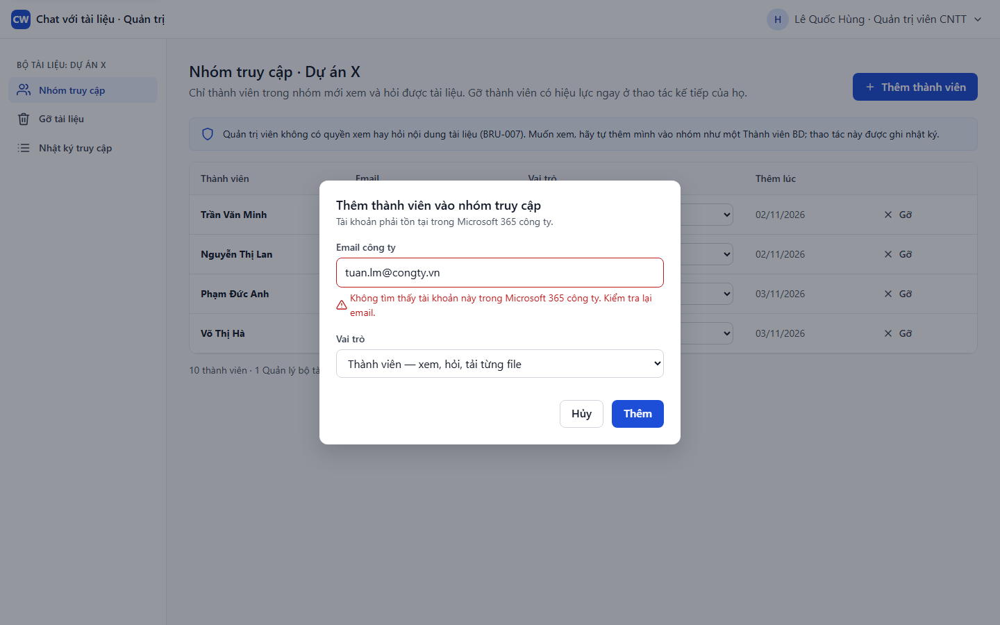
[Mở bản tương tác](../design/UI_UX_design/08-quan-tri-nhom-truy-cap.html#notfound)

---

### US-022 · Tra cứu và xuất nhật ký truy cập *(story mới)*

| Epic | Ưu tiên | Persona | Use case | Yêu cầu | Trường hợp biên |
|---|---|---|---|---|---|
| EP-03 | **P0** (xuất CSV: P1) | Hùng | UC-21 | BR-016, BRU-004, NFR-010, OI-04 | — |

> **Là** Hùng, **tôi muốn** tra cứu và xuất nhật ký truy cập theo bộ tài liệu, khoảng thời gian, người dùng và loại thao tác, **để** chứng minh việc tuân thủ NDA và quy định bảo vệ dữ liệu khi Pháp chế yêu cầu.

*Nguồn: UC-21 (Đặc tả Use Case v0.2). PRD v0.4 chỉ có NFR-010, chưa có story. Ưu tiên P0 vì BR-016 là Must; riêng phần xuất CSV là P1 theo OI-04.*

**Tiêu chí chấp nhận** *(đề xuất, viết từ AC-016 và UC-21)*
- **AC-US022-1 (tra cứu):** *Cho trước* một bộ tài liệu và một khoảng thời gian trong 12 tháng gần nhất; *khi* Hùng tra cứu; *thì* danh sách người đã xem, truy vấn hoặc thay đổi bộ tài liệu kèm thời điểm khớp 100% với các lượt truy cập đã thực hiện trong bài kiểm thử (truy vết AC-016).
- **AC-US022-2 (không có nội dung):** *Cho trước* bất kỳ bản ghi nào; *khi* hiển thị hoặc xuất; *thì* bản ghi không chứa nội dung tài liệu, đoạn trích hay câu hỏi (BRU-004, G-13).
- **AC-US022-3 (quá 12 tháng, UC-21 A1):** *Cho trước* khoảng thời gian vượt quá 12 tháng; *khi* tra cứu; *thì* hệ thống chỉ trả dữ liệu còn lưu và báo rõ giới hạn.
- **AC-US022-4 (xuất CSV, P1, UC-21 A2):** *Cho trước* một kết quả đã lọc; *khi* Hùng chọn "Xuất CSV"; *thì* file CSV (UTF-8) chứa đúng các bản ghi đã lọc, và lượt xuất được ghi nhật ký (`audit_export`).

**Giao diện**

*Bộ lọc và kết quả nhật ký; nút "Xuất CSV" (AC-US022-1, AC-US022-4)*
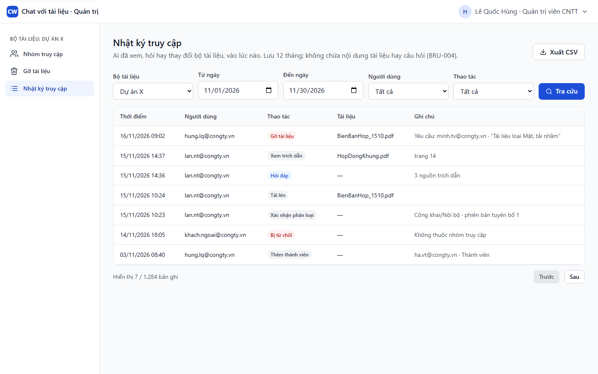
[Mở bản tương tác](../design/UI_UX_design/10-quan-tri-nhat-ky.html#results)

*Khoảng thời gian quá 12 tháng (AC-US022-3)*
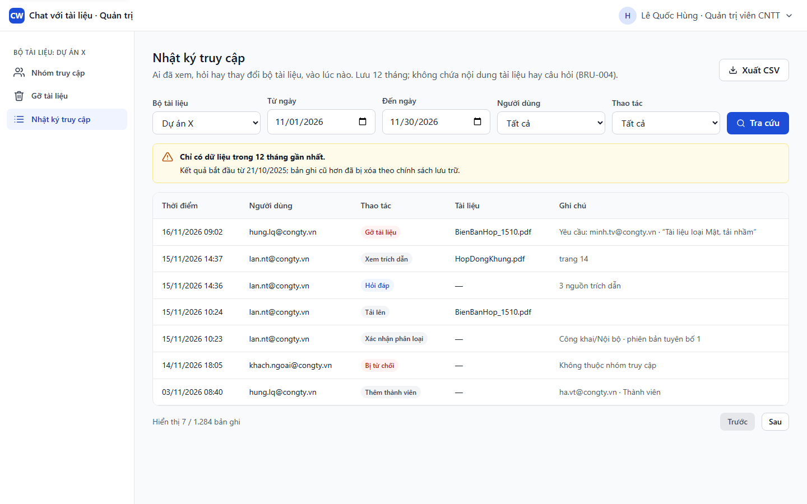
[Mở bản tương tác](../design/UI_UX_design/10-quan-tri-nhat-ky.html#range)

---

### EP-04 · Phản hồi và đo lường

### US-015 · Đánh giá câu trả lời

| Epic | Ưu tiên | Persona | Use case | Yêu cầu | Trường hợp biên |
|---|---|---|---|---|---|
| EP-04 | P1 | Lan | UC-17 | BO-002, BR-014, KR3.2 | — |

> **Là** Lan, **tôi muốn** đánh giá 👍/👎 cho câu trả lời (kèm lý do khi 👎), **để** nhóm sản phẩm biết câu trả lời nào sai.

**Tiêu chí chấp nhận**
- **AC-US015-1:** *Cho trước* một câu trả lời đã hoàn tất; *khi* Lan bấm 👎; *thì* hiện danh sách lý do (Sai / Thiếu / Nguồn sai / Khác). Sau khi chọn, đánh giá được ghi nhận (EVT-009) và nút được đánh dấu đã chọn.
- **AC-US015-2:** *Cho trước* Lan đã đánh giá một câu trả lời; *khi* Lan bấm lại nút còn lại; *thì* đánh giá được thay bằng lựa chọn mới. Mỗi người chỉ có một đánh giá cho mỗi câu trả lời.

**Giao diện**

*Bấm 👎 mở danh sách lý do (AC-US015-1)*
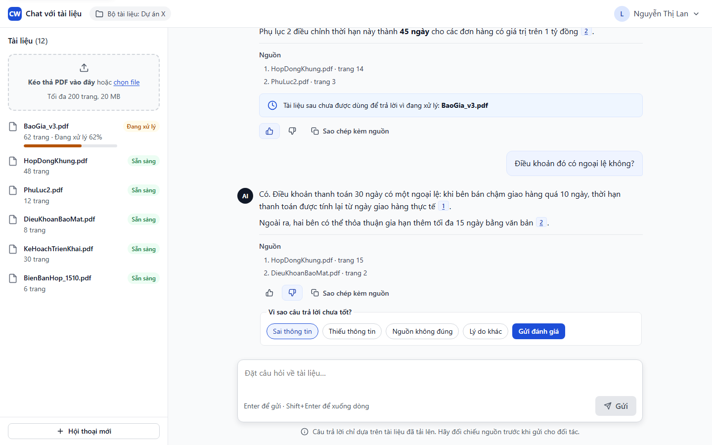
[Mở bản tương tác](../design/UI_UX_design/05-hoi-dap.html#feedback)

---

## 4. Truy vết

### 4.1 Màn hình → user story

| Màn hình | Trạng thái | User story |
|---|---|---|
| 01 Đăng nhập | mặc định, phiên hết hạn, lỗi | US-012 |
| 02 Trạng thái trống | chưa có tài liệu, đang xử lý | US-003, US-005, US-006 |
| 03 Xác nhận phân loại | — | US-001 |
| 04 Tải lên & xử lý | thành viên, trưởng nhóm | US-001, US-002, US-003, US-004 |
| 05 Hỏi đáp | đang trả lời, hoàn tất, đánh giá, đã sao chép | US-001, US-006, US-007, US-008, US-009, US-011, US-015, US-016, US-017, US-018 |
| 06 Xem trích dẫn | đoạn trích, tài liệu đã gỡ | US-009, US-019, US-020 |
| 07 Trạng thái câu trả lời | không tìm thấy, cần làm rõ, đã dừng, gián đoạn, giới hạn | US-007, US-008, US-010, US-017 *(gián đoạn và giới hạn 30 câu/giờ xem §4.3)* |
| 08 Nhóm truy cập | danh sách, thêm, không có tài khoản, đã gỡ | US-021 |
| 09 Gỡ tài liệu | danh sách, xác nhận, đã gỡ, chờ xóa | US-013, US-020 |
| 10 Nhật ký | kết quả, quá 12 tháng, không có kết quả | US-022 |
| 11 Không có quyền | chưa thuộc nhóm, bị thu hồi | US-013, US-014 |

**Độ phủ:** 11/11 màn hình đều thuộc ít nhất một story; 22/22 story đều có ít nhất một ảnh màn hình.

### 4.2 Use case → user story

| Use case | Story | Use case | Story |
|---|---|---|---|
| UC-01 | US-001 | UC-12 | US-017 |
| UC-02 | US-002 | UC-13 | US-009, US-013 |
| UC-03 | US-001 (AC-US001-4) | UC-14 | US-019, US-013 |
| UC-04 | *(withdrawn, gộp UC-01)* | UC-15 | US-018 |
| UC-05 | US-001, US-004 | UC-16 | US-016 |
| UC-06 | US-003, US-005, US-013 | UC-17 | US-015 |
| UC-07 | US-006, US-014 | UC-18 | US-012 |
| UC-08 | US-007, US-008 | UC-19 | **US-021** |
| UC-09 | US-009 | UC-20 | US-020 |
| UC-10 | US-010 | UC-21 | **US-022** |
| UC-11 | US-011 | | |

**Độ phủ:** 20/20 use case đang hoạt động đều có story; UC-19 và UC-21 có story từ tài liệu này.

### 4.3 Trường hợp biên không thuộc story nào

Ba trường hợp biên nằm trong yêu cầu phi chức năng, không gắn với một story cụ thể. Chúng được kiểm thử qua tiêu chí ra mắt (PRD §5.1):

| E | Tình huống | Màn hình | Kiểm thử qua |
|---|---|---|---|
| E-11, E-12 | Câu trả lời bị gián đoạn, dịch vụ AI lỗi | 07 (gián đoạn) | NFR-014, G-02 |
| E-13 | Vượt 30 câu/giờ hoặc hết ngân sách | 07 (giới hạn) | G-16 |

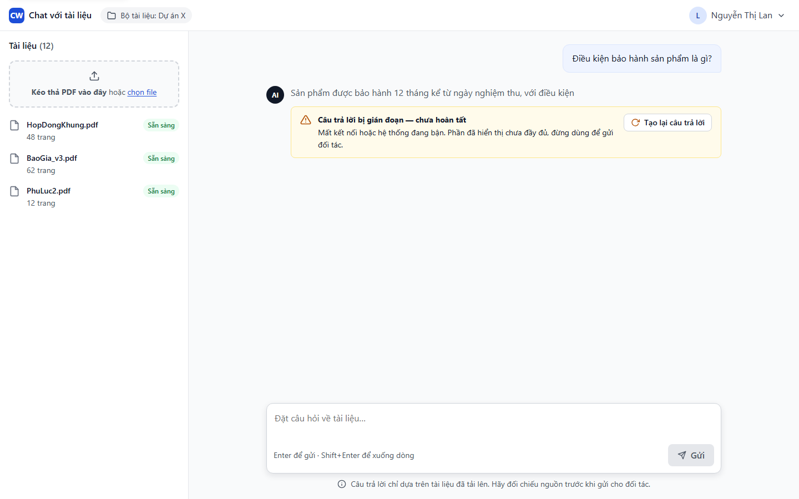 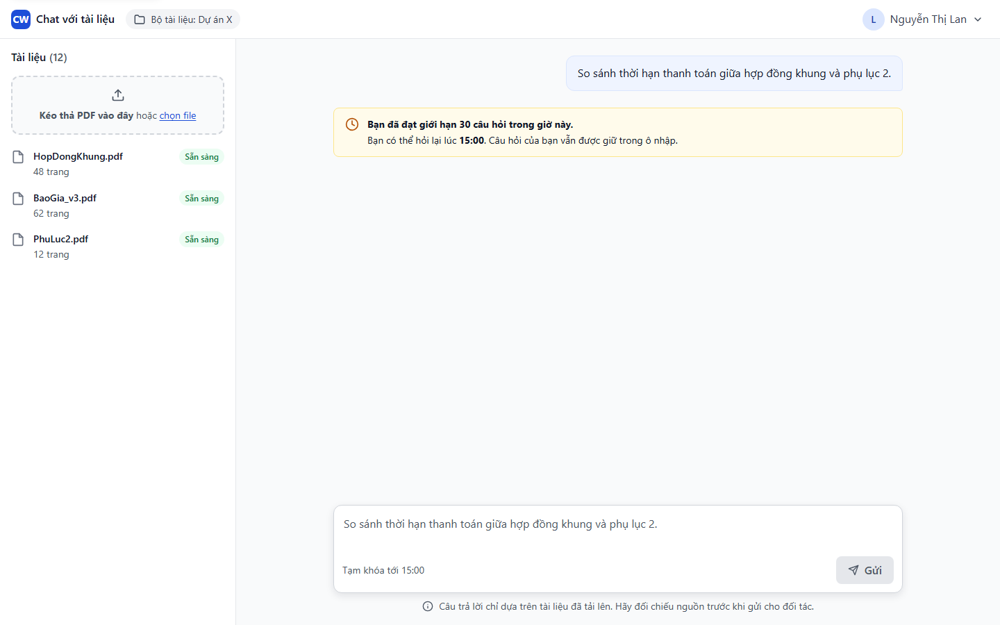

---

## 5. Việc cần làm tiếp

| ID | Việc | Người chịu trách nhiệm |
|---|---|---|
| USB-01 | Đưa **US-021** và **US-022** vào PRD (§3.4) và ma trận truy vết PRD §7, hoặc xác nhận để chúng chỉ nằm trong backlog | Product Owner |
| USB-02 | Ước lượng story point khi lập kế hoạch sprint (chưa có trong tài liệu nguồn) | Đội phát triển |
| USB-03 | Bổ sung ảnh trạng thái "vừa bắt đầu hội thoại mới" cho US-016 nếu cần | Designer |
| USB-04 | Khi thiết kế thay đổi, chạy lại `docs/design/UI_UX_design/render-screenshots.ps1` (chụp ở chế độ `?clean`) để ảnh trong tài liệu này luôn khớp | Designer |
